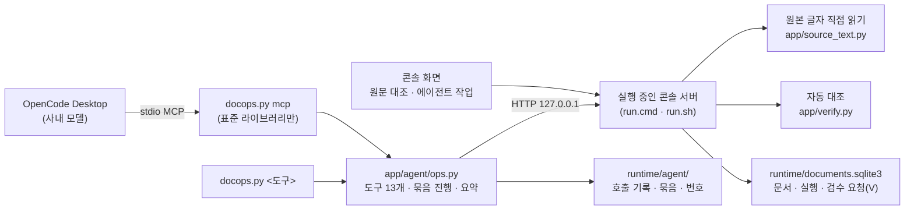

# 작업 에이전트 도구 (MCP · CLI)

> **2026-11-26 역할 변경.** 고객사 OpenCode 시험 후 사용자 피드백: 도구가 파싱·청킹 버튼을 대신 누르는 수준이면 쓸 이유가 없다. 사람은 수천 개 파일의 정답 텍스트를 만들 수 없으니, 에이전트는 **원본과 파싱 결과를 대조해 사람이 눈으로 확인할 곳을 짚어 주는 검수 보조**여야 한다. Claude가 고객사 파일을 직접 볼 수 없어서 만든 대리인이다. 그래서 원본 읽기(`source`)·자동 대조(`verify`)·검수 요청(`flag`)·사람 판정 읽기(`verdicts`)를 더하고, 한 번 읽기 3,500자 한도와 '같은 도구 반복 금지' 안내를 없앴으며, 의미가 적던 타이핑용 보고서(`report`)는 뺐다.

## 1. 목적과 역할 경계

- **에이전트(OpenCode + 사내 모델)**: 고객사 PC에서 문서를 파싱하고, 결과를 원본과 대조해 의심 지점을 고른 뒤, 같은 위치를 원본·결과로 나란히 읽어 확인하고, 사람이 볼 곳을 **검수 요청(V번호)**으로 올린다. **코드는 고치지 않는다.**
- **사람**: 콘솔 **에이전트 작업 → 검수 요청**(또는 에이전트가 준 링크)에서 원문 대조 화면을 그 위치로 열어 눈으로 보고 **맞음·틀림·보류**를 누른다. 필요하면 메모를 남긴다.
- **개발(Claude)**: 사람이 '틀림'으로 확인한 지점의 유형(숫자·기호·표 칸·빠진 줄·OCR)을 전달받아 파서를 고친다. 고객사 파일은 밖으로 가져가지 않는다. 무엇을 옮겨 적을지는 사람이 정한다.

런타임 질의 에이전트(고객사 기존 RAG의 MCP 도구 6개)와는 별개다. 이 도구는 작업용이다. 나중에 에이전트용 검색 MCP를 만들면 읽기 전용 도구 묶음으로 따로 둔다.

## 2. 구조



- MCP 서버와 CLI는 **실행 중인 콘솔 서버의 HTTP API만** 부른다. 서버가 `runtime/server.lock`으로 저장소를 혼자 쓰기 때문에 SQLite를 직접 열지 않는다. 덕분에 에이전트가 한 일과 올린 검수 요청이 콘솔 화면에 그대로 보인다.
- 서버 찾기: `DOCOPS_API_URL`이 있으면 그 주소, 없으면 `127.0.0.1:8000~8019`의 `/api/health`를 보고 응답 헤더 `x-docops-runtime`(저장소 경로의 SHA-256)이 같은 서버를 고른다. 사내 `HTTP_PROXY`가 127.0.0.1 요청을 가로채지 않게 프록시를 쓰지 않는다.
- 표준 라이브러리만 쓴다. 가상환경 없이 Python 3.12 이상이면 실행된다(`python3.13 -I docops.py status`로 확인).
- D번호는 서버가 매긴 문서 번호(`LiveDocument.seq`), S번호는 자동 대조가 그 실행에 매긴 의심 지점 번호(같은 실행이면 같음), V번호는 검수 요청 번호(서버 DB)다. 콘솔 화면과 같은 번호다.
- 에이전트 상태는 `runtime/agent/`에 둔다: `calls.jsonl`(모든 도구 호출과 결과 앞 12,000자·다룬 문서·연결 표식), `batches.json`(B번호), `registry.json`(원본 경로→문서), `runs.json`(실행별 지표 캐시). 예전에 만든 `reports/*.txt`는 지우지 않고 더 쓰지도 않는다.

## 3. 고객사 PC 설치


기존 콘솔을 닫고 GitHub의 **Code → Download ZIP**을 선택한다. 압축을 푼 폴더의 내용을 기존 설치 폴더에 복사해 모두 덮어쓴다. **`setup.cmd` → `run.cmd`** 순서로 실행한다. `setup.cmd`가 설치 폴더 안의 **OpenCode** 작업 폴더와 MCP 설정을 준비한다. Desktop에서 그 폴더를 열고 기존 사내 모델을 선택한다.

### 필요할 때만 쓰는 진단

```powershell
.\backend\.venv\Scripts\python.exe backend/docops.py doctor "OpenCode"
```

`PASS mcp`는 MCP 초기화와 도구 목록 조회, `PASS console`은 콘솔 상태 조회 성공을 뜻한다.

**사내 모델 호출 시험.** OpenCode에 등록된 정확한 `provider/model` ID를 넣는다. 아래 값은 예시다. CLI는 최대 4분 동안 도구 이벤트와 최종 답변을 기다리며 파서용 API 키를 요구하지 않는다.

```powershell
.\backend\.venv\Scripts\python.exe backend/docops.py doctor "OpenCode" --model "사내공급자/배포모델ID"
```

`PASS model`에는 새 세션에서 `docops_status(check="connection")` 호출 1건이 완료되고 모델의 마지막 답변이 도구에서 발급한 일회성 코드와 일치해야 한다. 이 상태 호출은 문서 목록이나 본문을 조회하지 않는다. CLI가 없는 Desktop에서는 위 작업 폴더를 열고 모델을 선택한 뒤 기본 `doctor`가 출력한 한국어 문장을 붙여 넣는다. 콘솔의 **에이전트 작업 → 호출 기록**에서 `status`의 check 인자와 반환 코드를 답변에 대조한다.

**같은 입력으로 현장 시험하기**

| 순서 | OpenCode에 입력할 문장 | 확인할 결과 |
|---|---|---|
| 1 | “AI 연결 점검.md 한 건만 파싱해 줘. 묶음 결과를 보여줘.” | 배포본에 들어 있는 합성 파일 1건. B번호, 판정별 건수, D번호 목록 |
| 2 | “방금 문서에서 점검번호와 보관 위치를 원본과 결과 양쪽에서 찾아 비교해 줘.” | `docops_source`(원본)와 `docops_read`(결과) 호출. 값은 `FIELD-026`, `B-204`, 양쪽 같음 |
| 3 | “방금 문서를 원본과 자동 대조해 줘.” | `docops_verify` 1회. 의심 0곳, 원본 글자 100% |
| 4 | “RPT-EQ-2026-031_점검보고서_서명본.pdf를 파싱하고 원본과 대조해서 사람이 볼 곳을 검수 요청으로 올려 줘.” | `docops_verify`가 4쪽(글자 층 없는 스캔 쪽)을 의심 지점으로 내고 `docops_flag`로 V번호. 콘솔 **에이전트 작업 → 검수 요청**에 같은 V번호와 링크 |
| 5 | (콘솔에서 V번호를 원문 대조로 열어 맞음·틀림을 누른 뒤) “검수 결과 정리해 줘.” | `docops_verdicts`가 사람이 누른 판정과 메모를 그대로 보고 |

게이트웨이가 꺼졌을 때는 아래 CLI로 같은 작업을 한다. `--workspace`는 OpenCode용 설정의 허용 폴더·runtime·API 주소를 이 프로세스에 적용한다. D번호와 B번호는 실제 결과에서 옮긴다.

```powershell
.\backend\.venv\Scripts\python.exe backend/docops.py --workspace "OpenCode" parse "AI 연결 점검.md"
.\backend\.venv\Scripts\python.exe backend/docops.py --workspace "OpenCode" wait B1
.\backend\.venv\Scripts\python.exe backend/docops.py --workspace "OpenCode" source D1 --find "점검번호"
.\backend\.venv\Scripts\python.exe backend/docops.py --workspace "OpenCode" read D1 --find "점검번호"
.\backend\.venv\Scripts\python.exe backend/docops.py --workspace "OpenCode" verify D1
.\backend\.venv\Scripts\python.exe backend/docops.py --workspace "OpenCode" flag D1 --line 7 --note "점검번호 칸 확인"
.\backend\.venv\Scripts\python.exe backend/docops.py --workspace "OpenCode" verdicts
```

실제 문서는 콘솔의 기존 허용 폴더(`.env`의 `DOCOPS_AGENT_ROOTS`)에서 고른다. 별도로 설정하지 않은 PC는 기본 `samples` 폴더에서 합성 문서를 찾는다. 허용 폴더를 직접 지정한 고객사 PC에서 위 합성 시험을 하려면 시험 문서를 그 폴더에 복사한다. 모델 연결은 기존 OpenCode 전역 설정이나 작업 폴더의 provider 설정을 쓴다.

`init-workspace`가 넣는 설정과 이유:

| 설정 | 값 | 이유 |
|---|---|---|
| `mcp.docops.timeout` | `120000` | OpenCode의 MCP 요청 시간 제한 기본값이 5초다(1.18.31 스키마로 확인). |
| `DOCOPS_AGENT_WAIT_SECONDS` | `40` | `parse`·`wait`가 한 번에 기다리는 시간. 설정이 없으면 4초(기본 시간 제한 5초 안). |
| `DOCOPS_AGENT_READ_CHARS` | (넣지 않음, 기본 12000) | `read`·`source`가 한 번에 돌려주는 글자 수. 사내 모델 문맥이 작으면 줄이고 크면 늘린다(2000~60000). 이어 읽기는 `line`. |
| `DOCOPS_AGENT_ROOTS` | 문서 폴더 | 이 폴더 밖의 파일은 읽지 않는다. 생략하면 기존 작업 폴더, 환경·.env, 기본 samples 순으로 결정. 콘솔 화면의 '허용 폴더에서 가져오기'도 같은 규칙(`app/folder_import.py`)을 쓰지만, 콘솔 서버는 `.env`의 값을 읽는다. |
| `permission`, `tools` | 편집·셸·웹·파일 읽기 끔 | 코드·파일을 고치지 않는다. 원본은 OpenCode의 파일 읽기 대신 `docops_source`로 읽는다(PDF·Office·시트를 콘솔과 같은 위치 이름으로 읽고, 허용 폴더 밖은 열지 않음). |
| `share` | `disabled` | OpenCode의 세션 공유(대화를 OpenCode 서버에 올려 링크를 만드는 기능)를 끈다. 모델 위치와 무관한 OpenCode 자체 기능이다. 내부망에서 외부가 막혀 있으면 실제 위험은 거의 없다. |

새 폴더에는 이 Mac에서 연결을 확인한 OpenCode 1.18 호환 형식을 쓴다. 기존 JSON에 V2 설정이 있으면 `mcp.servers` 아래에 `codemode: false`와 실행 시간 제한을 둔다. 고객사 Desktop 버전은 현장 확인 대상이다. 작업 폴더의 모델 설정과 직접 작성한 AGENTS.md는 보존한다. 사용자 지침이 있는 폴더에는 DOCOPS_GUIDE.md를 추가한다. [OpenCode MCP 설정](https://opencode.ai/docs/mcp-servers/) · [OpenCode 권한 설정](https://opencode.ai/docs/permissions/)

## 4. 도구

| 도구 | 인자 | 하는 일 |
|---|---|---|
| `status` | `check`(선택, connection) | 서버 연결, Docling·PDF 모델·OCR 준비, 허용 폴더, 문서 수, 최근 묶음, 검수 요청 수, 한 번 읽기 글자 수 |
| `files` | `folder`, `offset`(선택) | 허용 폴더 안 원본 파일을 형식별로 세고 30건씩 표시한다 |
| `parse` | `target`(필수), `reparse`, `confirm` | 파일·폴더·패턴(`*.pdf`)·파일 이름·D번호(`D12`, `D3 D7`)·`failed`를 묶음(B번호)으로 등록·파싱. 50개 넘으면 미리보기 후 `confirm=true`. 끝나면 판정별 건수와 D번호 목록(확인할 것부터) |
| `wait` | `batch`(선택, B번호) | 진행 중인 묶음을 기다리고 진행 상황 또는 요약 |
| `docs` | `state`(all·ok·warn·empty·fail·unsup·run·new), `before`(D번호) | 최신순 문서 목록을 40건씩 표시 |
| `doc` | `id` | 문서 하나의 원인·경고 원문·처리 시간·이력과 원문 대조 링크 |
| `verify` | `id`, `page` / `sheet`(선택) | **자동 대조.** 원본 글자와 결과를 대조해 의심 지점(S번호)을 높음→보통→낮음으로. 단위(쪽·슬라이드·시트)별 원본 글자 포함률, 이미 올린 검수 요청 표시 |
| `source` | `id`, `page` / `sheet` / `find`, `line` | **원본 읽기.** 파서와 별개로 원본에서 직접 읽은 글자(PDF 글자 층, Office XML, 시트 셀 값과 주소). 스캔·이미지는 글자 층이 없다고 알린다 |
| `read` | `id`, `page` / `sheet` / `find`, `line` | **결과 읽기.** 파싱 결과를 결과 줄 번호와 함께. 빈 줄은 번호만 건너뛴다 |
| `flag` | `id`(필수), `spot` 또는 `note`, `page`·`sheet`·`cell`·`line`·`source_text`·`result_text` | **검수 요청 올리기(V번호).** `spot=S3`이면 위치와 원본·결과 글자를 서버가 채운다. 같은 실행의 같은 S번호는 한 번만 생긴다. 원문 대조 링크를 돌려준다 |
| `verdicts` | `state`(all·open·correct·wrong·unclear), `id`(선택) | **사람 판정 읽기.** 검수 요청과 사람이 누른 맞음·틀림·보류와 메모. 그 뒤 다시 파싱했으면 표시 |
| `compare` | `id` | 직전 성공 실행과 최신 실행 비교, 바뀐 줄 20줄까지 |
| `chunk` | `id`, `strategy`, `size` | 기본 512 추정 토큰. 고정 길이·재귀·요소 단위 비교, 또는 한 전략 측정. 원문 포함률과 표 분할 수 |

한 번에 돌려주는 글자는 `read`·`source`가 기본 12,000자(`DOCOPS_AGENT_READ_CHARS`, 2,000~60,000)다. 넘으면 끝에 `… 이어 읽기: read(id="D12", page=3, line=241)`처럼 다음 호출을 알려 준다. **호출 횟수 제한은 없다.** 같은 도구·같은 인자를 2분 안에 다시 부르면 호출 기록에 '반복'으로 표시만 하고, 모델에게 막거나 경고하지 않는다(이전에는 결과 앞에 '방금과 같은 요청입니다'를 붙였다).

묶음 진행은 MCP 프로세스의 백그라운드 스레드가 맡는다: 파일 등록(한 회차 20개) → 처리 요청(서버 대기열 64건 한도, 503이면 다음 회차) → 완료 확인. 연결이 유지되는 동안 작업자가 등록·접수를 계속한다. CLI 종료·MCP 재연결 뒤에는 `wait B번호`로 이어 간다. 같은 runtime의 두 연결은 한 번에 한 작업자만 요청을 전송한다. 이름과 크기가 같은 후보는 원본 SHA-256을 대조한 뒤 재사용한다. `source-check`는 원본 대조 실패, `upload-unknown`·`process-unknown`은 등록·실행 응답 중단을 뜻한다. 이때는 문서함과 실행 이력에서 반영 여부를 확인한다.

## 5. 검수 흐름

1. `verify(id="D12")` → 의심 지점 목록. 예: `S3 [높음] 3쪽 2줄 → 결과 줄 120: 원본 '0.5'이(가) 결과에서 '05'(으)로 다릅니다.` 아래에 원본 줄과 결과 줄을 함께 보인다.
2. 의심 지점의 같은 위치를 `source(id="D12", page=3)`와 `read(id="D12", page=3)`로 읽어 직접 비교한다. 원본에서 글자 찾기는 `source(..., find="0.5 mL")`.
3. 사람이 볼 곳을 `flag(id="D12", spot="S3", note="소수점이 빠진 것으로 보임")`으로 올린다. 직접 찾은 곳이면 `flag(id="D12", page=3, line=120, note="…", source_text="…", result_text="…")`. 결과: `검수 요청을 올렸습니다 — V7 · D12 3쪽 결과 줄 120`과 원문 대조 링크(`?view=live&doc=<ID>&review=source&page=3&line=120&check=V7`).
4. 사람은 링크나 **에이전트 작업 → 검수 요청**에서 원문 대조를 그 위치로 열고(원본 칸은 그 쪽·셀, 결과 칸은 그 줄 강조) 맞음·틀림·보류를 누른다. 원문 대조 화면의 **확인할 곳** 막대에서도 같은 일을 한다.
5. `verdicts(state="wrong")`로 사람이 확인한 파싱 오류를 읽고 유형별로 묶어 보고한다.

### 자동 대조가 보는 것과 보지 않는 것

- **원본 글자**(`app/source_text.py`, `GET /api/live/documents/{id}/source-text`): PDF 쪽마다 글자 층(pypdfium2), DOCX 본문 순서의 문단·표 행·글상자와 머리말·꼬리말·각주(기호 글꼴·첨자는 사본 보정과 같은 기준으로 유니코드, 숨김 서식 글자는 뺌), PPTX 슬라이드마다 도형 순서의 글자·표 행·발표자 메모, XLSX·XLSM 시트마다 저장된 셀 값과 주소(표기 후보: 정수·백분율·날짜, Docling이 있으면 같은 서식 표기), TXT·MD·LOG 원본 줄, CSV 행·칸. 이미지·SVG는 글자 층이 없다(409).
- **대조**(`app/verify.py`, `GET /api/live/documents/{id}/verify`): 결과의 원문 위치(쪽·시트·행·열)로 같은 단위끼리 비교한다. 줄은 공백·표 칸 구분·글머리 기호·Markdown 꾸밈·이스케이프를 빼고 찾고, 없으면 가장 비슷한 결과 줄과 낱말 단위로 맞춰 빠지거나 바뀐 부분만 고른다. 같은 단위의 다른 곳에 있으면(줄바꿈·표 칸·순서 차이) 빼고, 같은 글이 원본에 여러 번 나오면 그 개수까지 본다. 표는 칸 대 칸으로 본다. 쪽의 위·아래 끝에 되풀이되는 줄(머리말·꼬리말·쪽 번호)과 원본에서 숨긴 시트·슬라이드(결과에 없으면 안내만)는 의심 지점으로 올리지 않는다. 숫자·`%`·부등호·특수기호가 바뀌거나 빠지면 높음.
- **의심 지점 종류**: `changed`(바뀜) · `missing`(빠짐, 반복 문단 하나가 빠진 경우 포함) · `moved`(다른 단위에만 있음) · `symbol`(기호 개수 차이) · `extra_number`(결과에만 있는 숫자) · `garbled`(깨진 글자) · `cell_changed`·`cell_missing`·`cell_moved`(표 칸) · `unit_missing`(쪽·슬라이드 대부분 없음) · `scan_ocr`·`scan_empty`(글자 층 없는 쪽) · `source_garbled`(원본 글자 층 깨짐) · `image_ocr`(그림 OCR 줄·이미지 원본).
- **보지 않는 것**: 표의 구조(칸 합치기·머리글)와 읽는 순서, 그림 속 글자, 글꼴·서식. PDF를 `pdf-text`로 파싱했으면 원본과 같은 글자 층이라 글자 누락은 거의 드러나지 않는다(안내 문구로 알림). 그래서 의심 지점이 없어도 '맞다'가 아니다.
- **측정(2026-11-26, 합성 말뭉치 56개, Docling 2.150.0 Office 경로·pdf-text):** 정상 파싱 문서 30건에서 의심 지점은 실제 스캔 쪽 1곳뿐이었다(오탐 0). 결과에 무작위 변조를 넣으면(시드 3개) 숫자 한 자리 바꾸기 88~91%, 줄 지우기 79~81%, 특수기호 지우기 100%를 ±4줄 안에서 잡았다. 놓친 것은 대부분 쪽마다 되풀이되는 머리말과 여러 번 나오는 같은 문장이다. 실제 고객 문서로는 재지 않았다.

## 6. 도구를 부르는 모델을 위한 설계

| 예상 실패 | 대책 |
|---|---|
| 도구를 잘못 고름 | 도구 13개, 이름이 겹치지 않게. OpenCode 기본 도구는 작업 폴더에서 끔 |
| 인자를 틀리게 만듦 | 한 단계 인자, 필수 1개 이하, 형식은 string·integer·boolean만(테스트로 고정). `path`·`document_id`·`query`·`slide`·`row`·`comment` 같은 흔한 다른 이름도 받고, `p3`·`3쪽`·`120줄`도 숫자로 읽고, 인자를 JSON 문자열로 보내도 읽음 |
| 긴 ID를 잘못 옮김 | 32자 hex 대신 D·S·V번호. `D12`·`d-12`·`12`·`#12`·파일 이름 일부 모두 받음 |
| 경로 표기 | 따옴표·백틱 제거, `\` 대신 `/` 허용, 파일 이름만 주면 허용 폴더에서 찾음, macOS 분해형 한글 이름도 같게 봄 |
| 기다리지 못하고 반복 조회 | 도구 안에서 기다림. 넘으면 "진행 중 — wait를 부르세요" 한 줄 |
| 원본을 못 봐서 결과만 믿음 | `source`로 원본을 직접 읽고, `verify`가 다른 곳을 짚는다. 결과의 `다음:` 줄이 짝 도구(`read`↔`source`)를 알려 줌 |
| 글자가 잘려 판단을 못 함 | 한 번 12,000자, 이어 읽기 `line`. 횟수 제한 없음 |
| 경고를 묻고 "성공" 보고 | 첫 줄이 판정. 경고가 없어도 "파싱 성공이 품질 보증은 아닙니다 — verify로 대조" |
| 실패 원인을 지어냄 | 서버 오류 코드를 짧은 코드와 한 줄 설명으로 돌려줌(`codes.MEANINGS`). 모델 요약은 근거로 쓰지 않음(서버의 `calls.jsonl`과 검수 요청 DB가 근거) |
| 같은 곳을 여러 번 올림 | 같은 실행의 같은 S번호는 서버가 하나만 만들고 기존 V번호를 돌려줌. `verify`가 이미 올린 V번호를 지점 옆에 표시 |

## 7. 코드표

### 판정

`ok` 경고 없음 · `warn` 경고 있음 · `empty` 글자 없는 이미지(실패로 세지 않음. 글자 없는 사진이면 정상, 글자가 보이는 이미지라면 OCR이 놓친 것) · `fail` 실패 · `unsup` 처리 경로 없는 형식 · `run` 처리 중 · `new` 등록만 함

`empty` 줄은 `empty3 D20 D22 D23`처럼 쓴다. 문서 번호(D번호)는 서버가 매긴 `seq`이며 콘솔 화면과 같다.

### 실패 코드 (`LiveDocument.error_code`)

| 짧은 코드 | 원래 코드 | 짧은 코드 | 원래 코드 |
|---|---|---|---|
| `drm` | `drm_protected` | `limit` | `limit_exceeded` |
| `drm-sus` | `drm_suspected` | `unsafe-zip` | `unsafe_archive` |
| `crypt` | `encrypted` | `charset` | `encoding_unknown` |
| `fmt-mis` | `format_mismatch` | `parse-err` | `parse_failed` |
| `fmt-unk` | `format_unrecognized` | `stopped` | `interrupted` |
| `unsup` | `unsupported_format` | `queue-full` | `queue_full` |
| `no-parser` | `parser_unavailable` | `internal` | `internal_error` |
| `no-text` | `no_text` | `unknown` | 코드 없음(이전 버전 실패) |

### 경고 코드

| 짧은 코드 | 뜻 | 출처 |
|---|---|---|
| `ocr-read` | OCR 모델로 읽은 쪽·그림이 있음(PDF는 `doc`에서 쪽 번호). 모델이 읽은 글자라 원본 대조 필요 | `adapters/ocr.OCR_READ_WARNING`, PDF 어댑터 |
| `ocr-repeat` | OCR 모델의 반복 폭주를 잘라냄 | `adapters/ocr.REPEAT_WARNING` |
| `ocr-limit` | PDF 큰 그림이 OCR 한도(문서당 40개)를 넘어 일부는 읽지 않음 | PDF 어댑터 |
| `ocr-off` | OCR 모델이 연결되지 않아 스캔·그림 쪽 글자를 읽지 않음 | `service.PDF_OCR_WARNING` |
| `empty-pg` | 글자·표가 없는 PDF 쪽(`doc`에서 쪽 번호) | Docling·pdf-text 어댑터 |
| `pic-skip` | PDF 쪽의 큰 그림 속 글자를 OCR 모델 미연결로 읽지 않음 | pdf-text 어댑터 |
| `text-only` | PDF 모델 없이 글자 층만 읽음(표 칸 구조 없음, 여러 단 순서 섞임 가능) | `adapters/pdf_text.FALLBACK_WARNING` |
| `text-broken` | PDF 글자 층이 깨진 쪽(글꼴 대응표 없음) | pdf-text 어댑터 |
| `notes-added` | PPTX 발표자 메모를 슬라이드 끝에 덧붙임 | Docling 어댑터(PPTX) |
| `title-row` | XLSX 표 맨 위 병합 제목 행을 표 위 문단으로 옮김 | Docling 어댑터(XLSX) |
| `ocr-fallback` | (이전 기록) OCR 포함 변환 실패 → 텍스트 층으로 재처리 | 2026-11-24 이전 Docling 어댑터 |
| `ocr-empty` | 이미지에서 글자를 못 찾은 프레임 | OCR 어댑터 |
| `ocr-low` | (이전 기록) EasyOCR 신뢰도 낮은 영역. 모델 OCR에는 믿을 만한 신뢰도가 없어 더 나오지 않음 | 2026-11-24 이전 OCR 어댑터 |
| `fid-skip` | 원문 충실도 점검 실패 | `service.FIDELITY_FAILED_WARNING` |
| `prep-fallback` | 기호·첨자 보정 사본 파싱 실패 → 원본으로 파싱 | `service.PREPARE_FALLBACK_WARNING` |
| `sym-lost` | 특수기호 손실 | 충실도 `symbol_lost` |
| `sym-font` | 유니코드로 못 바꾼 기호 글꼴 | 충실도 `symbol_font_unmapped` |
| `sub-flat` | 첨자가 일반 글자로 붙음 | 충실도 `script_flattened` |
| `sub-bad` | 유니코드로 못 바꾼 첨자 | 충실도 `script_unconvertible` |
| `low-contrast` | 흰색에 가까운 글자가 본문에 포함 | 충실도 `low_contrast_text` |
| `hidden-in` | 숨김 서식 글자가 본문에 포함 | 충실도 `hidden_text_included` |
| `merged` | 병합 셀(값 반복 가능) | 충실도 `merged_cells` |
| `supplement` | 원문에서 보충 추출해 끝에 덧붙임 | 충실도 `supplemented` |
| `img-ocr` | 그림 OCR 검토 필요 | 충실도 `image_ocr_review` |
| `img-skip` | OCR하지 않은 래스터 그림 | 충실도 `images_not_read` |
| `svg` | SVG 처리 경고 | SVG 어댑터 |
| `other` | 분류 안 된 경고(`doc`에서 원문 확인) | — |

### 건너뛴 파일과 호출 오류

| 코드 | 뜻 |
|---|---|
| `lock` | Office 임시 잠금 파일(`~$`) |
| `hidden` | 숨김·시스템 파일(`.`으로 시작, `Thumbs.db`, `desktop.ini`) |
| `empty` | 0바이트 |
| `too-big` | 100 MiB 초과 |
| `ext` | `ext-<확장자>`로 셈. 처리 경로가 없는 확장자(폴더·패턴으로 줄 때만 거름) |
| `bad-arg`·`not-found`·`outside`·`server-down`·`busy`·`api`·`internal` | 에이전트 호출 오류(잘못된 인자, 대상 없음, 허용 폴더 밖, 서버 꺼짐, 409·503, 그 밖의 API 오류, 도구 내부 오류) |

## 8. 확인한 것과 하지 않은 것

- 확인(2026-11-26, Linux 개발 환경): 임시 저장소 서버를 띄우고 합성 문서 5건(DOCX·PPTX·XLSX·PDF 2)으로 CLI `status → parse → verify → source → read → flag → verdicts`를 돌렸다. 스캔 쪽이 있는 PDF는 4쪽이 의심 지점으로 나오고, 결과 파일을 일부러 바꾼 DOCX는 빠진 문단과 깨진 글자를 짚었다. 같은 S번호를 두 번 올리면 기존 V번호를 돌려주는 것, 사람이 화면 API로 '틀림'을 누르면 `verdicts`가 메모와 함께 보이는 것을 확인했다. 회귀 테스트: `backend/tests/test_agent_tools.py`, `backend/tests/test_verify.py`.
- 하지 않음: 고객사 Windows PC와 사내 모델로 새 도구(`source`·`verify`·`flag`·`verdicts`) 호출, 실제 고객 문서의 자동 대조 품질, Docling PDF 모델 경로(이 환경은 PDF 모델이 없어 `pdf-text`), OCR 모델을 붙인 스캔 쪽 대조.
- 이전 기록(2026-11-24, macOS): OpenCode 1.18.31 + Ollama `qwen3.6:35b-a3b`(Q4, 컨텍스트 32K)로 당시 도구 10개를 실제 문장 6개로 시켜 도구 호출 15회·잘못된 인자 0·반복 0을 확인했다. 그때의 타이핑용 블록·`report`는 이번에 없앴다. 시험 하한은 35B-A3B로 둔다(고객사 메인은 몇백B급).
- 이전 시험에서 드러난 **파서 쪽 문제**: ① 스캔 PDF(`COA_…_스캔.pdf`)의 OCR 오인(`FBX-1O1`, `mglmL`, `≤`→`드`) — 이제 글자 층 없는 쪽은 `verify`가 항상 `scan_ocr`(높음)로 올린다. ② 글자 없는 사진 JPG는 `empty`로 따로 센다.
