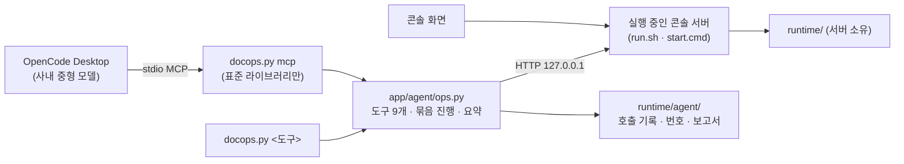

# 작업 에이전트 도구 (MCP · CLI)

> 2026-11-24 1단계(파싱·검수) 구현. 청킹·평가, Milvus 적재, 검색은 아직 없다. 고객사 PC(Windows)와 고객사 게이트웨이 모델로는 아직 돌려보지 않았다.

## 1. 목적과 역할 경계

OpenCode 같은 에이전트에게 "이 폴더 파싱해 보고 보고서 보여줘"처럼 말로 실험을 시키기 위한 도구다. 지금 사용자는 구축팀 2명이다.

- **에이전트(OpenCode + 사내 중형 모델)**: 고객사 PC에서 실제 문서로 실험하고, 결과를 짧은 보고서로 만든다. **코드는 고치지 않는다.**
- **사람**: 보고서의 `타이핑용` 블록을 보고 손으로 옮겨 적어 개발 쪽(Claude)에 전달한다. 고객사 PC의 파일은 밖으로 가져가지 않는다.
- **개발(Claude)**: 옮겨 적은 보고서를 읽고 코드를 고친 뒤 배포한다. 문구 수정도 고객사 PC에서 하지 않고 이 경로로 처리한다(현장에서 고치면 다음 업데이트 때 덮어써지고 Git과 어긋난다).

런타임 질의 에이전트(고객사 기존 RAG의 MCP 도구 6개)와는 별개다. 이 도구는 작업용이다. 나중에 에이전트용 검색 MCP를 만들면 읽기 전용 도구 묶음으로 따로 둔다.

## 2. 구조



- MCP 서버와 CLI는 **실행 중인 콘솔 서버의 HTTP API만** 부른다. 서버가 `runtime/server.lock`으로 저장소를 혼자 쓰기 때문에 SQLite를 직접 열지 않는다. 덕분에 에이전트가 한 일이 콘솔 화면에도 그대로 보인다.
- 서버 찾기: `DOCOPS_API_URL`이 있으면 그 주소, 없으면 `127.0.0.1:8000~8019`의 `/api/health`를 보고 응답 헤더 `x-docops-runtime`(저장소 경로의 SHA-256)이 같은 서버를 고른다. 이 헤더는 이제 앱이 모든 응답에 붙이므로 `run.sh`·`start.cmd` 어느 쪽으로 띄워도 찾는다. 사내 `HTTP_PROXY`가 127.0.0.1 요청을 가로채지 않게 프록시를 쓰지 않는다.
- 표준 라이브러리만 쓴다. 의존성 잠금 파일은 바뀌지 않았고, 가상환경 없이 Python 3.12 이상이면 실행된다(`python3.13 -I docops.py status`로 확인).
- 에이전트 상태는 `runtime/agent/`에 둔다: `calls.jsonl`(모든 도구 호출), `aliases.json`(D번호), `batches.json`(B번호), `registry.json`(원본 경로→문서), `runs.json`(실행별 지표 캐시), `reports/*.txt`.

## 3. 고객사 PC 설치

1. 콘솔을 평소처럼 띄운다(Git Bash에서 `./run.sh --docling`).
2. 작업 폴더를 **저장소 밖에** 만든다. 경로는 이 PC 기준으로 자동으로 채워진다.

   ```bash
   py -3.12 backend/docops.py init-workspace "C:/work/docops-agent" --roots "C:/work/samples"
   ```

   문서 폴더가 여럿이면 `;`로 잇는다. 이 명령은 작업 폴더에 `opencode.json`과 `AGENTS.md`(에이전트 작업 안내)를 만든다. 이미 `opencode.json`이 있으면 다른 설정은 그대로 두고 `mcp.docops`, `permission`, `tools`, `share`만 덮어쓴다.
3. OpenCode Desktop에서 그 작업 폴더를 연다. 모델 연결(base_url·model·api_key)은 기존 전역 설정을 쓴다. 모델 설정이 프로젝트 폴더의 `opencode.json`에만 있었다면 그 `provider` 부분을 작업 폴더의 `opencode.json`에 옮겨 넣는다.

`init-workspace`가 넣는 설정과 이유:

| 설정 | 값 | 이유 |
|---|---|---|
| `mcp.docops.timeout` | `120000` | OpenCode의 MCP 요청 시간 제한 기본값이 5초다(1.18.31 스키마로 확인). |
| `DOCOPS_AGENT_WAIT_SECONDS` | `40` | `parse`·`wait`가 한 번에 기다리는 시간. 설정이 없으면 4초(기본 시간 제한 5초 안). |
| `DOCOPS_AGENT_ROOTS` | 문서 폴더 | 이 폴더 밖의 파일은 읽지 않는다. 없으면 저장소의 `samples/`만 허용. |
| `permission`, `tools` | 편집·셸·웹·파일 읽기 끔 | 실험·보고만 한다. 고를 도구가 적을수록 중형 모델이 덜 헤맨다. |
| `share` | `disabled` | OpenCode의 세션 공유(대화를 OpenCode 서버에 올려 링크를 만드는 기능)를 끈다. 모델 위치와 무관한 OpenCode 자체 기능이다. 내부망에서 외부가 막혀 있으면 실제 위험은 거의 없다. |

`permission`·`tools`·`mcp.<이름>` 형식은 OpenCode 1.18에서 deprecated 표시가 있지만 동작한다. 고객사 OpenCode Desktop의 버전이 확인되면 새 형식(`permissions`, `mcp.servers`)으로 바꿀지 정한다.

## 4. 도구

| 도구 | 인자 | 하는 일 |
|---|---|---|
| `status` | 없음 | 서버 연결, Docling·PDF 모델·OCR 준비, 허용 폴더, 문서 수, 최근 묶음 |
| `files` | `folder`(선택) | 허용 폴더 안 원본 파일을 형식별로 센다(등록 전) |
| `parse` | `target`(필수), `reparse`, `confirm` | 파일·폴더·패턴(`*.pdf`)·파일 이름·D번호(`D12`, `D3 D7`)·`failed`를 묶음(B번호)으로 등록·파싱. 50개 넘으면 미리보기 후 `confirm=true` |
| `wait` | 없음 | 진행 중인 묶음을 기다리고 진행 상황 또는 최종 요약 |
| `docs` | `state`(all·ok·warn·fail·unsup·run·new) | 문서 목록(최근 40건) |
| `doc` | `id` | 문서 하나의 원인·경고·처리 시간·이력 |
| `read` | `id`, `page` / `sheet` / `find` | 결과 본문 일부(3,500자 한도) |
| `compare` | `id` | 직전 성공 실행과 최신 실행 비교 |
| `report` | `scope`(today·last·all) | 사람이 옮겨 적을 보고서(R번호) |

묶음 진행은 MCP 프로세스의 백그라운드 스레드가 맡는다: 파일 등록(한 회차 20개) → 처리 요청(서버 대기열 64건 한도, 503이면 다음 회차) → 완료 확인. 도구를 부르지 않는 동안에도 서버는 처리를 계속한다. 같은 파일(경로·크기·수정 시각, 화면에서 올린 것은 이름·크기)은 다시 올리지 않는다.

## 5. 중형 모델을 위한 설계

도구를 부르는 모델은 불안정하다고 가정한다.

| 예상 실패 | 대책 |
|---|---|
| 도구를 잘못 고름 | 도구 9개, 이름이 겹치지 않게. OpenCode 기본 도구는 작업 폴더에서 끔 |
| 인자를 틀리게 만듦 | 한 단계 인자, 필수 1개 이하, 형식은 string·integer·boolean만(테스트로 고정). `path`·`document_id`·`query` 같은 흔한 다른 이름도 받고, 인자를 JSON 문자열로 보내도 읽음 |
| 긴 ID를 잘못 옮김 | 32자 hex 대신 D번호. `D12`·`d-12`·`12`·`#12`·파일 이름 일부 모두 받음 |
| 경로 표기 | 따옴표·백틱 제거, `\` 대신 `/` 허용, 파일 이름만 주면 허용 폴더에서 찾음, macOS 분해형 한글 이름도 같게 봄 |
| 기다리지 못하고 반복 조회 | 도구 안에서 기다림. 넘으면 "진행 중 — wait를 부르세요" 한 줄 |
| 같은 호출 반복 | 같은 도구·같은 인자가 2분 안에 다시 오면 "방금과 같은 요청입니다"를 앞에 붙이고 기록에 `repeat` |
| 경고를 묻고 "성공" 보고 | 첫 줄이 "경고 있음"·"실패 있음". 경고 없을 때도 "파싱 성공이 품질 보증은 아닙니다" |
| 실패 원인을 지어냄 | 서버 오류 코드를 짧은 코드로 바꿔 돌려줌. 모델 요약은 근거로 쓰지 않음(서버의 `calls.jsonl`이 근거) |
| 짧은 코드를 추측해 잘못 풀이 | 요약·목록 결과에 코드별 한 줄 설명(`설명(경고): img-ocr 3건 D17 D18 D19 — …(OCR은 켜져 있음)`)을 함께 넣음(`codes.MEANINGS`). 35B-A3B 시험에서 `img-ocr`를 "OCR이 필요함"으로 풀어 "OCR 가능한 환경에서 다시 처리하라"고 잘못 조언한 사례로 추가 |
| 블록을 요약해 버림 | 결과에 "```text 코드 블록으로 한 글자도 바꾸지 말고 복사" 지시. 블록은 `runtime/agent/reports/`에도 저장 |

## 6. 타이핑용 보고서

사람이 고객사 PC 화면을 보고 옮겨 친다. 그래서 **ASCII만**(한/영 전환 없음), 짧은 코드, 줄당 짧게 만든다. 많은 동작(묶음 전체·오늘 전체)을 한 블록으로 줄인다.

```text
DOCOPS R1 today 11-24 13:42 build fa3d7b
env win py3.12 docling1 pdfm1 ocr1 ocrm1
ver docling2.150.0
sum 16 ok4 warn12
docx 11 warn11 t1.4/3.7s(D1)
pdf 4 ok4 t7.3/16s(D14)
xlsx 1 warn1 t0.4/0.4s(D16)
warn supplement11 D1 D3 D4 +8 / img-ocr5 D5 D7 D8 +2 / merged1 D16
skip ext-hwp3 ext-zip2 lock1
diff 1 same1 chg0
agent call16 err4 not-found2 outside1 bad-arg1
```

| 줄 | 뜻 |
|---|---|
| `DOCOPS <번호> [범위] <시각> build <6자리>` | `B`=parse 묶음, `R`=report. `build`는 `backend/app` 소스 해시(줄바꿈 무관). 배포한 코드가 맞는지 확인용 |
| `env` | OS, MCP를 돌린 Python, Docling 설치·PDF 모델·OCR 켜짐·OCR 모델(1/0) |
| `ver` | 이 범위 문서의 파서·버전 |
| `sum N ...` | 판정별 건수. **합이 N이어야 한다**(옮겨 적다 틀린 숫자를 찾는 검산). `reuse`는 이미 처리돼 다시 하지 않은 수 |
| `<형식> N ... tA/Bs(Dn)` | 형식별 판정, 평균/최대 처리 시간과 가장 느린 문서. 형식 줄의 합도 N |
| `fail`, `warn` | 코드별 문서 수와 D번호(3개까지, 나머지 `+k`) |
| `skip` | 등록하지 않은 파일 사유별 수 |
| `diff N sameA chgB` | 직전 성공 실행이 있는 문서의 변화. `txt±%`(공백 뺀 글자), `tbl±`(표 행), `num±`(숫자), `bad±`(깨진 글자 U+FFFD), `warn -코드 +코드` |
| `agent` | 이 범위의 도구 호출 수, 오류 종류별 수, 반복 호출 수 |

보고서는 `runtime/agent/reports/<번호>.txt`로도 저장된다. 에이전트가 블록을 바꿔 보여 주면 메모장으로 이 파일을 연다. 더 알아야 할 문서는 "D12 상세"처럼 요청해 `doc`의 타이핑용 블록을 받는다.

### 판정

`ok` 경고 없음 · `warn` 경고 있음 · `fail` 실패 · `unsup` 처리 경로 없는 형식 · `run` 처리 중 · `new` 등록만 함

### 실패 코드 (`LiveDocument.error_code`)

| 짧은 코드 | 원래 코드 | 짧은 코드 | 원래 코드 |
|---|---|---|---|
| `drm` | `drm_protected` | `limit` | `limit_exceeded` |
| `drm-sus` | `drm_suspected` | `unsafe-zip` | `unsafe_archive` |
| `crypt` | `encrypted` | `charset` | `encoding_unknown` |
| `fmt-mis` | `format_mismatch` | `parse-err` | `parse_failed` |
| `fmt-unk` | `format_unrecognized` | `stopped` | `interrupted` |
| `unsup` | `unsupported_format` | `queue-full` | `queue_full` |
| `no-parser` | `parser_unavailable` | `internal` | `internal_error` |
| `no-text` | `no_text` | `unknown` | 코드 없음(이전 버전 실패) |

### 경고 코드

| 짧은 코드 | 뜻 | 출처 |
|---|---|---|
| `ocr-off` | PDF인데 OCR 미적용(스캔 누락 가능) | `service.PDF_OCR_WARNING` |
| `empty-pg` | 글자·표가 없는 PDF 쪽(`doc`에서 쪽 번호) | Docling 어댑터 |
| `ocr-fallback` | OCR 포함 변환 실패 → 텍스트 층으로 재처리 | Docling 어댑터 |
| `ocr-empty` | 이미지에서 글자를 못 찾은 프레임 | OCR 어댑터 |
| `ocr-low` | OCR 신뢰도 낮은 영역 | OCR 어댑터 |
| `fid-skip` | 원문 충실도 점검 실패 | `service.FIDELITY_FAILED_WARNING` |
| `prep-fallback` | 기호·첨자 보정 사본 파싱 실패 → 원본으로 파싱 | `service.PREPARE_FALLBACK_WARNING` |
| `sym-lost` | 특수기호 손실 | 충실도 `symbol_lost` |
| `sym-font` | 유니코드로 못 바꾼 기호 글꼴 | 충실도 `symbol_font_unmapped` |
| `sub-flat` | 첨자가 일반 글자로 붙음 | 충실도 `script_flattened` |
| `sub-bad` | 유니코드로 못 바꾼 첨자 | 충실도 `script_unconvertible` |
| `low-contrast` | 흰색에 가까운 글자가 본문에 포함 | 충실도 `low_contrast_text` |
| `hidden-in` | 숨김 서식 글자가 본문에 포함 | 충실도 `hidden_text_included` |
| `merged` | 병합 셀(값 반복 가능) | 충실도 `merged_cells` |
| `supplement` | 원문에서 보충 추출해 끝에 덧붙임 | 충실도 `supplemented` |
| `img-ocr` | 그림 OCR 검토 필요 | 충실도 `image_ocr_review` |
| `img-skip` | OCR하지 않은 래스터 그림 | 충실도 `images_not_read` |
| `svg` | SVG 처리 경고 | SVG 어댑터 |
| `other` | 분류 안 된 경고(`doc`에서 원문 확인) | — |

### 건너뛴 파일과 호출 오류

| 코드 | 뜻 |
|---|---|
| `lock` | Office 임시 잠금 파일(`~$`) |
| `hidden` | 숨김·시스템 파일(`.`으로 시작, `Thumbs.db`, `desktop.ini`) |
| `empty` | 0바이트 |
| `too-big` | 100 MiB 초과 |
| `ext` | `ext-<확장자>`로 셈. 처리 경로가 없는 확장자(폴더·패턴으로 줄 때만 거름) |
| `bad-arg`·`not-found`·`outside`·`server-down`·`busy`·`api`·`internal` | 에이전트 호출 오류(잘못된 인자, 대상 없음, 허용 폴더 밖, 서버 꺼짐, 409·503, 그 밖의 API 오류, 도구 내부 오류) |

## 7. 확인한 것과 하지 않은 것

- 확인(2026-11-24, macOS): 임시 저장소 서버와 `samples/generated/corpus`로 CLI 전 도구, 스캔 PDF OCR, 재파싱·비교, 미리보기, 허용 폴더 밖·`../` 차단을 확인했다. OpenCode 1.18.31에서 `opencode mcp list`가 `docops connected`(초기화 협상 통과). 회귀 테스트는 `backend/tests/test_agent_tools.py`(실제 HTTP 서버, 합성 파일).
- OpenCode 1.18.31 + Ollama `qwen3.6:35b-a3b`(Q4, 컨텍스트 32K, M4 Max)로 실제 문장 6개를 각각 새 세션에서 시켰다: 폴더 파싱·보고, 실패 원인, 엑셀 시트 읽기, 스캔 PDF OCR 확인, 재파싱·비교, 옮겨 적을 보고서. 도구 호출 15회, 잘못된 인자 0, 반복 호출 0, 시나리오당 25~40초. 타이핑용 블록이 필요한 3개 모두 블록을 그대로 복사했다. 첫 시도에서 짧은 코드를 잘못 풀이해 코드별 설명 줄을 추가한 뒤의 결과다. 시험 하한은 35B-A3B로 둔다(고객사 메인은 몇백B급, 4B 같은 소형은 기준으로 삼지 않음).
- 이 시험에서 드러난 **파서 쪽 문제**(도구 문제 아님): ① 스캔 PDF(`COA_…_스캔.pdf`)가 경고 없이 `ok`로 나오지만 본문에 OCR 오인이 많다(`FBX-1O1`, `엔도록신`, `mglmL`, `≤`→`드`). PDF OCR 경로에는 신뢰도·OCR 적용 쪽 경고가 없어 `ok`가 품질을 과장한다. ② 글자 없는 사진 JPG 4개가 `fail no-text`로 집계된다.
- 하지 않음: 고객사 Windows PC·Git Bash·게이트웨이 모델, 고객사 OpenCode Desktop 버전, 대용량 폴더(수백 개) 진행.
- 참고: 앞서 "OpenCode `run`이 Ollama에 요청을 보내기 전에 멈춘다"고 기록했으나 잘못된 판단이었다. 요청은 도달했고 4B 모델이 생각 토큰을 길게 만들어 느렸을 뿐이며, 시험용 `timeout`이 연결을 끊었다.
- 다음 단계 후보: 2단계 청킹·임베딩 평가 도구(기존 `/api/retrieval` 감싸기), 3단계 Milvus 적재(계획→실행 분리, 실행만 승인), 4단계 검색(읽기 전용 묶음).
