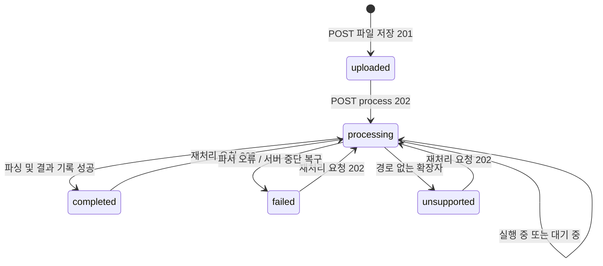

# API·데이터 계약: 현재 로컬 프로토타입

> **기준: 2026-11-19 현재 코드.** 이 문서는 합의된 고객사 운영 계약이나 향후 시스템 규격이 아니라, 다른 세션에서 현재 코드를 안전하게 이어가기 위한 관찰 기록이다. 구현이 바뀌면 코드·테스트와 이 문서를 함께 갱신한다. 미래에 필요한 계약은 마지막 절에 별도로 둔다.

## 1. 경계와 용어

- 프론트엔드 개발 서버는 기본 `http://127.0.0.1:5173`이고 `/api`를 로컬 FastAPI의 `http://127.0.0.1:8000`으로 프록시한다. 직접 호출할 때 주소만 다르고 경로는 아래와 같다.
- **Mock 경로:** `GET /api/data`의 고정 예시 데이터로 대시보드·문서 탐색·파이프라인 시뮬레이션·관계도를 표현한다. Mock 파일 선택은 브라우저 메모리에 파일명·크기·확장자만 추가한다. 파일 내용은 서버로 보내지 않는다. 화면의 Mock `status`, 파서명, 관계와 시각화 설정은 실제 처리 상태가 아니다.
- **실제 로컬 경로:** `POST /api/live/documents`로 선택한 파일 바이트가 서버로 전송되어 로컬에 저장된다. 파싱은 업로드와 별개인 `POST .../{id}/process` 요청을 받은 후에만 시작된다. 실제 문서 목록·결과는 Mock 목록이나 Mock 대시보드에 자동 반영되지 않는다.
- **허용 폴더 경로(2026-11-25):** `POST /api/live/import`는 파일 바이트를 받지 않는다. 화면은 허용 폴더 기준 상대 경로만 보내고, 서버가 그 파일을 직접 읽어 업로드와 같은 규칙으로 저장한다. 브라우저 파일 첨부·전송이 보안 프로그램으로 막힌 PC용이다. 허용 폴더는 `DOCOPS_AGENT_ROOTS`(작업 도구와 같은 이름, 서버는 `.env`·환경 변수에서 읽음)로만 정하고 API로 바꿀 수 없다. 비우면 저장소의 `samples/`. 저장만 하고 파싱은 시작하지 않는다.
- 다음 표의 **문서**는 실제 로컬 경로의 `LiveDocument`다. 파일에서 확인한 확장자에 따른 처리 후보일 뿐, 파일 내용·품질·문서 업무 분류가 검증됐다는 뜻은 아니다.
- 런타임은 단일 로컬 서버·단일 사용자용 실험 구성이다. 접근 제어, 다중 사용자·원천 연동·영속 작업 큐·검색 인덱스·게이트웨이 API는 현재 구현 범위가 아니다.
- **검색 준비 경로(2026-11-17 추가):** `/api/retrieval`(청킹 벤치·임베딩 평가)과 `/api/vectordb`(Milvus 조회)는 측정·확인용이다. 색인을 만들거나 Milvus에 쓰지 않는다. 임베딩 모델 호출은 사용자가 토큰 측정이나 평가 실행을 누를 때만 나가고, Milvus에는 연결이 설정돼 있을 때 조회 요청만 보낸다. 문서 계보(`/api/lineage`)는 저장된 구조 분석 결과로 계산만 한다.

- **저장소 표식(2026-11-24):** 모든 응답에 `x-docops-runtime` 헤더가 붙는다. 값은 서버 저장소 경로(`DOCOPS_RUNTIME_DIR`)의 정규화 경로 SHA-256이다. 실행기(`launch_local.py`)와 작업 에이전트 도구가 포트를 찾을 때 같은 저장소의 서버인지 비교한다. 이전에는 `run.sh` 실행기만 붙였다. 작업 에이전트 도구(MCP·CLI)는 이 API를 그대로 부르는 클라이언트이며 새 엔드포인트는 없다([작업 에이전트 도구](AGENT_TOOLS.md)).

## 2. 경로 요약

| 요청 | 입력 / 효과 | 성공 | 주요 오류 |
|---|---|---:|---|
| `GET /api/health` | API 기능 제공 상태 | `200` | 해당 응답은 고정값으로, Docling 설치·모델 또는 실제 문서의 파싱 성공을 확인하지 않음 |
| `GET /api/data` | `mock-data/data.json` 전체 | `200` | 예시 파일을 읽지 못하면 서버 오류 가능 |
| `GET /api/live/parsers` | `routes`는 지금 실제로 쓰는 확장자 → 파서 ID 매핑(이미지는 `ocr-model`). PDF는 필수 모델 파일이 갖춰지면 `docling`, 아니면 `pdf-text`(2026-11-25). `docling_installed`, `pdf_model_directory`는 패키지·폴더 확인값. `pdf_models_ready`는 필수 레이아웃·표 파일 5개가 존재하고 0바이트보다 큰지 확인한 값이며, `pdf_missing_files`는 누락·빈 파일의 모델 폴더 기준 상대 경로 목록. `ocr_models_found`는 OCR 모델 연결이 **설정됐는지**(2026-11-24부터, 호출해 보지 않음), `ocr_model`은 `{label, model_id, mode, configured}`. 조회는 모델 로딩·호출이나 파싱을 실행하지 않는다. | `200` | |
| `GET /api/live/documents` | 조건이 없으면 예전처럼 전체 목록 `{ "documents": [...] }`(파서 화면·에이전트·구조 분석이 쓴다). 조건(`q`·`status`·`format`·`sort`·`cursor`·`limit` 중 하나)이 있으면 **한 쪽**(2026-11-27): `{documents, total, next_cursor, facets:{formats, statuses}}`. `q`는 이름·확장자·ID 글자 포함 또는 D번호(`D12`·`#12`·`12`), `status`는 `all`·`attention`(실패+미지원)·`uploaded`·`processing`·`completed`·`failed`·`unsupported`·`no_text`(글자 없는 이미지), `format`은 확장자 목록(쉼표, 확장자 없음은 `-`, `XLSM`과 `XLSX`는 다른 값), `sort`는 `recent`(올린 순, 기본)·`updated`·`name`, `limit` 1~500(기본 50), `cursor`는 앞 응답의 `next_cursor`(정렬 열 + 바뀌지 않는 문서 번호의 키라 읽는 사이에 문서가 올라와도 같은 행이 두 번 나오지 않는다). `facets.formats`는 검색·상태 조건을 적용한 전체 집합의 확장자별 수(확장자 조건은 뺌), `facets.statuses`는 검색·확장자 조건 기준의 화면 상태별 수. 쪽 응답의 문서에는 최신 성공 실행의 자동 대조 판정 `qc:{state, label, unresolved}`가 붙는다. `ids=<ID,…>`(최대 200)는 그 문서들만(쪽 밖에서 처리 중인 작업의 완료 확인) | `200` | `400` 상태 값 오류, `403` 허용되지 않은 Origin |
| `POST /api/live/documents` | `multipart/form-data`의 `file` **1개**. 저장만 수행 | `201`, `LiveDocument` | `400` 파일명 오류/길이 정보 문제, `403` 허용되지 않은 Origin, `413` 크기 초과, `422` 필수 파일 필드 누락 등 |
| `GET /api/live/import/roots` | 허용 폴더 `{roots:[{index,path,name}], notes, default, setting, max_bytes}`. `notes`는 없거나 열 수 없는 설정 항목, `default`는 `samples/` 기본값 사용 여부 | `200` | `403` 허용되지 않은 Origin |
| `GET /api/live/import/entries?root=&path=&recursive=` | 허용 폴더 안 한 폴더의 하위 폴더와 파일. `recursive=true`면 하위 폴더 파일까지 평평하게(최대 5,000개, 넘으면 `truncated`). 파일마다 `state`(`ready` 파서 있음, `no_parser` 저장만, `empty`, `too_large`)와 이름·크기가 같은 기존 문서 `existing:[{id,seq,status}]` | `200`, `ImportListing` | `400` 허용 폴더 밖·숨김·없는 경로, `404` 허용 폴더 번호 없음 |
| `POST /api/live/import` | JSON `{root, paths:[상대 경로 1~1000개]}`. 파일마다 복사해 저장하고, 이름·크기·SHA-256이 같은 원본이 있으면 그 문서를 돌려준다. 파싱하지 않음 | `200`, `{items:[{path, outcome:"imported"\|"reused"\|"failed", document?, reason?}]}` | 파일별 실패는 `failed`와 `reason`(밖·숨김·빈 파일·크기 초과·읽기 실패). `404` 허용 폴더 번호 없음, `422` 경로 목록 형식 |
| `GET /api/live/documents/{id}` | 해당 문서 상태 | `200`, `LiveDocument` | `404` ID 형식이 틀렸거나 없는 문서 |
| `POST /api/live/documents/{id}/process` | 기존 원본에 대한 처리 요청. 바디는 선택(2026-11-27): 텍스트·CSV의 **원천 계약** `{csv_delimiter?: "," \| ";" \| "\t" \| "\|", encoding?: "utf-8" \| "utf-8-sig" \| "cp949" \| "utf-16" \| "utf-16-le" \| "utf-16-be" \| "utf-32"}`. 지정하면 파서가 고르지 않고 그 값으로 읽고, 실행의 `options`와 `evidence`(근거 `declared`)에 남는다 | `202`, 접수 시 `status: "processing"` | `404` 문서 없음, `409` 이미 처리/대기 중·텍스트·CSV가 아닌 문서에 계약 지정, `422` 지원하지 않는 값, `503` 대기열 만석 또는 작업자 사용 불가 |
| `GET /api/live/documents/{id}/result` | 마지막 성공 결과 | `200`, `ParseResult` | `404` 문서 없음, `409` 성공 결과 없음 **또는 결과 포인터·파일·메타데이터 오류** |
| `GET /api/live/documents/{id}/runs` | 같은 원본의 성공 실행 이력. 실행마다 파서·버전·OCR 여부와 처리 시간 `duration_ms`(2026-11-17부터 기록, 이전 실행은 `null`) | `200`, `{ "runs": [...] }` | `404` 문서 없음 |
| `GET /api/live/documents/{id}/runs/{run_id}` | 선택한 성공 실행의 Markdown·경고·위치, 판정 근거 `evidence`와 사용자가 지정한 원천 계약 `options`(2026-11-27, 예전 실행은 `null`) | `200`, `StoredParseRun` | `404` 문서 또는 실행 없음, `409` 결과 읽기 오류 |
| `GET /api/live/documents/{id}/source` | 저장된 원본 | `200`, PDF는 인라인, 나머지는 첨부 다운로드 | `404` 문서 없음, `409` 원본 오류 |
| `GET /api/live/documents/{id}/source-preview` | 텍스트 첫 60,000자 또는 XLSX·XLSM의 `sheet`·`cell` 주변 값 | `200`, `kind`가 `text` 또는 `sheet` | `404` 문서 없음, `409` 미지원 또는 원본 오류 |
| `GET /api/live/documents/{id}/history` | 상태 변경·접수 실패 이벤트 | `200`, `{ "id": ..., "history": [...] }` | `404` 문서 없음 |
| `POST /api/live/documents/{id}/structure` | 원본 구조 분석(하위 문서·링크·플래그). 원본·처리 상태는 바꾸지 않고 `runtime/structure/{id}.json`에 저장 | `200`, `{id,name,format,inspected_at,root,summary}` | `404` 문서 없음, `409` 저장 경로 확인 불가, `403` 허용되지 않은 Origin |
| `GET /api/live/documents/{id}/structure` | 마지막 구조 분석 결과 | `200` | `404` 문서 없음, `409` 분석 결과 없음·읽기 실패 |
| `GET /api/live/structure-summary` | 분석한 문서 전체 합계: 원본 대비 발견 문서 배율, 최대 깊이, 링크·하위 문서·플래그 종류별 수 | `200` | |
| `GET /api/models`, `POST /api/models/{key}/test`, `POST /api/models/{key}/models` | 생성 모델 연결(`primary`·`secondary`)과 임베딩 연결(`embedding`) 상태(키 값 제외, `saved`=화면에서 저장한 값을 씀), 사용자가 누를 때만 짧은 채팅 요청·모델 목록 조회 | `200` | `404` 연결 없음, `409` 미설정, `403` 허용되지 않은 Origin |
| `PUT /api/models/{primary\|secondary\|embedding}`, `DELETE /api/models/{…}/saved` | 화면에서 연결 저장 `{label, base_url, model_id \| models[], api_key?, clear_api_key?}` · 저장값 지우고 `.env`로 되돌리기. `<runtime>/settings/connections.json`(0600)에 두고 `.env`보다 우선, 다음 요청부터 반영. `api_key`를 보내지 않으면 저장된 키 유지 | `200` 갱신된 목록 | `400` 주소·글자 형식 오류(계정 정보가 든 URL 거부), `404` 없는 자리 |
| `POST /api/models/draft/test`, `POST /api/models/draft/models`, `POST /api/models/embedding/test` | 저장하지 않고 입력 중인 값으로 확인 `{kind: chat\|embed, key, base_url, model_id \| models, api_key?}`(키를 비우면 저장된 키), 저장된 임베딩 연결로 짧은 문장 하나 임베딩(차원·지연) | `200` `{ok, status, latency_ms, …}` | `400` 입력 오류, `409` 미설정 |
| `GET /api/models`의 `ocr`, `PUT /api/models/ocr`, `DELETE /api/models/ocr/saved`, `POST /api/models/ocr/test` (2026-11-24) | 문서 OCR 모델 연결 `{label, base_url, model_id, api_key?, clear_api_key?, mode: region\|page, text_prompt, table_prompt, page_prompt}`(지시문은 비우면 기본값 `OCR:`·`Table Recognition:`·`document parsing.`). 응답에 키 값 없음(`api_key_set`). 연결 확인은 'OCR TEST 12.5 mg/mL'이 든 시험 그림을 실제로 읽혀 `12.5`가 나오는지 본다(사용자가 누를 때만, **외부 모델 호출**). `POST /api/models/draft/test`에 `kind: ocr`로 저장 전 확인, `POST /api/models/draft/models`에 `kind: ocr`로 게이트웨이 모델 목록(모델 ID 없이도 됨, 키를 비우면 저장된 OCR 키) | `200` | `400` 입력 오류·방식 오류, `409` 연결 미설정 |
| `GET /api/live/documents/{id}/source-text` (2026-11-26) | **파서와 별개로 원본에서 직접 읽은 글자**(`app/source_text.py`). 기본은 단위 목록 `{format, method, notes, truncated, units:[{key,label,page,sheet,kind,note,chars,lines}]}`. `?unit=<key>`면 그 단위의 줄 `{unit:{…, lines:[{text, ref, row?, cells?}]}}`, `?find=<글자>`면 찾은 줄 최대 50개 `{hits:[{unit,label,page,sheet,ref,row,text}]}`. 단위는 PDF 쪽(`p3`, 글자 층 없는 쪽은 `kind: scan`, 깨진 글자 층은 `garbled`)·PPTX 슬라이드(`p3`, 숨김은 `hidden`)·XLSX·XLSM 시트(`sheet:<이름>`, 셀 `{cell, value, alts}`)·DOCX `body`·`headers`·`notes`·텍스트 `body`. 원본은 바뀌지 않으므로 서버가 문서 3개까지 잠시 둔다 | `200` | `404` 문서·단위 없음, `409` 읽을 글자 층이 없는 형식(이미지·SVG 등)·손상·암호·구성 요소 없음(문장으로 사유) |
| `GET /api/live/documents/{id}/verify?run=&severity=&unit=&kind=&order=&offset=&limit=&unreviewed=` (2026-11-26, 2026-11-27 원장) | **자동 대조 원장**(`app/verify.py` → `qc_runs`·`qc_findings`): 파싱 결과(기본 최신 성공 실행)를 원본 글자와 비교한 의심 지점. 판정이 아니라 후보다. 성공 실행을 저장할 때 같은 트랜잭션에서 '미평가'로 등록하고 같은 작업자가 이어 계산하며, 없으면(예전 실행·규칙 버전 변경) 조회할 때 계산해 저장한다. 응답 `{id, run_id, is_latest, document_status, rule_version, qc_state, method, format, parser, source_layer, summary:{…}, units:[…], spots:[…한 쪽], spots_total, spots_matched, page:{offset, limit, order, next}, top, top_spots, notes, reasons, checks, contract, gate, verdicts}`. **`spots`는 우선순위 순(높음 → 원본 단위 순서 → 결과 줄)으로 한 쪽**(기본 400, 최대 1,000)이고 `page.next`로 이어 받는다(예전에는 문서 순서 앞 400곳으로 잘라 우선순위 1위가 빠질 수 있었다). `order=document`면 S번호 순. `severity=high,medium`·`unit=p3`·`kind=changed,missing`으로 거른다. `unreviewed=true`면 사람이 판정(맞음·틀림·보류)한 지점을 뺀다. 지점마다 `id`(finding ID)·`rank`·`source_layer`(`pdf_text_layer`·`pdf_hidden_layer`·`ooxml_xml`·`xlsx_values`·`xlsx_chart_cache`·`csv_records`·`text`·`mime_parts`·`ocr_model`). `top_spots`는 우선순위 앞 20곳의 상세. `gate`·`reasons`·`checks`는 §11. 이미지·SVG는 결과 전체를 `image_ocr` 지점 하나로 돌려준다 | `200` | `400` 심각도 값 오류, `404` 문서·실행 없음, `409` 성공 결과 없음·원본 글자를 읽을 수 없음 |
| `GET /api/live/documents/{id}/verify/spots/{ref}?run=` (2026-11-27) | 의심 지점 하나. `ref`는 S번호(`S441`) 또는 finding ID(`F` + 16진수 12자). 받은 쪽에 없는 지점(주소의 `check=S441`)을 바로 연다 | `200`, 지점 + `{run_id, rule_version}` | `404` 문서·실행·지점 없음, `409` 형식 오류·원본을 읽을 수 없음 |
| `GET /api/live/qc-summary` (2026-11-27) | **처리 깔때기**: 반입 전체 `documents` → 파싱 완료 `parsed` → 자동 대조 `qc_done`(나머지 `qc_pending` 미평가·`qc_unavailable` 대조 불가) → 판정 상태 `states:{needs_review, undetermined, pass_candidate}`(최신 성공 실행, 사람 판정 합침). `not_parsed`는 파싱하지 못한 사유(오류 코드·상태)별 수, `human_decided`는 사람 판정이 있는 문서 수. 마지막 단계만 보고 처리율을 말하지 않도록 분모를 차례로 준다 | `200` | `403` 허용되지 않은 Origin |
| `GET /api/live/reviews?status=&doc=&limit=` (2026-11-26) | **검수 요청(V번호)** 목록, 최신 먼저. `status`는 `open`(확인 전)·`correct`(맞음)·`wrong`(틀림)·`unclear`(보류)·`all`, `doc`은 문서 ID. `counts`는 상태별 전체 수(거른 목록과 별개) | `200`, `{reviews:[Review], counts}` | `400` 상태 값 오류, `403` 허용되지 않은 Origin |
| `POST /api/live/reviews` (2026-11-26) | 검수 요청 만들기 `ReviewCreate`. 작업 에이전트(`origin: agent`, 기본)는 `flag` 도구로, 화면(`origin: console`)은 원문 대조의 자동 대조 지점에 판정을 누를 때 만든다. `spot`(S번호 또는 finding ID)이나 `finding_id`를 주면 서버가 그 실행의 **원장 전체**에서 지점을 찾아(화면이 받은 한 쪽 밖도 된다) 위치·원본/결과 글자·종류·심각도와 기본 `note`, `finding_id`·`rule_version`을 채우고, **같은 문서·실행·finding ID는 하나만** 둔다(기존 것을 `created:false`로 돌려줌. finding ID가 없던 예전 요청은 S번호로). `run_id`를 생략하면 최신 성공 실행. 지점이 없으면 `note`가 필요하다 | `201`, `Review + {created}` | `404` 문서·실행 없음, `409` note 없음·없는 지점·성공 결과 없음, `422` 형식 오류 |
| `PATCH /api/live/reviews/{n}` (2026-11-26) | 사람의 판정과 메모 `{status?, comment?}`. 상태를 바꾸면 `decided_at`을 남기고, `open`으로 되돌리면 지운다 | `200`, `Review` | `400` 바꿀 값 없음, `404` 없는 번호 |
| `GET /api/agent/activity?limit=` (2026-11-24, 2026-11-26 바뀜) | 작업 에이전트(MCP·CLI)의 묶음·호출 기록과 **에이전트가 다룬 문서**. `runtime/agent/`와 문서·검수 요청을 읽기만 한다. 묶음·호출의 문서는 `seq`(D번호)로 준다. `documents`: 묶음·도구 호출·에이전트 검수 요청에 나온 문서 `{id, seq, name, format, status, error_code, updated_at, last_agent_at, batches, calls, reviews:{open,correct,wrong,unclear}}`(최근 순). `calls`: `{ts, tool, args, kind, repeat, ms, result, text(에이전트가 받은 결과 앞 12,000자), docs, session(연결 표식)}`. 예전의 `reports`(타이핑용 보고서)는 2026-11-26에 뺐다. 작업 도구는 Origin 없이 부르고, 브라우저는 로컬 화면 Origin만 허용 | `200`, `{available, batches, documents, calls}` | `403` 허용되지 않은 Origin |
| `GET /api/lineage?source=live\|example` | 문서 계보(판 묶음·최신 판단·포함·참조 연결 상태). `live`는 업로드 목록과 **이미 실행해 둔** 구조 분석 결과만 읽고 분석·파싱을 새로 시작하지 않는다. `example`은 `mock-data/lineage-example.json`으로 계산한다 | `200`, `LineageData` | `400` 출처 값 오류, `503` 예시 파일 읽기 실패 |
| `GET /api/retrieval/config` | 임베딩 연결(`EMBED_*`와 주소가 있는 `MODEL_*`·`MODEL2_*`, 키 값 제외), 모델 사양, 청킹 전략 설명, 요청 한도, 벡터 캐시 크기 | `200` | `403` 허용되지 않은 Origin(이하 `/api/retrieval`, `/api/vectordb` 공통) |
| `GET /api/retrieval/documents`, `GET /api/retrieval/samples` | 청킹 원문 후보: 성공 결과가 있는 실제 문서 / 합성 예시 3종(`sop` 절차서, `report` 그림 많은 점검 보고서, `coa` 표 많은 시험 성적서)과 요소 구성 | `200` | |
| `POST /api/retrieval/chunk` | `{source: {doc_id} · {sample} · {text,name}, strategies(1~6개), limit_tokens, parallelism?}` → 원문 요소 목록(제목·본문·목록·표·그림·캡션·코드·반복 머리말, 쪽)과 전략별 청크·통계·요소별 결과(`outcomes`, `by_kind`). 실제 문서(2026-11-27)는 `source`에 나눈 본문의 성공 실행 `run_id`·`text_sha256`과 그 실행의 판정 `qc:{state, label, unresolved, rule_version}`를 주고, 청크마다 덮는 원본 영역 `regions:[{page}\|{sheet}]`와 **겹치는, 사람이 아직 판정하지 않은 의심점** `qc:[{key, id, severity, kind, message, page, sheet, cell, line, line_end, source_hit, result_hit, source_layer}]`(최대 12)·`qc_total`, 표시 `unverified`를 붙인다(청킹을 막지는 않는다). 전략은 기준선 4종(고정·재귀·문장·제목 구조)과 요소 인지·부모-자식·페이지 단위, 의미 기반(`semantic`). 의미 기반은 캐시에 있는 문장 임베딩만 쓰고, 없으면 그 전략만 `pending {missing,total,model}`으로 돌려준다. 사용자가 '나누기'를 누른 요청(`embed: true`)에서만 임베딩 연결을 호출하고 결과를 캐시에 넣는다. 그 밖의 전략은 외부 호출 없음 | `200` | `400` 원문·전략 오류, `404` 문서 없음, `409` 성공 결과 없음, `413` 원문·청크 수 한도 초과 |
| `POST /api/retrieval/tokens` | 고른 연결·모델로 표본 텍스트(최대 16개)를 임베딩해 실제 토큰 수·차원을 잰다. **외부 모델 호출** | `200` | `400` 표본 오류, `409` 연결 미설정 |
| `GET`·`PUT /api/retrieval/questions`, `POST .../questions/parse`, `GET .../questions/export?format=csv\|jsonl` | 평가 질문 세트(질문·정답 문서·정답 구절). `runtime/retrieval/questions.json`에 저장 | `200` | `400` 형식 오류, `409` 저장 파일 읽기 실패 |
| `POST /api/retrieval/runs` | 문서(실제·`sample:<id>`)·청킹 프리셋·후보 모델·`top_k`로 검색 정확도 평가 시작. 결과는 질문 유형(본문·표·그림)별 지표 포함. 한 번에 하나만 실행. **외부 모델 호출**, 청크 벡터는 `runtime/retrieval/embeddings.sqlite3`에 캐시 | `202`, `Run` | `400` 요청 오류, `409` 다른 평가 실행 중 |
| `GET /api/retrieval/questions/example` | 합성 예시 문서에 맞춘 예시 질문(본문·표·그림 유형). 저장하지 않음 | `200` | |
| `POST /api/retrieval/plan` | `{doc_ids, preset, models}` → 고른 청킹으로 나눈 청크 수와 모델별 입력 한도 초과 청크·벡터 용량, 유형별 질문 수. 외부 호출 없음 | `200` | 알 수 없는 문서는 `errors`에 담음 |
| `GET /api/retrieval/runs/current`, `POST .../runs/current/cancel`, `GET .../runs/current/questions/{index}?combo=` | 진행 상태와 결과, 취소, 질문별 검색 결과. 실행 상태는 메모리에만 있어 서버를 다시 시작하면 사라진다 | `200` | `404` 상세 결과 없음 |
| `GET /api/vectordb/sources`, `POST /api/vectordb/milvus/check` | 출처(예시 데이터·Milvus)와 연결 설정의 공개 정보(토큰 값 제외), Milvus 연결 확인. `sources`는 Milvus에 요청하지 않으며, 최근 연결 실패로 쉬는 중이면 `milvus.unreachable`(`retry_in`초, `error`)을 담고 기본 출처를 `example`로 돌려준다. `check`는 사용자가 누를 때만 실제로 요청하고 쉬는 상태를 풀어 다시 시도한다 | `200` | |
| `GET /api/vectordb/{source}/tree`, `GET .../collection?db=&name=` | 데이터베이스·컬렉션·파티션 트리, 컬렉션 스키마·인덱스·감지한 필드 역할(텍스트·문서·순서·쪽) | `200` | Milvus 오류의 상태 코드와 메시지를 그대로 전달. 연결 실패(연결 거부·시간 초과·인증서)와 `collections/list`의 HTTP 404(Milvus REST v2 주소가 아님)가 나면 같은 주소로 30초(`UNREACHABLE_COOLDOWN`) 동안 요청을 보내지 않고 `503`으로 바로 답한다. 첫 오류는 원래 메시지(`502`/`504`)를 보여 준다 |
| `POST /api/vectordb/{source}/browse`, `/chunk`, `/similar`, `/documents`, `/document` | 청크 조회(필터·파티션·페이지, `offset+limit` 16,384 미만), 청크 상세, 유사 청크, 문서 값 목록, 한 문서의 청크를 순서대로 다시 읽기. **읽기 전용**, 쓰기·삭제 요청 없음 | `200` | `422` 요청 값 오류, Milvus 오류 전달 |

청킹 비교의 `parallelism`은 동시에 실행할 전략 수다. 기본값은 1이고 현재 서버는 1~4의 정수를 받는다. 화면은 `GET /api/retrieval/config`의 `caps.max_parallel_strategies`로 한도를 확인한다. 요청마다 원문을 한 번 읽고, 서버 프로세스 전체에서 최대 네 전략을 동시에 실행한다. 결과 배열은 요청 순서를 유지하며 잘못된 전략의 오류는 해당 결과에 담긴다.

`202`는 요청이 **접수되었다는 뜻**이다. 반환된 스냅샷의 `processing`은 실행 중 **또는 메모리 대기열에서 대기 중**을 뜻하며, 결과가 준비됐음을 의미하지 않는다. 아주 빠른 처리는 응답 후 조회 시 이미 끝나 있을 수 있다. 목록을 다시 조회하거나 상세 문서를 폴링해 최종 상태를 확인한다.

예시 health 응답:

```json
{"status":"ok","mode":"local","mock_data":"available","live_processing":"available"}
```

브라우저 실제 업로드 예시의 형태는 다음과 같다. 아래는 요청 구조 예시이며 실행하면 지정 파일이 로컬 `runtime/uploads/`에 실제로 저장된다.

```http
POST /api/live/documents HTTP/1.1
Content-Type: multipart/form-data; boundary=...

--...
Content-Disposition: form-data; name="file"; filename="sample.txt"
Content-Type: text/plain

예시 내용
--...--
```

`file` 하나당 요청 하나를 보낸다. 현재 프론트는 여러 파일을 고르면 순차적으로 개별 요청을 보낸다. 업로드 중 실제 처리 화면을 벗어나면 이미 요청한 파일은 서버에 저장됐을 수 있다. 진행 중 요청이 성공하면 이후 파일의 전송이 중단될 수 있고 실패 경로에서는 후속 요청이 계속될 수도 있다. 완료 여부는 실제 목록에서 다시 확인해야 하며 일괄 업로드 재개는 구현되지 않았다. 요청 본문에 경로·원본 ID·사용자 ID를 넘기는 방식은 없다.

## 3. 실제 문서와 결과의 응답 스키마

### `LiveDocument`

아래 값은 예시다. `id`는 서버에서 만든 소문자 16진수 32자이며 입력 시 같은 형식을 검사한다. 시각은 코드상 UTC ISO 8601, 초 단위다. 실제 저장 경로와 결과 경로는 응답하지 않는다.

```json
{
  "id": "0123456789abcdef0123456789abcdef",
  "name": "sample.txt",
  "format": "TXT",
  "size_bytes": 37,
  "status": "uploaded",
  "created_at": "2026-11-12T05:00:00+00:00",
  "updated_at": "2026-11-12T05:00:00+00:00",
  "parser": null,
  "error": null,
  "error_code": null,
  "seq": 12
}
```

`seq`(2026-11-24)는 문서 번호다. 올린 순서로 1부터 매기며 바뀌지 않는다(유일 인덱스). 화면과 작업 에이전트가 `D12`처럼 같은 번호로 부른다. 번호 열이 없던 DB는 시작할 때 기존 문서에 올린 순서(`created_at`, 같으면 저장 순서)대로 매긴다.

| 필드 | 의미 및 제한 |
|---|---|
| `id` | 서버가 생성한 문서 ID. 원천 문서의 ID나 콘텐츠 해시가 아님 |
| `name` | 정리된 표시용 파일명. 경로 구분자 앞부분과 제어문자 제거, macOS 분해형 한글(NFD)은 조합형(NFC)으로 바꾸고 방향 제어·폭 없는 글자(U+202E 등)는 뺀다. `℃`·`±`·`−` 같은 기호는 그대로 둔다(2026-11-19). 저장 경로에는 파일명을 사용하지 않음 |
| `format` | 파일명 마지막 확장자의 대문자. 확장자가 없거나 ASCII 영숫자 1–20자 조건에 맞지 않으면 빈 문자열. 이 값 자체는 확장자다. 처리 때는 내용 서명으로 다시 확인해 맞지 않으면 실패시킨다(§4-1) |
| `size_bytes` | 업로드한 바이트 수 |
| `status` | `uploaded` / `processing` / `completed` / `failed` / `unsupported` 중 하나 |
| `created_at`, `updated_at` | 서버에서 기록한 UTC 시각. 초 단위이므로 같은 초에 여러 변화가 발생할 수 있음 |
| `parser` | 현재 또는 마지막 처리 요청에 선택된 파서명. `null`일 수 있음. **마지막 성공 결과의 파서와 동일하다고 가정하지 말 것** |
| `error` | 마지막 처리 실패 등에 대한 표시용 문자열 또는 `null`. 자동 분기용 안정 코드가 아님 |
| `error_code` | 마지막 실패·미지원의 안정 사유 코드 또는 `null`(2026-11-19 추가). 값은 §4-1. 처리 접수·성공 시 `null`로 비운다. 추가 전에 실패한 문서는 `null` |

조건 없는 목록은 `documents` 배열로 전체를 반환하고 생성 시각 내림차순, 같은 시각에는 내부 등록 순서의 역순으로 정렬한다. 조건을 주면 서버가 검색·상태·확장자·정렬·커서를 처리한 한 쪽을 준다(2026-11-27, §2). 사용자·원천·파일명별 접근권한, 변경분 조회는 없다.

### `ParseResult`

```json
{
  "id": "0123456789abcdef0123456789abcdef",
  "markdown": "예시 문서 본문",
  "parser": "python-text",
  "parser_version": "stdlib-3.13.12",
  "is_stale": false,
  "warnings": [],
  "fidelity": null
}
```

- `markdown`은 마지막으로 **성공해 현재 연결된** 결과 파일의 텍스트다. 구조화 페이지/시트/셀 위치의 완전 보존을 보장하지 않는다. DOCX·XLSX·XLSM·PPTX에서 파서 결과에 없던 글상자·SVG 글자를 찾으면 끝에 `<!-- docops:supplement -->`와 `## 보충 추출: 파서 결과에 없던 원본 글자` 구획을 덧붙인다. 각 줄은 `- [글상자 · 시트!B3:D5 도형] 글자` 형식이며 **원래 위치가 아니다**. 종류는 글상자·SVG 글자·그림 OCR·머리말·꼬리말·각주·미주(2026-11-25, 본문에서 참조한 순서로 `각주 N`)·수식 원문이다. XLSX·XLSM 글상자 줄은 `locations`에 시트·행·열이 남는다.
- **결과 보강(2026-11-25, Docling 결과에 콘솔이 더하는 줄):** 기존 줄의 글자는 바꾸지 않고 줄을 끼우며, `locations`의 줄 번호를 함께 민다(`app/adapters/markdown_edit.py`).
  - XLSX·XLSM: 시트마다 첫 내용 앞에 `## 시트: <이름>`(숨긴 시트는 Docling이 내용을 내지 않아 제목도 없다).
  - PPTX: `locations`에 `page` = 슬라이드 번호. 발표자 메모는 그 슬라이드 내용 끝에 `> 발표자 메모(슬라이드 N): …`(여러 줄은 `> …`)로 붙이고 `page` 위치를 단다. 경고 `발표자 메모 N개를 … 붙였습니다(파서 결과에는 없던 글자).`
  - 모든 Docling 형식: 글·목록 줄 바로 뒤의 표 앞에 빈 줄. 표 맨 위에서 모든 칸이 같은 글자인 행(전체 너비 병합 제목·안내, 숫자·기호만 있는 행 제외)은 표 위 문단으로 옮기고 남은 첫 행을 머리글로 삼는다. 경고 `표 맨 위의 전체 너비 병합 행 N개(제목·안내 문구)를 표 위 문단으로 옮겼습니다(칸마다 반복하지 않음).` 표 중간의 병합 셀 반복은 그대로다.
- `fidelity`(2026-11-19 추가)는 DOCX·XLSX·XLSM·PPTX 성공 결과의 원문 충실도 보고서다. 다른 형식이나 이전 결과는 `null`이다. 아래 '원문 충실도 보고서'를 본다.
- `parser`, `parser_version`은 이 **성공 결과를 만든 파서와 버전**이다. 현재/최신 시도의 파서값인 `LiveDocument.parser`와 별도로 취급한다.
- `is_stale: false`는 문서의 현재 상태가 `completed`임을 뜻한다. `true`는 현재 상태가 완료가 아닌데도 **과거 성공 결과**가 있어서 반환했다는 뜻이다. 예를 들어 재처리 대기·실행 중이나 재처리 실패 후 이전 결과를 보여준다. `is_stale`은 결과 품질 평가나 원천 최신성 검증이 아니다.
- `warnings`는 결과 관련 문자열 배열이다. OCR 없이 처리한 PDF는 미적용 경고를 유지한다. 본문·표가 추출되지 않은 PDF 페이지 번호를 별도로 기록한다. `ocr_enabled`는 PDF 변환 설정, 이미지·Office 그림은 OCR 적용 여부다.
- DOCX·XLSX·XLSM·PPTX 결과의 `warnings`에는 원문 대조 경고가 붙는다: 특수기호 손실(`특수기호 N건이 결과에서 빠짐(원문 M건): ≥×2…`), 바꿀 수 없는 첨자·기호 글꼴, 흰색에 가까운 글자 포함, 숨김 글자 포함, 병합 셀 값 반복 가능, 보충 추출, OCR 없이 읽지 않은 래스터 그림 수. 사본 보정이나 점검이 실패하면 그 사실도 경고로 남는다.
- 매크로(VBA 프로젝트 `vbaProject.bin`)가 든 통합문서 결과(2026-11-25, XLSM과 이름만 `.xlsx`로 바꾼 매크로 통합문서)의 `warnings`: 코드가 든 모듈이 있으면 `매크로 포함: VBA 모듈 N개(코드 M줄)는 실행하지 않았고 결과 본문에 넣지 않았습니다. 셀 값은 파일에 마지막으로 저장된 값입니다.`로 시작하는 한 줄. 열거나 닫을 때 자동 실행되는 프로시저(`Auto_Open`, `Workbook_Open`, `Document_Open` 등 이름 기준)가 있으면 같은 줄에 이름을 덧붙인다. 소스가 없는 모듈(실행 코드만 남았거나 손상)은 따로 한 줄, 프로젝트를 읽지 못하면 `매크로(VBA) 프로젝트가 있지만 읽지 못했습니다…` 한 줄. 빈 시트·통합문서 모듈만 있으면 경고가 없다. 매크로 코드는 `markdown`에 넣지 않는다.
- `run_id`(2026-11-27)는 이 결과를 만든 성공 실행이다(청크·검수 요청이 같은 실행을 가리키게 한다). `locations`도 함께 준다. 결과 생성 시각, 결과 원본 버전, 페이지별 품질이나 이전 결과 목록은 없다(실행 목록·실행별 조회는 `runs`). 여러 번 성공했을 때 이 경로는 마지막 성공 결과만 가리킨다.

### 원문 충실도 보고서 (`fidelity`)

`ParseResult.fidelity`와 `StoredParseRun.fidelity`(실행별, `parse_runs.fidelity`에 저장)의 형태다. 파서와 무관하게 **원본 OOXML을 직접 읽은 인벤토리**와 최종 Markdown을 대조한다.

```json
{
  "version": 1,
  "symbols": {"expected": 215, "found": 215, "lost": {}, "normalized": {}, "top": {"℃": 15, "±": 15}},
  "prepared": {"symbol_font_converted": 2, "symbol_font_unmapped": 0, "scripts_converted": 3, "scripts_kept": 0, "parts_changed": ["word/document.xml"]},
  "findings": [{"code": "merged_cells", "severity": "warning", "count": 2, "message": "병합 셀 2개: …", "examples": []}],
  "supplemented": 1,
  "notes": []
}
```

| 항목 | 뜻 |
|---|---|
| `symbols.expected` | 원문에서 보이는 글자의 특수기호 수(ASCII·한글·한자·공백 제외). 기호 글꼴 문자는 유니코드로, 서식 위·아래첨자는 바꿀 수 있으면 유니코드 첨자(`m²`)로 센다. 숨김 서식 글자·SVG 글자는 넣지 않는다 |
| `symbols.lost` / `normalized` | 결과에서 모자란 기호 수. `℃→°C`처럼 기호가 남는 호환 변환은 `normalized`, `²→2`처럼 ASCII로 내려앉으면 `lost` |
| `prepared` | 파서에 넣기 전 사본에서 바꾼 수. 보정을 끄거나 실패하면 `null` |
| `findings[].code` | `symbol_lost`, `symbol_normalized`, `symbol_font_converted`, `symbol_font_unmapped`, `script_converted`, `script_flattened`, `script_unconvertible`, `low_contrast_text`, `hidden_text`, `hidden_text_included`, `hidden_sheets`, `merged_cells`, `supplemented`, `images_not_read`, `metafiles_not_read`. `severity: warning`이면 `warnings`에도 문구가 들어간다 |

한계: 스타일·테마에서 상속한 글자색은 보지 않는다(직접 서식만), Word 본문에서 참조한 머리말·꼬리말은 점검하며 각주는 제외한다, PPTX는 배경색을 몰라 저대비를 판정하지 않는다, 병합 셀 값의 반복은 결과 표에서 지우지 않고 보고만 한다, 그림 속 글자는 OCR 없이는 알 수 없다.

### `DocumentHistory`

```json
{
  "id": "0123456789abcdef0123456789abcdef",
  "history": [
    {"created_at": "2026-11-12T05:00:00+00:00", "status": "uploaded", "message": "파일을 로컬에 저장했습니다. 아직 처리하지 않았습니다."},
    {"created_at": "2026-11-12T05:01:00+00:00", "status": "processing", "message": "로컬 처리 요청을 접수했습니다."},
    {"created_at": "2026-11-12T05:01:01+00:00", "status": "completed", "message": "파싱을 완료했습니다."}
  ]
}
```

`history`는 이벤트 삽입 순서다. 대기열 포화·워커 불가로 **접수되지 않은 요청**도 그때의 문서 `status`와 사유 메시지로 기록될 수 있다. 이력 문자열은 설명용이며 버전이 고정된 이벤트 코드가 아니다. 이력만으로 각 실행의 결과·시작/종료·원문 버전이 완전하게 재현되는 감사 추적을 보장하지 않는다.

### 구조 분석 결과 (`root` 노드)

| 필드 | 뜻 |
|---|---|
| `name`, `ext`, `size`, `location` | 표시 이름, 이름의 확장자, 바이트 수, 상위 문서 안 위치(압축 경로·`첨부: 이름`·내장 경로) |
| `kind` | `file`(원본) · `archive-entry` · `attachment` · `embedded` |
| `detected` | 파일 앞부분으로 판별한 실제 형식(`docx`, `xlsx`, `pptx`, `doc`, `xls`, `ppt`, `msg`, `mime`, `pdf`, `zip`, `hwp`, `hwpx`, `html`, `text`, `xml`, `image`, `encrypted-ooxml`, `ole`, `unknown`) |
| `flags` | `encrypted`, `drm-suspect`(Office·PDF 확장자인데 형식을 알 수 없음), `format-mismatch`, `macro`, `macro-autorun`(열거나 닫을 때 자동 실행되는 프로시저), `has-images`, `image-only`, `duplicate`(같은 내용이 이미 나옴), `unreadable`, `truncated`(한도 초과), `too-large` |
| `links[]` | `{kind, target, location, evidence}`. `kind`: `hyperlink`, `url`, `unc-path`, `file-path`, `doc-number`(후보), `external-workbook`, `field-link`, `linked-object`, `template`, `linked-image`, `subdocument`, `pdf-remote`, `external`. `location`은 `시트!셀`, `본문 문단 N`, `슬라이드 N`, `N행`, `매크로 <모듈> N행` 등 |
| `children[]`, `stats`, `hash`, `duplicate_of` | 하위 문서, 이미지·페이지·시트 수 등, 내용 해시 앞 16자, 중복일 때 처음 나온 위치. 매크로가 있는 Office 문서의 `stats.macro`는 `{modules, code_modules, code_lines, auto_run[], stripped_modules, items[{name, kind: standard\|document, code_lines, auto_run?}]}`(모듈 50개까지), 읽지 못하면 `stats.macro_error` |

한도(기본): 깊이 8, 노드 1,500, 메모리로 여는 하위 문서 합계 300MB·개당 100MB, 링크 3,000. 하위 문서는 메모리에서만 열고 디스크에 풀지 않는다. 문서번호 후보 정규식은 `DOCOPS_DOCNUMBER_PATTERN`으로 바꿀 수 있다. 레거시 DOC·XLS·PPT 본문은 형식을 완전히 해석하지 않고 UTF-16·CP949로 훑어 후보만 찾는다(`stats.crude_text`). PDF 본문 텍스트 안의 문서번호는 아직 찾지 않는다(링크 주석·실행 동작·첨부만). 매크로 코드는 [MS-OVBA] 압축을 풀어 읽기만 하고 실행하지 않는다. 경로·URL·문서번호 후보를 찾을 때 `Attribute VB_` 줄은 건너뛴다. 소스를 지우고 실행 코드(p-code)만 남긴 모듈은 내용을 보지 못한다(`stripped_modules`).

## 4. 결과가 없을 때와 오류 계약

일반 오류는 FastAPI `{"detail": "..."}` 형태다. 값은 사용자에게 보여 줄 수 있는 설명이며 향후 문구가 바뀔 수 있다. `422` 같은 FastAPI 검증 오류의 `detail`은 배열일 수 있다.

**결과 조회의 `409`는 한 가지 뜻이 아니다.** 현재 `frontend/src/api/live.ts`의 `getLiveResult`는 상세가 정확히 `"완료된 파싱 결과가 없습니다."`일 때만 `null`로 바꾸고, 나머지 `409`는 오류로 노출한다. 따라서 백엔드 문구만 바꾸면 정상적인 빈 상태가 프론트 오류로 바뀔 수 있다.

| `GET .../{id}/result`의 `409 detail` | 의미 |
|---|---|
| `완료된 파싱 결과가 없습니다.` | 연결된 성공 결과가 아직 없음. 업로드 직후, 최초 처리 중, 성공 이력이 없는 실패/미지원에서 발생 가능 |
| `저장된 결과를 확인할 수 없습니다.` | 결과 파일명/포인터 검증 실패 |
| `저장된 결과 정보를 확인할 수 없습니다.` | 성공 결과 파서 또는 버전 메타데이터가 없음 |
| `저장된 결과 파일을 찾을 수 없습니다.` | 결과 파일 읽기 실패 |

이 구분은 현재 **표시 문구에 결합된 임시 계약**이다. 다른 언어·클라이언트를 추가하거나 API를 운영용으로 다듬을 때는 안정적인 오류 코드와 별도 사용자 문구를 도입하고 프론트와 테스트를 함께 변경한다. 재처리 요청의 `409`는 `이미 처리 중인 문서입니다.`이며 결과 조회의 `409`와 의미가 다르다.

### 4-1. 처리 실패 사유 코드 (`LiveDocument.error_code`)

2026-11-19부터 처리 실패·미지원에 안정 코드를 남긴다. 결과 조회 `409`의 구분(위 표)은 아직 문구 기반이다.

| 코드 | 상태 | 뜻 |
|---|---|---|
| `drm_protected` | `failed` | 등록한 DRM 머리말(`DOCOPS_DRM_SIGNATURES`)과 일치하거나 Microsoft 권한 관리(IRM)로 보호됨. 파서를 호출하지 않는다 |
| `drm_suspected` | `failed` | Office·PDF·텍스트 확장자인데 문서 서명이 없고 본문 엔트로피가 7.5 bits/byte 이상(암호문처럼 보임). DRM 래핑으로 의심 |
| `encrypted` | `failed` | 암호가 걸린 Office 문서(CFB `EncryptionInfo`+`EncryptedPackage`, IRM 아님) |
| `format_mismatch` | `failed` | 확장자와 내용 서명이 다름. 예: `.xlsx`인데 DOCX·구형 XLS(OLE)·일반 ZIP·텍스트 |
| `format_unrecognized` | `failed` | 알려진 서명이 없거나 ZIP 목차를 읽을 수 없음 |
| `unsupported_format` | `unsupported` | 처리 경로가 없는 확장자 |
| `parser_unavailable`, `no_text`, `limit_exceeded`, `unsafe_archive`, `encoding_unknown`, `parse_failed` | `failed` | Docling·모델 미설치, 추출 글자 없음, 크기·행·압축 한도, 위험한 내부 경로, 인코딩 판별 실패, 그 밖의 파서 오류 |
| `interrupted`, `queue_full`, `internal_error` | `failed` | 서버 종료·재시작으로 중단, 대기열 포화 후 기록, 예상하지 못한 오류 |

DRM 판별은 **판별만** 한다. 복호화·우회는 하지 않으며 해제본은 DRM 제품의 공식 경로로 받는다. 제품 서명은 공개 자료로 확정할 수 없어 내장하지 않는다(NASCA 포함). 실제 파일의 머리말을 구조 분석(`stats.header`)으로 확인한 뒤 `.env`에 `DOCOPS_DRM_SIGNATURES=제품=ascii:문자열; 제품2=hex:0A0B0C`처럼 등록한다. `hex:`는 파일 맨 앞부터, `ascii:`는 앞 4 KiB 안 어디서든 일치하면 된다. 형식이 틀리면 서버 시작이 실패한다. 등록한 서명은 구조 분석에도 쓰여 `drm-suspect` 플래그와 `stats.drm_vendor`로 표시된다.

## 5. 상태와 처리 생명주기



1. 업로드는 ID별 원본을 저장하고 SQLite에 `uploaded` 이벤트를 남긴다. 미지원 확장자여도 업로드는 가능하며, 실제 처리 요청 뒤 `unsupported`가 될 수 있다.
2. 처리 접수 시 중복 여부 확인과 `processing` 상태·run ID 기록을 거쳐 작업을 메모리 대기열에 넣는다. 현재 상태 종류에는 별도 `queued`가 없다.
3. 작업자는 파서를 부르기 전에 내용 서명으로 형식을 확인한다(§4-1). DOCX·XLSX·PPTX는 압축 안전 검사 후 `runtime/work/docops-prep-*/`에 **사본**을 만들어 기호 글꼴(Word `w:sym` 등)·바꿀 수 있는 위·아래첨자를 유니코드로 바꾸고, 그 사본을 파싱한다. 사본은 처리 직후 지우고 원본은 바꾸지 않는다. 사본 파싱이 실패하면 원본으로 한 번 더 파싱하고 경고를 남긴다. `DOCOPS_OOXML_PREPARE=0`이면 사본 보정을 끈다(대조 보고는 유지). 파싱 뒤 원본을 직접 읽어 대조·보충하고(`fidelity`), 처리 시간 `duration_ms`에는 이 단계까지 포함한다.
4. 전용 작업자는 하나이며 기본 대기열은 **추가 64건**이다. 대기열이 가득 차 접수되지 않으면 `503`과 이력을 남기며 일반적인 포화 경로에서는 기존 문서 상태와 결과를 유지한다. 같은 문서의 중복 처리 요청은 `409`다. 목록 조회가 대기 작업 수만큼 워커 스레드를 점유하는 방식은 아니다.
5. 결과는 임시 파일에 쓴 뒤 파일명을 바꾸고, 같은 문서·run ID가 아직 `processing`인 경우 SQLite에 성공 결과를 연결한다. 실패한 재처리는 마지막 성공 결과의 포인터·파서/버전·경고를 보존한다. 정상 성공한 재처리는 그 연결을 새 결과로 바꾼다.
6. 정상 종료에서는 대기 중인 작업을 실패로 기록하고, 실행 중인 작업의 종료를 최대 5초 기다린다. 작업이 더 오래 남아 있으면 해당 워커가 끝나기 전까지 프로세스 잠금을 유지한다. 프로세스가 먼저 사라지면 OS가 잠금을 해제하고 다음 시작에서 남은 `processing`을 `failed`로 복구한다. 메모리 큐 자체는 재시작 후 재개되지 않는다.
7. 잠금과 SQLite 트랜잭션은 **이 로컬 단일 서버 프로토타입**의 중복·상태 일관성을 위한 것이다. 분산 실행, 영속 큐, 자동 재시도, 정확히 한 번 실행, 백업/복구를 약속하지 않는다.

## 6. 저장과 데이터 무결성의 현재 범위

기본 경로는 프로젝트의 `runtime/`, 재정의는 `DOCOPS_RUNTIME_DIR`이다. 런타임 폴더는 Git 제외 대상이다.

| 저장물 | 현재 위치 / 의미 |
|---|---|
| 원본 파일 | `runtime/uploads/{id}.{소문자 확장자}`. 확장자 없으면 `{id}`. 업로드 중에는 `{id}.part`를 사용 |
| 문서·이벤트 | `runtime/documents.sqlite3`의 `documents`, `document_events` |
| 성공 결과 | `runtime/results/{id}-{run_id}.md`. DB의 `result_file`은 마지막 성공 결과를 가리키고, `parse_runs`는 비교할 성공 실행의 메타데이터를 보관 |
| 서버 잠금 | `runtime/server.lock`. 같은 런타임 디렉터리를 쓰는 중복 서버를 막음 |
| 파싱용 사본 | `runtime/work/docops-prep-*/prepared.{확장자}`. 처리 중에만 존재하고, 비정상 종료로 남은 것은 다음 시작 때 잠금을 얻은 뒤 지운다 |

`documents`에는 현재 상태·선택 파서 외에 마지막 성공 결과용 `result_file`, `result_parser`, `result_parser_version`, `result_warnings`와 실패 사유 `error_code`가 있다. `parse_runs`에는 실행별 `fidelity`(JSON)가 있다. 기존 DB에 없는 컬럼은 시작 시 추가·보완한다. 이미 예전 코드에서 포인터가 사라진 결과를 자동 발견해 복원하는 기능은 없다.

성공적인 재처리 후 이전 `.md` 파일이 디스크에 남을 수 있지만, 이전 버전 조회·복구 API나 보존 정책은 없다. 파일·DB·결과는 계속 남고 현재 삭제 UI/API도 없다. 직접 데이터를 지우거나 이동하면 DB 포인터가 가리키는 파일이 사라질 수 있다. 고객 문서와 결과는 민감할 수 있으므로 확인된 보관·삭제 정책이 마련되기 전까지 사용자가 선택한 로컬 프로토타입 데이터로 취급한다.

## 7. 형식별 실제 처리 및 제한

| 파일 형식 | 현재 실제 어댑터 | 한계·검증 상태 |
|---|---|---|
| `.txt`, `.md`, `.log` | Python 텍스트 | UTF-8(선택 BOM), CP949, BOM이 있는 UTF-16/32. 100 MiB. 디코딩 실패·NUL은 `encoding_unknown`, 빈 본문은 `no_text` |
| `.csv` | Python CSV → Markdown | 텍스트 입력은 파일당 100 MiB, CSV는 100만 행·1,000열, 셀당 4,194,304자, 물리적 한 줄당 8,388,608자, UTF-8 Markdown 결과 100 MiB까지 처리합니다. 큰 파일은 두 차례 순회하여 열 너비를 확인한 뒤 행 단위로 출력한다. |
| `.pdf` | Docling(글자 층·레이아웃·표) + OCR 모델(연결 시) | 글자 층 없는 쪽은 200 dpi로 렌더링해 OCR 모델로 읽고 쪽 순서 자리에 끼운다. 디지털 쪽의 큰 그림(쪽 면적 10% 이상, 문서당 40개)은 잘라 읽어 그 쪽 끝에 `[그림 속 글자]`로 붙인다. OCR로 읽은 쪽·그림은 경고로 남긴다. 최대 500쪽, 렌더링 페이지당 3,200만 픽셀. Docling 안의 OCR은 쓰지 않는다. |
| `.pdf` (PDF 모델 없음, 2026-11-25) | `pdf-text`: pypdfium2 글자 층(모델 없음) + OCR 모델(연결 시) | 쪽마다 글자 층을 줄 단위로 꺼내 쪽 위치(`page`)를 남긴다. 표는 칸 구조 없이 줄 글자, 여러 단은 순서가 섞일 수 있어 항상 `PDF 레이아웃·표 모델 없이 글자 층만 읽었습니다(pdf-text)…` 경고를 붙인다. 줄 머리의 `#`·`>`·`|`는 앞에 `\`를 붙여 글자로 남긴다. 글자 층 없는 쪽은 OCR 모델(영역 방식은 레이아웃 모델이 없으면 쪽 전체 1회)로 읽어 끼우고, 글자 있는 쪽의 큰 그림(쪽 면적 10% 이상, 문서당 40개)은 잘라 읽어 쪽 끝에 `[그림 속 글자]`로 붙인다. 연결이 없으면 `큰 그림이 있는 PDF 쪽: …(OCR 모델 미연결)` 경고. 글꼴 대응표가 없어 사용자 정의 영역·대체 문자가 10%를 넘는 쪽은 `글자 층이 깨져 보이는 PDF 쪽` 경고. 쪽·픽셀 한도·암호는 Docling 경로와 같다. 합성 말뭉치 디지털 PDF 7건에서 정답 숫자+단위 63/63 |
| PNG·JPEG·BMP·TIFF·GIF·WebP | OCR 모델(`ocr-model`) | 다중 프레임·EXIF 회전·투명 배경을 처리한다. 프레임당 3,200만, 문서당 누적 1억 6천만 픽셀, 최대 128프레임. 모델 미연결이면 `parser_unavailable`, 글자가 없으면 `no_text`(작업 에이전트 보고서에서는 `empty`로 따로 센다). |
| SVG | XML 텍스트 + OCR 모델(인라인 그림, 연결 시) | 최대 10 MiB. 벡터 글자와 인라인 그림을 읽는다. 원격 참조는 가져오지 않는다. |
| `.docx` | 사본 보정 → 선택 설치 Docling → 원문 대조 | Docling 2.150.0의 합성 DOCX 검증. 엣지 케이스 실측(아래)은 합성 문서 기준이며 복잡한 실제 문서 품질은 별도 검증 필요 |
| `.xlsx`, `.pptx` | 사본 보정 → 선택 설치 Docling 경로 → 원문 대조 | XLSX는 합성 문서로 첨자·병합 셀·글상자·흰회색 글자를 실측. PPTX는 합성 그림 슬라이드에서 OCR을 확인했다. 캐시 값이 없는 보이는 시트의 셀은 수식 원문·셀 위치를 보충한다. 외부 문서 참조와 수식 재계산은 별도 범위 |
| `.xlsm` (2026-11-25) | XLSX와 같은 경로(사본 보정 → Docling 워크시트 → 원문 대조) + 매크로 목록 | 매크로는 실행하지 않는다. 셀 값은 파일에 저장된 값(Docling은 `data_only`로 읽음)이라 매크로가 열 때 채우는 값은 저장 시점 것만 있다. 매크로 경고는 위 `warnings` 절. 합성 XLSM(합성 `vbaProject.bin`, cp949 모듈 이름)으로 셀·시트 행 위치·원본 셀 미리보기·구조 분석을 확인했고, Excel이 실제로 저장한 XLSM과 고객 문서로는 아직 확인하지 않았다 |
| HWP/HWPX, ZIP, 메일, DOCM·PPTM 및 그 밖의 형식 | 현재 미지원 | 업로드 후 처리 요청 시 `unsupported`. Mock 파이프라인의 예시 구성과 실제 지원은 별개 |

**Docling 2.150.0 엣지 케이스 실측(합성 DOCX·XLSX, `backend/tests/edge_case_files.py`):** 유니코드로 저장된 `℃ ≥ ± ∓ ≤ −`는 보존된다. Word '기호 삽입'(Symbol 글꼴 `w:sym`)은 글자가 빠지고(`압력 ≥ 10`→`압력  10`), 위·아래첨자 서식은 평탄화된다(`m²`→`m2`, `10⁻³`→`10-3`, `CO₂`→`CO2`). 병합 셀 값은 칸마다 반복되고, XLSX 도형 글상자와 SVG 안 글자는 빠지며, 흰색에 가까운 글자는 표시 없이 본문에 들어간다. 사본 보정 후에는 앞의 두 손실이 사라지고(특수기호 215건 문서 208→215건), 글상자·SVG 글자는 보충 추출로, 나머지는 경고로 드러난다.

공통 업로드는 파일당 기본 100 MiB, multipart 본문 제한은 파일 한도 + 1 MiB이다. 각 파일을 스트리밍하면서도 실제 파일 크기를 확인한다. PDF·DOCX·PPTX 변환에는 최대 500페이지 제한을 전달한다. XLSX·XLSM은 시트당 한 페이지로 세므로 별도의 한도를 전달한다. Office 컨테이너는 ZIP 내부 항목 최대 10,000개, 압축 해제 합계 최대 250 MiB이며 내부 경로·암호화 여부·압축 비율도 검사한다. XLSX에서 내부 항목 수는 시트 XML뿐 아니라 스타일·그림·관계 파일까지 포함한다. 이 검사는 악성코드 검사나 모든 파일 안전성 보장이 아니다.

Docling 실행 시 `HF_HUB_OFFLINE=1`, `TRANSFORMERS_OFFLINE=1`을 설정하며 PDF에서 원격 서비스·외부 플러그인을 비활성화한다. PDF 모델 경로 우선순위는 `DOCOPS_DOCLING_ARTIFACTS` → `DOCLING_ARTIFACTS_PATH` → 존재 시 프로젝트의 `offline/docling-models`(오프라인 ZIP) → 존재 시 `~/.cache/docling/models`다. 폴더가 있어도 필수 파일이 빠졌거나 비었으면 PDF는 `parser_unavailable`로 실패한다. Docling 패키지 설치는 선택 사항이며 미설치·모델 미준비는 명시적 실패로 처리한다. 모델 준비는 setup이 맡는다: `huggingface.co`(또는 `HF_ENDPOINT`)에 10초 안에 접속되는지 먼저 확인한 뒤 `docling-tools models download layout tableformer`로 받고, 막힌 PC는 `setup --models <ZIP|폴더>`로 다른 PC에서 만든 묶음(`prepare-offline.py --models-only`, `manifest.json`에 파일별 크기·SHA-256)을 검증해 위 우선순위의 폴더에 설치한다. 설치는 다른 내용의 기존 파일을 덮어쓰지 않는다(`app/model_bundle.py`).

## 8. 로컬 요청 보호와 한계

- 개발 실행은 `127.0.0.1` 바인딩을 전제로 한다. `Origin` 헤더가 있는 `/api/live/` 요청은 scheme이 HTTP(S)이고 hostname이 `localhost`, `127.0.0.1`, `::1`인 경우만 허용한다. **Origin 헤더가 없는 요청은 통과**한다. 이 검사는 인증·인가가 아니다.
- 업로드의 최종 경로는 서버 생성 ID 기반이고, 원본 파일명은 표시 메타데이터로만 사용한다. 임시/최종 파일은 서버 생성 이름을 사용한다. 예외 로그에는 원문·파일명·예외 상세를 출력하지 않도록 한다.
- `fcntl` 기반 잠금과 로컬 파일시스템·SQLite를 사용하는 현재 구현은 단일 프로세스 실행을 전제한다. 다중 서버, 공유 배포, Windows, 네트워크 파일시스템, 보안 격리 환경의 지원 여부는 별도로 검증해야 한다.
- 허용 폴더 가져오기(`/api/live/import`)도 `/api/live/` 아래라 같은 Origin 검사를 받는다. 경로는 허용 폴더 기준 상대 경로만 받고, `..`·절대 경로·드라이브 문자·`:`를 거부한다. 링크·정션은 실제 경로로 풀어 허용 폴더 밖이면 목록에서도 빼고 가져오지도 않는다. `.`·`$`·`~$`로 시작하는 이름과 `__MACOSX`, `thumbs.db`·`desktop.ini`는 숨긴다. 목록에는 파일 이름·크기·수정 시각만 나가고 내용은 가져올 때 서버가 읽는다. 호스트 헤더를 검사하지 않으므로 DNS 재바인딩에 대한 보호는 다른 `/api/live/` 경로와 같은 수준이다(인증 없음).
- 브라우저에서 실제 파일 업로드를 하면 이 컴퓨터의 백엔드 저장소에 실제 내용이 남는다. 모델 인증값·고객 문서·결과를 저장소 또는 외부 서비스로 임의 전송하지 않는다.

## 9. 이어서 결정해야 할 계약 — 미구현

1. **원천·문서 식별:** 원천 커넥터, 원천 고유 ID, 파일 서명과 확장자 불일치, 원본 버전·해시·변경/삭제·권한을 어떻게 정의할지.
2. **품질과 근거:** 파서별 구조화 표, 페이지·좌표·시트·셀 위치, 품질 경고·사람의 검토 상태, OCR 실제 실행 여부, 한글·수치·단위 평가 기준을 어떻게 보존할지.
3. **참조·검색:** 명시적 링크·문서번호·추론 관계의 근거와 대상 버전, 미발견·다중 후보, 삭제/권한 변경을 검색·에이전트에 어떻게 전달할지.
4. **운영:** 내구성 있는 큐·재시도·부분 실패·중복 처리, 분산 작업, 용량·시간 제한, 이력 보존·삭제·백업·감사·접근 제어, 대량 목록 API를 어떻게 구성할지.
5. **게이트웨이/모델:** endpoint·인증·모델 ID, 텍스트·비전·임베딩·분류 모델별 API와 운영 자원·호환성은 환경 확인 후 별도 서버 어댑터로 정의한다. 키를 프론트나 저장소에 넣지 않는다.
6. **API 발전:** 처리 실패 사유는 `error_code`로 시작했다(§4-1). 결과 조회 `409`의 구분, 결과·원본의 버전과 시간, 페이지네이션·필터·정렬, 호환성 정책은 아직 정의하지 않았다.

## 10. 확인할 코드·테스트

- API 조립·Mock: `backend/main.py`, 실제 라우터: `backend/app/routers/live.py`, 허용 폴더 가져오기: `backend/app/routers/folder_import.py`·`backend/app/folder_import.py`(테스트 `backend/tests/test_folder_import.py`), 공개 모델: `backend/app/models.py`.
- 처리·오류·결과: `backend/app/service.py`, DB·마이그레이션: `backend/app/repository.py`, 보호: `backend/app/middleware.py`, 설정: `backend/app/config.py`.
- 형식별 선택·파싱: `backend/app/adapters/registry.py`, `text.py`, `docling.py`, 공통 결과 `base.py`.
- 파싱 전 형식·DRM 판별: `backend/app/format_gate.py`. 사본 보정·원문 대조: `backend/app/fidelity/`(`prepare.py`, `probe.py`, `report.py`). 문자 도우미(기호 글꼴 표·첨자·대비·파일명 키): `backend/app/textnorm.py`.
- 엣지 케이스 회귀: `backend/tests/test_edge_cases.py`(Docling 실측 테스트는 Docling이 설치된 환경에서만 실행), 합성 파일 `backend/tests/edge_case_files.py`.
- 프론트 실제 API 경계: `frontend/src/api/live.ts`. 실제 API와 실패 동작의 회귀: `backend/tests/test_live_api.py`, `frontend/src/__tests__/live.test.tsx`.
- 자동 대조 원장·판정(2026-11-27): 규칙·finding ID·판정 `backend/app/qc.py`, 대조 `backend/app/verify.py`, 원장 저장 `backend/app/repository.py`(`qc_*`), 계산 시점 `backend/app/service.py`(`ensure_qc`·`verify`·`finding`·`qc_summary`·`documents_page`), PDF 숨은 층 `backend/app/pdf_layers.py`, 차트 `backend/app/xlsx_charts.py`, 청크 연결 `backend/app/chunk_qc.py`, 메일 `backend/app/adapters/eml.py`. 테스트 `backend/tests/test_qc_ledger.py`(S441·CSV 216종 축약·판정 순서), `test_pdf_hidden_layer.py`, `test_xlsx_charts.py`, `test_document_page.py`(1만 건 커서), `test_eml.py`, 프론트 `frontend/src/__tests__/qc-ledger.test.tsx`.


### 작업 도구의 청킹 비교

`POST /api/retrieval/chunk`는 선택적으로 `summary_only: true`를 받는다. 이때 source는 문서 식별 정보와 이전 성공본 여부만 포함한다. 성공한 전략별 응답은 id·kind·stats만 포함한다. 생략하면 기존 벤치 화면용 전체 응답을 반환한다. 작업 도구 `chunk`는 `embed: false`로 로컬 분할을 요청한다. 길이는 추정 토큰 수다.

## 검수 요청(Review, 2026-11-26)

`runtime/documents.sqlite3`의 `review_requests` 테이블(서버 시작 때 없으면 만든다. 기존 문서·실행은 건드리지 않는다). 사람이 원문 대조 화면에서 눈으로 확인할 곳과 그 판정이다. 수천 개 파일의 정답 텍스트를 사람이 만들 수 없으므로, 에이전트·자동 대조가 고른 곳에 사람이 맞음·틀림을 남기는 것이 정답셋을 대신한다.

| 필드 | 뜻 |
|---|---|
| `id` | V번호(1부터, 바뀌지 않음) |
| `document_id`, `document_seq`, `document_name`, `document_format`, `document_status` | 문서와 D번호(목록 표시용으로 함께 준다) |
| `run_id`, `is_latest_run` | 검수 요청이 본 파싱 실행. 그 뒤 다시 파싱하면 `is_latest_run: false`(결과 줄 번호가 달라질 수 있음) |
| `origin` | `agent`(작업 도구 `flag`) · `console`(원문 대조 화면) |
| `spot`, `kind`, `severity` | 자동 대조 지점 S번호와 종류(`changed`·`missing`·`cell_changed` 등, 직접 올린 것은 `agent`·`manual`), 심각도(`high`·`medium`·`low`) |
| `page`, `sheet`, `cell`, `line`, `line_end`, `ref` | 원본 위치(쪽·슬라이드·시트·셀)와 결과 줄 범위, 사람이 읽는 위치 이름(`문단 8`, `3쪽 2줄`) |
| `note` | 무엇을 확인할지(에이전트·사람 문장, 2,000자) |
| `source_text`, `source_hit`, `result_text`, `result_hit` | 원본·결과 문맥과 그중 다른 부분 |
| `status`, `decided_at`, `comment` | 사람의 판정(`open`·`correct`·`wrong`·`unclear`)과 시각, 메모 |
| `batch` | 에이전트 묶음 B번호(있으면) |
| `finding_id`, `rule_version` | (2026-11-27) 자동 대조 원장의 의심점 ID와 그때의 규칙 버전. V는 만들 때의 위치·글자를 스냅샷으로 가지므로 규칙이 바뀌어 S번호가 달라져도 내용이 그대로다. 다른 실행에 자동으로 이어 붙이지 않는다 |

원문 대조 주소는 `?view=live&doc=<ID>&review=source`에 `page`·`sheet`·`cell`·`line`·`check`(V·S번호)·`run`을 붙여 그 위치를 연다([프론트·화면 계약](FRONTEND_AND_INTERACTION_CONTRACT.md) §5-2).


## 11. 자동 대조 원장과 판정 상태 (2026-11-27)

'파서 품질 검수 고도화 계획'(개정 2, 2026-11-27, 저장소 밖 문서)의 1·2단계와 3·4단계 일부를 구현한 것이다. 검수 요청을 끝까지 전달하고, 어떤 근거로 무엇을 검사했는지 실행에 고정한다. **운영 자동 통과는 하지 않는다(기록 모드).**

### 저장(`runtime/documents.sqlite3`, 서버 시작 때 없으면 만든다)

| 테이블·열 | 뜻 |
|---|---|
| `qc_runs (document_id, run_id, rule_version)` | 실행·규칙 버전마다 한 줄. `state`(`pending` 미평가 · `done` · `unavailable` 원본을 읽을 수 없음), `machine_state`(사람 판정 전 상태), `spots_total`·`high`·`blocking`(막는 이유 수), `result`(요약·단위·참고·이유·검사 항목 JSON), `duration_ms`. 성공 실행을 저장하는 트랜잭션에서 `pending`으로 등록한다 |
| `qc_findings (…, seq)` | 의심점 전부. `seq`(S번호, 문서 순서), `finding_id`(유일), `rank`(우선순위), `severity`·`kind`·`unit`·`page`·`sheet`·`line`, `data`(지점 JSON). 우선순위·S번호·조건으로 조회한다 |
| `parse_runs.evidence`, `parse_runs.options` | 판정 근거와 사용자가 지정한 원천 계약(아래) |
| `review_requests.finding_id`, `.rule_version` | 검수 요청이 가리키는 의심점 |

규칙 키(`app/qc.rule_key()`: 이름 `RULE_VERSION`(지금 `verify-2026.11.28`) + 대조 코드·원본 읽기 라이브러리 지문, 아래 '리뷰 반영')가 바뀌면 같은 실행이라도 원장을 새로 계산한다(서버 시작 때 최신 성공 실행부터). 이전 원장과 V번호는 남는다. **finding ID**는 종류·원본 단위·원본 주소(셀·참조)·원문/결과 조각과 같은 서명의 발생 순번으로 만든 `F` + 16진수 12자다(결과에만 있는 지점은 결과 줄도 넣는다). 같은 원본 영역에 같은 종류의 문제가 둘이면 발생 순번으로 구별한다.

### 판정 상태 `gate`

순서대로 본다. ① 실행 실패는 문서 상태·이벤트에 남는다. ② 원장이 없으면 `pending`(미평가). ③ 확인하지 않은 의심점(사람이 '맞음'이라 하지 않은 것), 열린·보류 검수 요청, '틀림'이 있으면 `needs_review`(검수 필요). ④ 막는 이유(`blocking`)가 있으면 `undetermined`(판정 불가). ⑤ 나머지는 `pass_candidate`(통과 후보, `note`: 기록 모드). 일치율(coverage) 평균은 쓰지 않는다. `gate = {state, label, reasons:[{code, message, blocking}], unresolved, unresolved_high, open_reviews, wrong_reviews, note?}`.

| 이유 `code` | 막음 | 뜻 |
|---|:-:|---|
| `findings`·`open_reviews`·`confirmed_wrong` | ○ | 확인 안 된 의심점·열린 검수 요청·틀림 확인 |
| `no_contract` | ○ | 이 형식은 통과 후보 기준(형식 계약)을 아직 검증하지 않음. 지금은 CSV만 기준이 있다 |
| `scan`·`source_garbled` | ○ | 글자 층 없는 쪽(OCR 결과)·깨진 글자 층 |
| `hidden_layer` | ○ | 그림 위 보이지 않는 글자 층에서 읽은 값(화면 값 미확인) |
| `shared_layer` | PDF ○ / XLSX × | 결과와 대조 기준이 같은 원천(pdf-text 글자 층 · openpyxl 저장 값) |
| `unlocated` | ○ | 원문 위치가 없어 단위별로 대조하지 못함 |
| `truncated`·`findings_capped` | ○ | 원본이 커서 앞부분만 · 의심점 2만 곳 초과 |
| `delimiter_ambiguous`·`encoding_uncertain`·`ragged`·`no_evidence`·`grid_unavailable` | ○ | CSV 계약 미충족(아래) |
| `chart_no_cache`·`chart_unresolved`·`chart_literal` | ○ | 차트 표시값 미확인 · 참조 해석 못 함 · 셀 참조 없는 값 |
| `image_only` | ○ | 이미지 원본(글자 층 없음) |
| `hidden_excluded`·`supplement`·`stale` | × | 숨긴 시트·슬라이드 제외 · 보충 추출에서만 찾음 · 이전 성공본 |

`checks`는 무엇을 어떤 근거로 검사했는지다: `{id, label, state: done|partial|unverified, method?, source_layer?, derived_from: independent|same_layer|same_contract|none, units?, checked?, excluded?, unverified?, detail?}`. `preserved`(본문 글자 보존·제자리 셀 값), `visible`(PDF 화면에 보이는 값), `hidden_layer`, `csv_grid`, `chart_values`.

### 판정 근거 `evidence`(실행마다)

- **CSV**(`app/adapters/text.py`): `{kind:"csv", encoding, encoding_basis: bom|utf-8|ascii|cp949|declared, encoding_certain, delimiter, delimiter_basis: sniffed|declared, delimiter_certain, delimiter_candidates:[{delimiter, width, share, rows}], delimiter_alternatives, records, width, row_widths:[[열 수, 연속 행 수]…], row_widths_complete, ragged_rows, layout:{header_line:1, separator_line:2, first_record_line:3}}`. 구분자를 고르는 규칙은 예전과 같고(쉼표 우선), 다른 구분자로도 열 수가 일관되면(예: 세미콜론 구분 + 쉼표 소수점) `delimiter_certain: false`. CP949는 UTF-8이 아니어서 고른 추정이라 `encoding_certain: false`. 둘 다 원천 계약(`process`의 바디)으로 지정하면 확정된다. TXT·MD·LOG도 `{kind:"text", encoding…}`.
- **PDF**(`pdf-text`): `{kind:"pdf", pages, hidden_layer_pages, hidden_regions:{쪽:[{bbox, text, numbers, chars}]}}`.
- **EML**: `{kind:"eml", bodies, attachments, nested, inline_images}`.

### CSV 주소별 양방향 대조(통과 후보 기준)

원본 레코드를 **실행에 기록된 인코딩·구분자**로 다시 읽고(빈 칸 포함), 결과 Markdown 표를 콘솔 writer의 문법(`\\`·`\|`·`<br>`·문자 참조)으로 되돌려 행 수·열 수·모든 칸을 비교한다. 같은 앞·뒤 행은 빠르게 넘기고 차이 구간만 정렬(최대 2만 행)한다. 원본에서 출발하는 예전 대조가 놓치던 같은 행 두 칸 맞바꿈, 빈 칸에 생긴 값, 결과에만 있는 행·중복 행을 잡는다. 통과 후보 조건: 실행에 근거가 있고, 구분자·인코딩이 확정되고, 열 수가 모자란 레코드(빈 줄 포함, `x`와 `x,`가 같은 Markdown이 됨)가 없고, 원본 전체를 대조함. 의심점이 있으면 조건과 별개로 검수 필요다.

### PDF 보이지 않는 글자 층·통합문서 차트

- `app/pdf_layers.py`: 쪽마다 글자 객체의 렌더 모드와 그림 상자를 같은 좌표(회전 전 PDF 사용자 공간)에서 보고, 그림과 절반 이상 겹치는 렌더 모드 3 글자를 '그림 위 숨은 층'으로 묶는다. 판정 가능한 글자의 절반 이상이면 쪽 `kind: hidden_text`. 숨은 층은 지우지 않는다. 같은 쪽에 그림 OCR 결과(`[그림 속 글자]`)가 있으면 두 값을 대조해 다르면 `hidden_conflict`. `source-text`의 단위에 `hidden_regions`.
- `app/xlsx_charts.py`: 통합문서 → 시트 → 그리기 → 차트 관계를 따라 차트가 놓인 시트를 찾고, 계열마다 값 참조(한 행·한 열 연속 범위)의 셀 값과 차트에 저장된 표시값(`numCache`)을 점마다 비교한다. 다르면 `chart_conflict`(두 값·계열·범주·셀 주소). 캐시가 없으면 `chart_no_cache`(셀 값만 확인), 여러 영역·외부 통합문서·이름 정의는 `chart_unresolved`. 축 눈금으로 값을 추정하지 않는다. `source-text`의 차트 단위(`kind: chart`)에 `chart`.

### PDF 네이티브 호출 직렬화

pypdfium2는 한 프로세스의 여러 스레드에서 동시에 부르면 안 된다. PDF 파싱(Docling PDF 경로·`pdf-text`)과 원본 읽기(`source-text`·자동 대조)는 `app/pdf_layers.PDFIUM` 잠금 안에서 한다. 큰 PDF를 파싱하는 동안 다른 PDF의 원본 읽기는 기다린다(자동 대조는 파싱 직후 같은 작업자가 계산해 두므로 화면 조회는 대개 원장만 읽는다). 프로세스 격리는 아직 하지 않았다.


### 리뷰 반영 (2026-11-27, 8건)

다른 에이전트의 반입 리뷰에서 재현된 문제를 고쳤다. 계약이 바뀐 부분만 적는다.

| 항목 | 바뀐 계약 |
|---|---|
| 규칙 키 | 원장의 `rule_version`은 `verify-2026.11.28+<지문 10자>`다. 지문은 대조·원본 읽기 모듈(`qc.py`·`verify.py`·`source_text.py`·`pdf_layers.py`·`xlsx_charts.py`·`textnorm.py`·`adapters/text.py`·`adapters/eml.py`·`fidelity/probe.py`·`fidelity/report.py`·`format_gate.py`) 내용과 `pypdfium2`·`openpyxl`·`docling` 버전, Python 버전이다. 이름만 쓰던 첫 커밋은 규칙이 바뀌어도 같은 이름이라 옛 원장(의심점 0)을 계속 썼다. |
| 다시 대조 | 서버가 시작할 때 현재 키의 원장이 없는 **최신 성공 실행**을 백그라운드에서 다시 대조한다(`DOCOPS_QC_REVERIFY`, 기본 켬, 원본만 다시 읽음). 그 사이 조회하면 그 자리에서 계산한다. 이전 키의 원장 행과 검수 요청(V번호·판정·메모·근거)은 지우지 않는다. `verify` 응답에 `rule_history`(같은 실행의 이전 원장: 규칙·의심점 수·시각)와 막지 않는 이유 `rules_changed`. `qc-summary`에 `qc_stale`(이전 규칙 원장만 있는 실행)·`reverify:{state, total, stale, done, failed, rule_version}`. 목록의 `qc.label`은 '규칙 변경 · 다시 대조 대기'. |
| 상세 없는 차이 | 단위별 상세 상한(CSV 200행·글·셀 40곳·결과에만 있는 숫자 8·깨진 글자 5·그림 OCR 줄 10)을 없앴다. 찾은 차이는 모두 의심점이다. 전체 상한 2만 곳을 넘으면 우선순위 순으로 남기고 나머지를 `omitted`로 세며(`findings_capped`, 막음), `gate.unresolved`에 더하고 이유 `findings_omitted`를 단다. 앞의 지점을 모두 '맞음'으로 해도 통과 후보가 되지 않는다. |
| 칸 단위 의심점 | CSV·XLSX의 바뀐·빠진·생긴 칸은 **칸마다** 의심점 하나다(두 칸 맞바꿈은 그 쌍 하나, 행 순서·행 빠짐·결과에만 있는 행은 행 하나, XLSX 열 밀림은 행 하나). 한 행을 묶으면 공백 차이만 보고 '맞음'을 눌러 같은 행의 수치 오류까지 해결될 수 있었다. |
| 청크의 판정 | 청크 `qc`는 원장 의심점 중 '맞음'이 아닌 것과 의심점 없이 올린 검수 요청(결과 줄이 있고 '맞음'이 아닌 것)이다. 항목마다 `review:{id, status, comment, origin, page, sheet, cell, line, decided_at}`(없으면 `null`). 청크 `qc_counts:{wrong, unclear, open}`, 표시 `confirmed-wrong`(틀림 확인)·`unverified`(보류·확인 전·판정 없음). `source.qc`에 `wrong`·`unclear`. 순서는 틀림 → 보류 → 확인 전 → 판정 없음. |
| CSV 구분자 | 고른 구분자로는 대부분의 행이 한 칸인데 다른 후보(`\|` 등)가 표본 행의 80% 이상을 여러 칸으로 나누면 열 수가 들쭉날쭉해도 '확정 아님'이다(`delimiter_candidates[].multi`). 사유 문장은 후보마다 일관된 열 수 또는 나뉘는 비율을 말한다. 정상 1열 CSV는 확정이다. |
| PDF 숨은 층 ↔ 그림 OCR | `pdf-text` 실행 근거에 그림마다 `picture_ocr:{쪽:[{bbox(PDF 좌표), text}]}`. 숨은 층 묶음은 상자가 겹치는(IoU ≥ 0.5) 같은 그림의 OCR과만 짝짓고(근거가 없으면 그 쪽에 묶음·OCR이 하나씩일 때만), **항목·값·단위**를 한 벌로 비교한다(`verify.measure_match`). 다르면 `hidden_conflict`(항목별 `conflicts:[{label, hidden, ocr}]`), 항목 대응을 정할 수 없거나 짝이 없으면 `hidden_layer`(화면 값 미확인), 모두 같으면 의심점 없음. |
| 차트 | 계열마다 **(범주, 값)** 한 쌍으로 대조한다(셀의 범주 ↔ 차트에 저장된 범주 이름, 날짜는 일련번호 변환). 참조 셀 수와 캐시 `ptCount`·캐시에만 있는 점도 충돌로 본다. 점이 2,000개를 넘으면 앞 2,000개만 대조하고 계열 상태 `partial`, 이유 `chart_partial`(막음), 검사 항목 `2,000/2,001`. 차트 단위 `series[]`에 `points`(전체)·`checked`. |
| 목록·집계의 해결 수 | 해결 = 지금 원장에 있는 의심점(finding ID)을 가리키는 '맞음'·'틀림'(gate와 같은 기준, 검수 요청을 만든 때의 규칙 키와 무관). 목록 `qc.wrong`: 그 실행의 '틀림' 검수 요청 수. `verify?unreviewed=true`는 판정한 지점을 하위 질의로 뺀다. |
| 재처리 실패 | 지금 처리 중·실패지만 이전 성공본이 있는 문서는 목록 `qc.previous: true`, `qc.label` '이전 성공본 · …'(당시 판정은 그대로). `qc-summary`의 `parsed`·`qc_done`·`states`에 넣지 않고 `previous_results:{상태: 수}`로 따로 세며, 실패는 `not_parsed`에 오류 코드로 센다. |
| EML 그림 | 대표 본문은 하나만 내보내되 그림·첨부·첨부 메일은 모든 MIME 부분에서 센다. 결과에 `## 본문 그림 N개 (읽지 않음)` 표(위치·형식·크기·연결 cid·속한 본문: 표시한 본문 / 표시하지 않은 대체 본문), 경고에 위치. 첨부·그림 표에서 `#` 번호 열은 뺐다(원본에 없는 숫자). |
