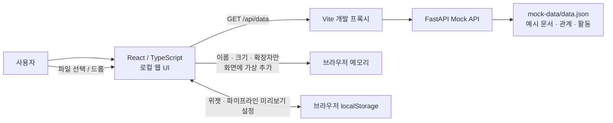
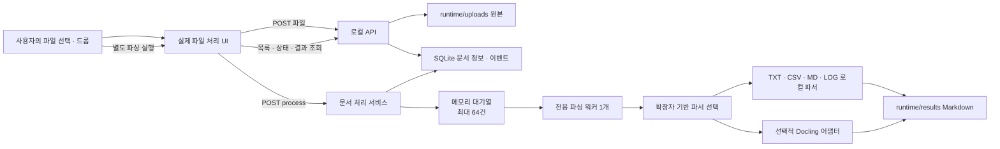
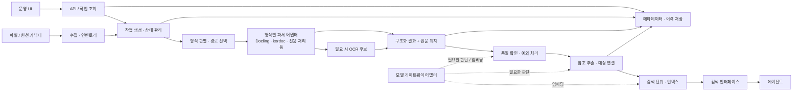

# Unstructured Review 아키텍처와 확장 계획

> 이 문서는 **현재 구현**, **구현 중**, **향후 설계 제안**을 구분한다. 대시보드·문서 탐색 등의 데이터는 예시이고, 별도의 **실제 파일 처리** 화면은 사용자가 선택한 파일을 로컬에 저장해 실제로 처리한다. 이 문서는 고객 환경의 실제 원천·확장자·처리 규모·제품 구성을 확정하지 않는다.

## 1. 목적과 설계 전제

Unstructured Review는 계속 추가되는 여러 원천의 다양한 파일에 대해, 수집 이후 처리 경로와 결과를 살펴보고 예외를 검토하는 내부 작업 공간을 목표로 한다. 검색과 에이전트가 활용할 수 있도록 원문 위치, 버전, 처리 이력, 문서 간 참조 근거를 추적하는 방향을 고려한다. **파싱 품질 자체도 핵심 목표**다. 표·문서번호·수치·단위와 원문 위치를 비교·평가할 수 있어야 한다.

- 원천 시스템과 파일 확장자 목록은 사전에 닫힌 집합이 아니다. 새로운 원천·형식은 발견·기록하고, 처리 경로가 없으면 별도 상태로 드러낸다.
- 문서 분류, 파일 형식 판별, 처리 경로 선택, 문서 참조 추출은 서로 다른 책임이다. 모든 판단에 LLM을 사용하지 않는다.
- 텍스트 PDF와 스캔 페이지, XLSX의 셀·수식·외부 참조, 압축·메일 첨부 등은 서로 다른 구조와 실패 유형을 가진다.
- 대상 환경의 OpenAI 호환 게이트웨이와 모델은 연결 확인까지만 구현했다. 용도별 인터페이스·인증·운영 제약은 환경에서 확인해야 한다.
- 로컬 Mock 수치와 화면 흐름은 실제 성능, 지원 범위, 모델·파서 연결 상태의 증거가 아니다.

## 2. 화면 정보 구조

| 영역 | 역할 | 현재 관찰 가능한 범위 |
|---|---|---|
| 운영 대시보드 | 상단 **처리 흐름**(모의 운영 엔진의 단계별 대기·처리·보류·실패, 주의 단계에서 파이프라인으로 바로 이동)과 샘플 문서 기반 형식 분포·예외·작업 목록 | 처리 흐름 수치는 브라우저 안 모의 운영 결과, 아래 위젯은 샘플 문서 집계. 둘 다 실측이 아님 |
| 문서 탐색 | 문서 목록, 필터, 상세, 가상 파일 추가, 관련 처리 경로 이동 | 파일 선택·드롭 시 이름·크기·확장자만 화면의 가상 목록에 추가. 콘텐츠는 읽거나 업로드하지 않음 |
| 실제 파일 처리 | 로컬 백엔드에 파일 저장, 사용자가 지정한 파싱 실행, 상태·결과 확인 | 실제 파일을 업로드해 로컬에 저장하고, 별도의 버튼으로 처리. Mock 목록과 분리 |
| 처리 파이프라인 | **운영 모드**: 전체 흐름과 형식별 하위 흐름 위에서 단계별 문서 흐름을 보고 일시정지·동시 처리 조정·우회·경로 고정·재시도·승인/반려·문서 이동으로 개입. **설계 모드**: draw.io형 캔버스에서 도형 추가·연결·연결 사이 삽입·삭제(앞뒤 자동 재연결)·자동 정렬·되돌리기 | 흐름 정의는 브라우저 저장값이고 운영 수치·개입은 브라우저 안 모의 엔진에만 적용. 실제 백엔드 라우팅·파서 실행과 무관 |
| 파싱 비교 | 예시 원문 및 파싱 결과를 대조 | 가상 텍스트 비교. 실제 원문 렌더링과 파서 실행 아님 |
| 문서 관계 | 문서 참조 목록과 관계도, 근거 위치 살펴보기 | 예시 관계 기반 탐색. 자동 관계 추출 아님 |
| 모델·게이트웨이 | 연결 대상과 역할을 정리하는 공간 | 미연결 상태 표시. 실제 API 호출·모델 등록 기능 없음 |

사이드바는 업무 영역, 상단 작업 탭은 탐색 중인 화면, 대시보드 내부 탭은 현황을 보는 관점을 구분한다. 로컬 설정과 실제 운영 설정은 분리해야 한다.

## 3. 현재 서비스 경계와 데이터 흐름

아래는 현재의 **Mock 경로**다. Mock 문서 탐색 화면에서는 파일을 선택해도 콘텐츠가 서버로 전달되지 않는다. **실제 파일 처리** 화면에서는 파일 선택·드롭 시 파일이 로컬 백엔드에 전송·저장되며, 이후 별도의 파싱 실행이 필요하다.

- 프론트의 Vite 개발 서버는 `/api`를 로컬 백엔드로 프록시한다. 백엔드는 예시 JSON과 별도의 실제 문서 API를 제공한다. Mock 응답이 실패하거나 지연되어도 앱 셸과 실제 파일 처리 탭에는 접근할 수 있으며, Mock 화면에 로딩·오류·재시도를 표시한다. 실제 파일 처리 API 자체가 실패하는 경우는 해당 화면에서 따로 표시한다.
- 가상 파일 항목은 UI 상태에 추가되며, 페이지 새로고침 후 유지되는 문서 저장소가 아니다.
- 위젯과 파이프라인 **미리보기 설정**은 브라우저 localStorage를 사용한다. 이는 백엔드 운영 설정이나 공유 정책이 아니다.
- Vite의 개발 프록시는 개발 편의 설정이다. 운영 배포 방식이나 외부 네트워크 접근이 가능한 구성을 확정한 것이 아니다.

### 실제 로컬 파일 경로

- 업로드와 파싱은 별개다. 업로드한 파일은 `runtime/uploads/`, 성공 결과는 `runtime/results/`, 문서 정보·상태·이력은 `runtime/documents.sqlite3`에 저장한다. `DOCOPS_RUNTIME_DIR`로 위치를 바꿀 수 있다. 런타임 데이터는 `.gitignore` 대상이다.
- 기본 텍스트 어댑터는 TXT·MD·LOG와 CSV를 처리하고 UTF-8 또는 CP949를 읽는다. 현재 제한은 파일 업로드 100 MiB, 텍스트 입력 10 MiB, CSV 10,000행·1,000열이다. 이는 프로토타입의 제한이며 운영 처리 한도가 아니다.
- PDF·DOCX·PPTX·XLSX는 선택적으로 설치한 Docling에 연결된다. Docling 2.150.0으로 합성 DOCX와 텍스트 PDF를 미리 준비한 로컬 모델 캐시를 사용해 오프라인으로 처리하는 것을 확인했다. PDF는 사전 준비된 모델이 필요하고 현재 **OCR은 꺼져 있다**. 따라서 일부 페이지만 스캔된 PDF는 변환이 완료되어도 해당 내용이 누락될 수 있다. 현재 페이지별 스캔 탐지 없이 모든 PDF 성공 결과의 `warnings`에 OCR 미적용·누락 가능성을 넣는다. 텍스트를 추출하지 못하는 파일은 실패할 수 있다. 이 경고나 제한된 합성 문서 검증은 실제 문서·복잡한 표·다른 형식의 품질이나 모든 파일의 성공을 보장하지 않는다. 설치·모델·원본 상태에 따라 실패할 수 있다.
- 지원 경로가 없는 확장자는 `unsupported`, 파서·입력 오류는 `failed`로 표시한다. 실제 형식 판별은 아직 확장자 중심이며 결과는 Markdown 텍스트다. 구조화된 페이지·시트·셀 위치의 완전한 보존, 문서 간 참조 추출, 검색 인덱싱은 아직 구현되지 않았다.
- 처리 요청은 **전용 워커 1개와 메모리 대기열**로 접수한다. 기본 구성에서 워커 1건과 대기 64건까지 가능하며, `processing`은 대기와 실제 파싱을 구분하지 않는다. 대기열이 차면 HTTP 503과 함께 거절 이력을 기록하고 해당 문서의 기존 상태를 유지한다. 동일 문서가 이미 `processing`이면 HTTP 409다. 이 대기열은 재시작 후 살아남는 내구성 작업 큐가 아니다.
- 정상 종료 시 새 요청을 막고 아직 시작하지 않은 대기 작업을 실패로 기록한다. 실행 중인 워커는 최대 5초 기다린다. 계속 실행 중이면 워커가 종료될 때까지 런타임 폴더 잠금을 유지하며, 프로세스가 먼저 종료되면 운영체제가 잠금을 해제한다. 다음 시작 시 남은 모든 `processing` 문서를 실패로 바꾸고 이력을 남긴다. 자동 재실행은 하지 않으며 사용자가 다시 요청해야 한다. 런타임 폴더 잠금은 같은 저장소를 사용하는 서버의 중복 실행을 방지한다.
- 성공 결과는 별도 파일과 파서 정보·경고로 기록한다. 재처리 중이나 실패·미지원 상태에서도 마지막 성공 결과는 보존되며 결과 API가 `is_stale: true`로 반환한다. 성공한 새 결과가 생기면 최신 결과 포인터가 갱신되고 `is_stale: false`가 된다. 성공 이력이 없으면 결과 조회는 HTTP 409다. 결과 파일 또는 메타데이터가 손상·누락된 경우도 409다. 현재 프론트 API 클라이언트는 오류 메시지로 이 경우와 성공 이력 부재를 구분한다. 메시지 변경에 취약하므로 안정적인 오류 코드가 필요하다.

### 현재 확인된 API

| 요청 | 의미 | 데이터 출처 |
|---|---|---|
| `GET /api/health` | 로컬 API 상태 | 고정 응답 |
| `GET /api/data` | 대시보드와 문서·관계 화면용 예시 데이터 | `mock-data/data.json` |
| `GET /api/live/documents` | 실제 로컬 문서 목록 | SQLite |
| `POST /api/live/documents` | 파일 1건을 로컬에 업로드 | 원본 파일 + SQLite |
| `GET /api/live/documents/{id}` | 실제 로컬 문서 상태 조회 | SQLite |
| `POST /api/live/documents/{id}/process` | 대기열에 접수하면 202·`processing` 반환. 중복 409, 대기열 만석·워커 불가 503 | 메모리 대기열 + SQLite 이력 |
| `GET /api/live/documents/{id}/result` | 마지막 성공 결과, 파서 정보, `is_stale`, `warnings` 조회. 성공 이력 없음 또는 결과를 읽을 수 없으면 409 | Markdown 산출물 + SQLite 메타데이터 |
| `GET /api/live/documents/{id}/history` | 문서 상태 변경 이력 조회 | SQLite |

Mock 모델과 로컬 API 상태명은 프로토타입 계약이다. 운영 계약에 고정하기 전에 응답 스키마, 오류, 버전 및 호환성 정책을 별도로 정해야 한다.

## 4. 코드 모듈 책임과 개선 지점

### 프론트엔드

| 파일 | 현재 책임 | 경계 개선 제안 |
|---|---|---|
| `frontend/src/main.tsx` | React 진입점과 스타일 로드 | 진입점은 조립만 유지 |
| `frontend/src/App.tsx` | 앱 셸, 내비게이션·작업 탭, Mock 데이터 로딩, 문서 선택과 가상 파일 추가, 모델 예시 화면 | 화면 조립, API 접근, 파일 시뮬레이션, 탐색 상태를 나눠 역할 집중. 데이터 읽기와 에러 처리의 단일 진입점 마련 |
| `frontend/src/Dashboard.tsx` | 예시 현황 집계, 차트·위젯, 브라우저 위젯 설정 | 순수 집계 함수와 저장/복원 로직을 UI에서 분리. 예시/실측 지표의 출처 명시 |
| `frontend/src/StructurePanel.tsx`, `ModelWorkspace.tsx` | 실제 문서 구조 분석 결과(계보 트리·링크 표·플래그·전체 요약), 모델 연결 상태와 확인 | 표시 전용. 분석·호출은 백엔드 |
| `frontend/src/LiveWorkspace.tsx` | 실제 로컬 업로드·처리 동작, 목록·결과 표시와 상태 폴링 | 화면/요청 상태를 더 명확히 분리하고 이전 결과와 경고의 표시 계약 유지 |
| `frontend/src/api/live.ts` | 실제 파일 API 요청, 응답 타입과 오류 처리. 결과 부재 409와 손상 409를 현재는 오류 메시지로 구분 | 메시지 의존을 없앨 안정적 오류 코드와 버전 정책 정의 |
| `frontend/src/DocumentBrowser.tsx` | Mock 문서 목록, 필터, 가상 파일 선택·드롭 | 목록 탐색과 실제 업로드 UI의 데이터 출처를 계속 명확하게 구분 |
| `frontend/src/DocumentDrawer.tsx` | Mock 문서의 정보·처리 내용·참조 상세 패널 | 상세 데이터 계약과 실제 처리 문서의 계약을 필요에 따라 별도 설계 |
| `frontend/src/CompareView.tsx`, `RelationsView.tsx` | Mock 원문·파싱 비교와 문서 참조 목록·관계도 | 실제 결과·원문 위치·관계 근거가 구현되면 계약에 맞춰 연동. 현재는 예시 화면 |
| `frontend/src/DocumentCommon.tsx`, `DocumentViews.tsx` | 공통 문서 아이콘·상태 표현, 뷰 컴포넌트의 호환 재내보내기 | 공통 표시 규칙과 안정적인 import 경로 유지 |
| `frontend/src/PipelineStudio.tsx` | 파이프라인 작업 공간 조립: 툴바·도형 팔레트·React Flow 캔버스·상세 패널·운영 기록·흐름 페이지 탭, 편집 이력과 단축키 | 실제 실행 규칙과 시각 편집 상태를 계속 구분 |
| `frontend/src/flow/flowTypes.ts`, `flowTemplates.ts`, `flowLayout.ts` | 흐름 그래프 타입, 기본 흐름(전체 + 형식별 7개)과 새 형식 흐름 생성, 라우팅 조건에서 형식→흐름 매핑 계산, dagre 자동 정렬, localStorage 로딩·검증·저장 | 실제 파서 라우팅과 연결하지 않음. 실제 구성 계약이 생기면 저장 경계를 백엔드로 옮김 |
| `frontend/src/flow/flowSim.ts` | 모의 운영 엔진: 하위 흐름을 펼친 실행 그래프, 유입·처리·실패·재시도·보류, 운영자 개입, 이벤트 기록 | 실제 작업 큐·워커 상태 API로 교체할 수 있도록 스냅숏·개입 메서드 형태를 유지 |
| `frontend/src/flow/FlowCanvasParts.tsx`, `FlowInspector.tsx`, `FlowDock.tsx`, `FormatPanel.tsx`, `LiveFlowPanel.tsx` | 노드·플로팅 연결선, 설계/운영 상세 패널과 검증, 이벤트·문서 추적, 형식과 경로, 대시보드 처리 흐름 | 표시 컴포넌트는 엔진·저장소에 직접 의존하지 않고 props로 받음 |
| `frontend/src/types.ts` | 화면이 사용하는 문서·관계 등 타입 | API DTO와 화면 표현 타입을 구분. ID, 처리 상태, 실제/예시 출처를 명시 |
| `app.css`, `dashboard.css`, `live.css`, `flow/flow.css`, `flow/liveFlow.css` | 앱 셸과 화면별 스타일 | 색·간격·타이포그래피 토큰과 컴포넌트 범위를 통일 |
| `frontend/src/__tests__/` | 프론트 상호작용 검증 | Mock 경로와 실제 연동 경로를 분리해 테스트하고, 원천 위치·참조·실패 등 의미 있는 행동을 검증 |

문서별 화면과 공통 표시 요소가 분리됐고, 파이프라인의 흐름 정의·저장은 `flow/flowTemplates.ts`, 모의 운영은 `flow/flowSim.ts`로 분리됐다. 일부 영역에는 여전히 화면 표시와 요청·상태 처리가 함께 있다. **캡슐화의 목표는 단순 파일 쪼개기가 아니라 API·도메인 규칙·UI의 변경 이유를 분리하는 것**이다. 전역 상태는 공유가 필요한 항목에 한정하고, 작업 탭에서 유지해야 할 필터·선택 상태와 페이지 종료 시 초기화할 상태를 명시적으로 구분한다.

### 백엔드

| 구성 | 현재 책임 | 향후 분리 후보 |
|---|---|---|
| `backend/main.py` | FastAPI 앱 조립, 초기화, Mock 응답과 라이브 라우터 연결 | 앱 설정·생명주기와 API 계약 관리 |
| `backend/app/routers/live.py`, `models.py` | 로컬 문서 API와 응답 모델 | 인증·인가, 페이징, 버전·오류 계약은 운영 요구에 맞춰 확장 |
| `backend/app/service.py`, `repository.py`, `config.py` | 업로드·단일 워커와 대기열·종료/복구, SQLite 상태·이력, 런타임 설정 | 서비스·저장소 경계를 유지하고 내구성 있는 작업 실행은 별도 설계 |
| `backend/app/structure.py`, `cfb.py` | 실제 파일 구조 분석: 시그니처 기반 형식 판별, 압축·메일·OLE/Office/HWP 내장 개체·PDF 첨부 펼치기, 링크·문서번호 후보, 암호화·DRM 의심·불일치·매크로 표시. `cfb.py`는 표준 라이브러리만 쓰는 OLE 복합 문서 읽기 | 링크 대상 해석(업로드 문서와 매칭)·순환 탐지, 형식 판별 결과를 파서 선택에 연결 |
| `backend/app/llm.py`, `routers/models.py`, `filelock.py` | `.env` 모델 연결과 연결 확인, OS 독립 실행 잠금 | 용도별 모델 어댑터, 비밀 관리 |
| `backend/app/adapters/` | 텍스트/CSV·선택적 Docling 파서와 확장자 기반 선택 | 실제 형식 판별, 위치가 있는 구조화 결과, 추가 파서와 OCR을 별도 어댑터로 확장 |
| `backend/app/middleware.py` | 로컬 API의 Origin 및 요청 크기 제한 | 인증·인가의 대체가 아님. 배포 경계와 운영 보안은 별도 설계 |
| `mock-data/data.json` | 가상 문서·참조·활동 예시 | 실제 운영 데이터와 별개로 유지하고 스키마 검증 |
| `.env.example` | 향후 게이트웨이 설정 이름 예시 | 서버 전용 설정 로딩과 비밀 관리. 실제 값은 저장소에 넣지 않음 |

정확한 모듈·클래스 명칭보다 서비스 경계가 중요하다. 파서 호출, 문서 저장, 모델 호출, 검색 인덱스는 서로 교체 가능한 어댑터 뒤에 두고, API나 화면에서 특정 엔진의 내부 구현을 직접 호출하지 않는 방향을 권장한다.

## 5. 향후 목표 구조 — 제안, 미구현

그림은 책임을 설명하는 목표 구조이며 실제 프로세스 수, 제품 배치, 저장 위치, 작업 순서를 확정하지 않는다. 예를 들어 OCR은 페이지 상태에 따라 파싱 경로 안에서 실행될 수도 있다.

### 책임과 확장 포인트

1. **수집·인벤토리:** 원천 식별자, 파일의 실제 형식, 크기, 시간, 버전, 권한 등 확보 가능한 메타데이터를 기록한다. 새 원천은 커넥터를 통해 추가한다. ZIP·메일 첨부는 부모 문서와 내부 항목의 관계를 보존한다.
2. **판별과 라우팅:** 파일 확장자와 실제 형식이 다를 수 있으므로 단순 확장자만으로 지원 여부를 단정하지 않는다. 규칙 기반을 기본으로 하고 미지정·불확실 상태를 둔다. 조건과 우선순위, 엔진 버전, 실패 사유를 기록할 수 있어야 한다.
3. **파서와 OCR:** 형식별 어댑터가 공통 결과를 반환하도록 한다. Docling, kordoc, OCR 후보를 실제 문서로 비교한다. 텍스트 기반 문서의 추출, 페이지별 OCR, 표 구조 복원은 구분한다. 외부 문서 참조나 셀 주소 같은 형식 고유 정보도 보존한다.
4. **품질과 예외:** 파싱 성공과 품질 확보는 다른 상태다. 표, 숫자·단위, 한국어 인식, 읽기 순서, 좌표·페이지·시트 위치, 손상·암호·미지원 여부를 대표 샘플로 검증한다. 오류·검토·재처리의 이력을 관리한다.
5. **문서 관계:** 관계마다 출발 문서 ID와 버전·위치, 원문 근거, 추출 방법, 대상 후보 및 연결 상태를 가진다. 명시적 하이퍼링크, 문서번호 규칙, 모델 추정은 근거 유형을 구분한다. 후보 모호성과 대상 미발견을 정상 상태로 표현한다.
6. **모델 게이트웨이:** Base URL·인증·모델 ID는 백엔드 설정에서 관리한다. 텍스트 생성, 시각 모델, 임베딩, 빠른 의사결정 모델은 기능과 API가 서로 다를 수 있어 호출 어댑터와 계약을 구분한다. 권한·호환성·사용 가능한 모델은 환경에서 확인해야 한다.
7. **검색과 에이전트:** 검색 단위에는 원문 참조, 버전, 권한 및 처리 결과의 출처를 연계한다. 임베딩과 인덱스의 모델·버전·스키마를 기록한다. 수정·삭제·권한 변경의 반영 경로는 실제 원천과 검색 시스템이 정해진 후 설계·검증한다.

### 데이터 계약의 최소 후보 — 제안

- **문서:** 내부 식별자, 원천 및 원천 내 식별자, 버전, 파일명, 발견 형식, 접근 권한, 생성·변경 시각, 처리 상태.
- **작업과 단계:** 문서 버전, 작업 ID, 단계·상태, 입력/출력, 시각, 오류, 사용한 구성과 파서·모델 버전.
- **파싱 결과:** 구조화된 본문·표, 추출 위치(페이지·시트·셀 등), 원문 버전, 경고 및 품질 검토 상태.
- **문서 참조:** 출발 문서와 위치, 근거 텍스트·추출 방법, 대상 후보/버전, 연결 상태, 검토 이력.
- **검색 결과:** 문서·검색 단위 ID, 원문 위치와 버전, 점수의 의미, 접근 가능 여부. 점수·권한 전달 방식은 실제 연동 요구사항에 맞춰 확정한다.

파일 형식이나 문서가 늘어나도 UI 수정만으로 새 유형을 지원한다고 주장하면 안 된다. 실제 지원은 추출 어댑터와 테스트 결과로 확인해야 한다.

## 6. API 경계 — 미래 제안

`/api/data`는 Mock 전체 묶음 응답이고 `/api/live/documents`는 별도 로컬 문서 API다. 실제 사용자·운영 작업 큐·관계·검색 시스템을 연결할 때는 문서, 작업, 파싱 결과, 관계, 검색의 계약을 더 분리할 수 있다. 예를 들어 문서 목록·상세, 문서 등록, 작업 및 단계 상태, 파싱 결과·참조 조회 등의 계약이 필요하다. **위 표에 없는 추가 운영 API의 경로와 요청·응답 형식은 제안 단계이며, 존재하지 않는 엔드포인트를 클라이언트가 호출해서는 안 된다.**

실제 계약을 정할 때는 대용량 목록의 페이지네이션과 필터, 비동기 작업 ID, 단계 상태, 오류와 재시도, 정렬 기준, 인증·인가, API 버전, 변경·삭제 전파를 함께 정의한다. 특히 현재 결과 조회의 409는 오류 메시지 문자열로 원인을 구분하므로 안정적인 오류 코드 도입이 필요하다. 초기 Mock 응답은 실 데이터와 출처를 섞지 않고 명시적으로 구분한다.

## 7. 위험과 의존성

| 항목 | 주의할 점과 선결 조건 |
|---|---|
| 데이터 보안 | 원본, 파싱 결과, 파일명, 경로, 로그에도 민감 정보가 있을 수 있다. 실제 파일·API 키·추출 결과는 승인된 위치에 보관하고 Git에 올리지 않는다. |
| 접근 제어 | Mock과 실제 로컬 API에는 사용자 인증·문서별 권한 구현이 없다. Origin 검사나 로컬 바인딩은 인증의 대체가 아니다. 공유 배포 전에는 시스템의 인증·인가와 원천 권한 반영 방식을 별도 설계한다. |
| 파일 처리 | 손상·암호·압축 중첩·대용량·매크로·첨부파일은 별도 실패 정책이 필요하다. 매크로 실행은 문서 읽기와 구분한다. |
| 저장·삭제 | Mock 파일 시뮬레이션은 메모리, 실제 업로드 원본·결과·이력은 로컬 디스크에 남는다. 현재 문서 삭제 API·화면은 없다. 보존 기간과 안전한 정리, 수정·삭제 전파를 설계해야 한다. |
| 파서 품질 | ‘파일 지원’이 표·숫자·셀·페이지 정보를 정확히 보존한다는 뜻은 아니다. 샘플의 원문과 결과를 비교하고 오류 유형을 기록해야 한다. |
| 모델 | 게이트웨이의 허용 모델·프로토콜·반입·자원·권한은 미확인이다. 파서와 모델을 독립적으로 교체·평가하고, 모델 출력의 불확실성과 버전도 기록한다. |
| 작업 운영 | 규모·형식 분포와 피크 부하가 미확정이다. 큐·동시성·재처리·중복 제거·관측 지표는 실제 환경과 측정에 맞춰 결정한다. |
| 문서 관계 | 외부 경로나 이름만으로 대상이 일치한다고 확정할 수 없다. 버전 충돌과 동명이문서, 다중 후보, 대상 부재를 처리해야 한다. |
| 의존성·배포 | Python/Node 버전, 파서별 라이선스와 설치물, 오프라인 모델, 시스템 패키지, 운영 네트워크 및 반입 절차를 확인해야 한다. |
| 브라우저 저장 | localStorage는 브라우저별 설정일 뿐 백업이나 공유·감사 저장소가 아니다. 스키마 변경 시 오래된 설정 처리와 저장 실패 경험도 필요하다. |

## 8. 다음 우선순위

1. **현재 기능과 Mock/실제의 경계 명시:** 문서 등록·작업·결과가 실제로 어디까지 처리되는지 응답과 화면에 동일하게 반영하고, 실제 처리되지 않은 값을 성공처럼 표현하지 않는다.
2. **프론트 경계 정리:** 분리된 문서 화면과 파이프라인 모델을 유지하면서 API 클라이언트, 데이터·상태 타입, 탐색 상태, 대시보드 집계를 적절한 단위로 정리한다. 열린 탭의 선택·필터 유지 정책을 명확히 한다.
3. **백엔드 계약과 저장 경계:** 로컬 파일·SQLite 기반 경로를 작은 파일·실패 파일·알 수 없는 형식으로 검증하고, 삭제·보존·원천 버전 및 권한을 운영 요구에 맞게 확장한다.
4. **대표 문서에 대한 파싱 평가:** PDF·시트·스캔 및 관계 참조를 포함한 평가용 샘플을 준비하고 Docling·kordoc·OCR 후보의 결과와 처리 비용을 비교한다. 실제 고객 문서는 사용 권한과 보관 위치가 확보된 뒤 다룬다.
5. **문서 관계·검색 연계:** 명시적 참조와 후보를 위치·버전과 함께 저장하고, 검색 결과가 근거로 돌아갈 수 있는지 평가한다. 전체 검색·에이전트 연동은 요구 인터페이스와 권한 기준이 정해지면 진행한다.
6. **운영 전환:** 실제 부하·실패를 바탕으로 재처리, 모니터링, 로그·감사, 권한, 배포·백업과 삭제 전파를 보완한다.
