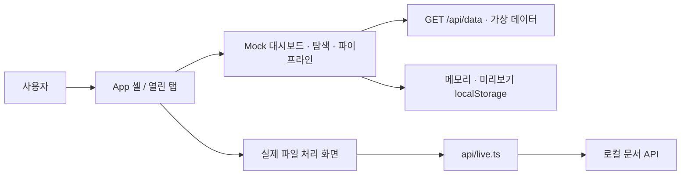

# 프론트엔드 화면·상호작용 계약

> 2026-11-12 코드 기준. 이 문서는 현재 구현과 유지해야 할 사용자 경험을 설명한다. UI 구조는 고객 확정 요구사항이나 실제 운영 기능의 완성을 뜻하지 않는다. API와 처리 규칙은 [API·데이터 계약](API_AND_DATA_CONTRACT.md), 전체 경계는 [아키텍처](ARCHITECTURE.md)를 함께 확인한다.

## 1. 목적과 경계

사용자는 문서 처리 과정과 예외를 파악하고, 파일 형식별 흐름과 파싱 품질을 비교할 수 있는 **정보 밀도가 있는 내부 운영 도구**를 원한다. 원천과 파일 형식은 계속 늘어날 수 있으며, 목록을 미리 확정할 수 없다. 시각적으로 정돈된 품질, 충분한 가독성, 탐색 가능성, 드래그와 접기·숨기기 같은 직접 조작을 중요하게 여긴다.

이 앱에는 명시적으로 분리된 두 경험이 있다.

| 경험 | 데이터와 조작 | 실제 영향 |
|---|---|---|
| Mock 워크스페이스 | `/api/data`의 가상 문서·관계, 브라우저 내 위젯과 파이프라인 설정 | 대시보드·파이프라인·파싱 비교·관계도는 예시. 가상 파일 추가는 이름·확장자·크기만 메모리에 반영하고 파일 내용을 읽거나 서버에 전송하지 않음 |
| 실제 파일 처리 | `/api/live/documents` 기반 로컬 업로드·실행·상태·결과 | 파일 선택/드롭 즉시 서버의 로컬 저장소에 실제 원본 저장. 파싱은 별도 버튼으로 시작 |

이 둘의 수치·파일·설정은 공유되지 않는다. Mock의 `Docling + OCR`, 완료 상태, 시간, 참조 관계는 실측 결과가 아니다. Mock 데이터 로딩이 실패해도 사이드바와 실제 파일 처리 화면에 접근할 수 있다. 실제 API 자체의 장애는 실제 화면에서 별도로 나타난다.

## 2. 화면과 파일 책임

| 영역 | 사용자에게 보이는 기능 | 주요 코드 |
|---|---|---|
| 앱 셸 | 사이드바 축소 및 그룹 접기, 열린 작업 탭 열기·전환·닫기, 예시 파일 선택 | `frontend/src/App.tsx` |
| 운영 대시보드 | 운영 현황 탭 상단의 처리 흐름(모의 운영 단계 열·지표·주의 단계 → 파이프라인 해당 단계로 이동), 샘플 문서 기반 운영 현황·형식 분석·품질/예외 탭 | `Dashboard.tsx`, `flow/LiveFlowPanel.tsx`, `dashboard.css`, `flow/liveFlow.css` |
| 문서 탐색 | 검색, 상태·형식·원천 필터, 가상 파일 추가, 문서 상세와 선택 형식의 파이프라인 이동 | `DocumentBrowser.tsx`, `DocumentDrawer.tsx`, `DocumentCommon.tsx` |
| 처리 파이프라인 | 운영/설계 모드 전환, 전체 흐름과 형식별 하위 흐름 페이지, 형식과 경로(19종 출처·로컬 관찰·직접 추가·경로 만들기), 운영 개입, draw.io형 편집 | `PipelineStudio.tsx`, `flow/*` |
| 파싱 비교 | 가상 원문·기준 결과·비교 결과, 원문/비교안 숨기기, 단순 줄 차이 강조 | `CompareView.tsx` |
| 문서 관계 | 예시 참조의 관계도·목록과 출발 위치 및 근거 표시 | `RelationsView.tsx` |
| 모델·게이트웨이 | 미연결 상태의 설정 자리 | `App.tsx`의 `ModelWorkspace`; 실제 호출·등록 없음 |
| 실제 파일 처리 | 업로드, 상태 목록/상세, 명시적 실행, 텍스트 결과·오류·경고 | `LiveWorkspace.tsx`, `live.css`, `api/live.ts` |

`DocumentViews.tsx`는 문서 관련 화면을 재내보내는 호환 경계다. `types.ts`는 Mock에 사용되는 화면 데이터 타입이며, 실제 처리 DTO는 `api/live.ts`에 별도로 정의돼 있다.

## 3. 작업 탭과 상태의 수명

- 사이드바에서 화면을 열면 상단 작업 탭에 추가한다. 운영 대시보드는 고정 탭이다. 열린 Mock 화면은 활성 탭이 아니어도 마운트를 유지해 탭을 왕복할 때 하위 선택·접기 상태를 유지한다.
- 닫은 작업 탭의 컴포넌트 상태는 사라진다. 다른 문서에서 특정 확장자 파이프라인을 열면 해당 형식으로 전환하기 위해 파이프라인 컴포넌트가 다시 만들어질 수 있다.
- 실제 파일 처리 화면은 활성 탭일 때만 마운트된다. 탭을 벗어나면 화면 내 검색·선택 등 임시 상태는 초기화될 수 있고, 돌아오면 실제 목록을 다시 읽는다. 실제 파일·작업은 서버에 남는다.
- **여러 파일의 업로드 중 탭 이동은 현재 주의가 필요하다.** 프론트는 파일을 순차 전송하는데, 실제 화면을 벗어나 컴포넌트가 해제된 뒤 진행 중인 요청이 성공하면 이후 파일 전송이 중단될 수 있고, 실패 경로에서는 후속 요청이 계속될 수도 있다. 이미 요청한 파일이 서버에 저장됐을 수 있으므로 돌아와 실제 목록을 확인해야 한다. 일괄 업로드의 지속·취소·재개 및 부분 성공 표시는 아직 해결 과제다.
- 예시 파일 추가 목록, 열린 탭, 문서 선택·필터 등은 브라우저 메모리 기반이다. 새로고침 후 저장되는 문서 인벤토리가 아니다.
- 대시보드 위젯의 순서·숨김·접기 설정은 브라우저 `localStorage`의 `document-ops-dashboard-layout-v1`에 보관한다. 파이프라인 흐름 정의(노드·연결·위치·방향)는 `document-ops:flows:v2`, 직접 추가한 형식은 `document-ops:manual-formats:v1`에 보관한다. 이전 `document-ops:pipeline-preview:v1`·캔버스 배치 키는 더 이상 읽지 않는다. 모의 운영 상태(문서·개입·이벤트)는 메모리에만 있고 새로고침하면 초기화된다. 모의 엔진은 앱에서 하나를 만들어 대시보드와 파이프라인이 함께 쓰며, 둘 중 하나가 보이는 동안만 시간이 흐른다. 브라우저 저장에 실패해도 해당 세션의 화면은 동작하도록 처리한다. 이 값들은 서버 설정이나 감사 이력이 아니다.

## 4. 직접 조작과 접근성

- 대시보드의 **위젯 편집**에서 위젯을 숨기거나 복원할 수 있고, 핸들 드래그와 위/아래 버튼으로 순서를 바꾼다. 위젯은 개별 접기·펼치기를 지원한다.
- 파이프라인 **설계 모드**: 왼쪽 팔레트 도형을 끌어 놓거나 눌러 추가(기존 노드와 겹치지 않는 자리), 노드 가장자리 점을 끌어 대상 도형 위에 놓으면 연결, 연결선의 + 또는 상세 패널로 연결 사이에 단계 삽입(뒤쪽 노드를 밀어 자리 확보), 연결선 위에 도형을 놓아도 삽입, 앞뒤가 하나씩인 노드를 지우면 앞뒤를 다시 연결, 더블클릭 이름 수정, ⌘Z/⇧⌘Z·⌘D·Delete, 방향키 이동, 세로·가로 자동 정렬, JSON 내보내기·가져오기, 검증(시작 없음·연결 끊김·분기 부족·하위 흐름 미지정).
- 파이프라인 **운영 모드**: 노드를 선택하면 상세 패널에서 일시정지·재개, 동시 처리 수, 우회, 조건 분기 경로 고정, 실패 재시도, 보류 승인·반려, 다른 단계나 흐름으로 문서 이동, 문서별 우선 처리·건너뛰기·제외를 할 수 있다. 하위 흐름 노드는 더블클릭이나 열기 버튼으로 들어간다. 아래쪽 운영 기록에서 이벤트와 문서 위치를 추적한다. 이 조작은 **브라우저 안 모의 엔진에만 적용되고 실제 백엔드의 실행 순서·어댑터·파일을 바꾸지 않는다.**
- 예시 파일 드롭 영역과 실제 업로드 영역은 별개다. 실제 화면에는 로컬에 파일이 저장됨을 안내한다. 파일 선택 버튼은 드래그의 대안이다.
- 문서 상세는 대화상자로 열리고 닫기·Escape 및 키보드 포커스 처리를 제공한다. 관계도의 노드는 키보드로 선택할 수 있다.
- 화면은 좁은 폭에서 사이드바/카드가 재배치되며, 가로가 긴 표·관계도는 스크롤될 수 있다. 새 UI 작업 때 데스크톱과 모바일에서 조작 크기, 줄바꿈, 수평 스크롤 및 대비를 확인한다.

버튼이 실제로 수행하지 않는 동작을 성공처럼 표시해서는 안 된다. 모델 연결, 문서 삭제, 실제 참조 추출·인덱싱은 현재 해당 동작을 실행하지 않는다.

## 5. 실제 문서 상태와 결과 표시

`LiveWorkspace.tsx`는 목록을 읽고, 처리 중인 문서가 있으면 2초 간격으로 상태를 확인한다. 최대 120회 확인 후 자동 확인을 중단하며 사용자는 수동 새로고침할 수 있다. `processing`은 **실행 중 또는 전용 워커 대기 중**을 포함한다.

- 업로드된 원본을 선택하면 문서명·크기·상태·파서와 오류를 표시한다. 업로드와 처리 요청은 별개다.
- 마지막 성공 결과가 있다면 현재 작업이 진행 중이거나 실패해도 읽을 수 있고, `is_stale: true`인 경우 **이전 성공 결과이며 현재 작업 결과가 아님**을 표시한다.
- `warnings`는 화면에 보인다. PDF OCR 경고는 스캔 페이지를 감지했다는 뜻이 아니라, 모든 PDF에 적용되는 누락 가능성 경고다.
- 결과 API 409 중 `완료된 파싱 결과가 없습니다.`는 정상적인 결과 없음으로 취급한다. 다른 409(결과 파일·메타데이터 문제 등)는 오류로 표시한다. 현재 이 구분은 메시지 문구에 의존하므로 API 오류 코드 계약이 도입되면 `api/live.ts`와 서버·테스트를 함께 바꾼다.
- 서버의 결과 Markdown은 현재 서식을 실행하지 않는 텍스트로 표시한다. 실제 문서 내용을 신뢰할 수 있는 HTML로 간주하지 않는다.

## 6. 데이터를 연결할 때 지켜야 할 경계

실제 데이터를 대시보드에 연결하는 작업은 별도 설계다. 출처·시점·집계 범위, 실제 상태 모델, 파일 형식 표시와 사용자 권한을 정하고, 예시 수치를 실제처럼 섞지 않는다. 파이프라인 화면에서 실제 구성을 편집하게 될 때도 `pipelineModel.ts`의 Mock 저장값을 실제 정책으로 암묵적으로 취급해서는 안 된다.

## 7. 검증과 변경 시 체크

`frontend/src/__tests__/workspace.test.tsx`와 `live.test.tsx`는 위젯·문서 필터·드롭·작업 탭·Mock 장애와 Live 독립성·업로드/실행·결과 경고·오류 및 응답 경합 등을 검증한다. 실제 UI를 바꿀 때는 다음을 확인한다.

1. Mock 드롭이 파일 내용을 전송하지 않고, 실제 드롭은 저장 전 화면상 의미가 분명한가?
2. 차트와 예외 집계 클릭이 같은 범위의 문서 필터로 연결되는가?
3. 탭을 왕복하거나 닫을 때 남는 상태와 사라지는 상태가 사용자에게 자연스러운가?
4. 마우스 없이 단계와 위젯 순서를 바꾸고 상세를 닫을 수 있는가?
5. 재처리 중/실패 후 결과가 오래된 것인지, PDF가 OCR 미적용인지 표시되는가?
6. 작은 화면에서 문서명·상태·오류·조작 영역이 잘리거나 겹치지 않는가?
7. 변경 후 `npm test`, `npm run build`를 실행하고, 시각 관련 변경은 가능한 환경에서 직접 화면을 확인했는가?
