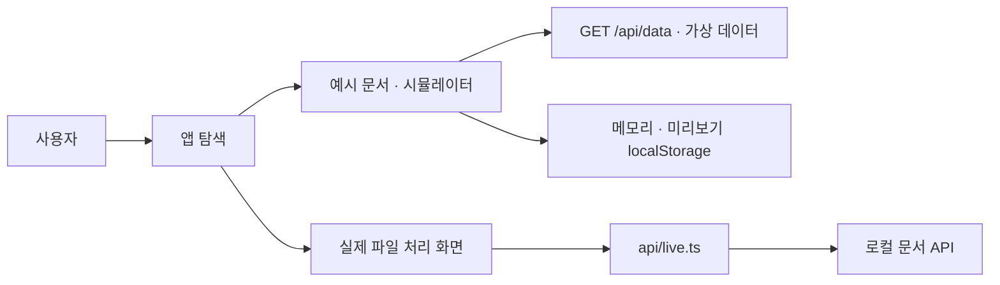

# 프론트엔드 화면·상호작용 계약

> 2026-11-24 에이전트 작업 화면, 문서 번호(D번호) 표시·검색, OCR 모델 연결 카드, 이미지의 '글자 없음' 상태 반영. 2026-11-23 파서 플로우와 청킹 비교의 주 메뉴 승격 반영. 이 문서는 현재 구현과 유지해야 할 사용자 경험을 설명한다. UI 구조는 고객 확정 요구사항이나 실제 운영 기능의 완성을 뜻하지 않는다. API와 처리 규칙은 [API·데이터 계약](API_AND_DATA_CONTRACT.md), 전체 경계는 [아키텍처](ARCHITECTURE.md)를 함께 확인한다.

## 1. 목적과 경계

사용자는 문서 처리 과정과 예외를 파악하고, 파일 형식별 흐름과 파싱 품질을 비교할 수 있는 **정보 밀도가 있는 내부 운영 도구**를 원한다. 원천과 파일 형식은 계속 늘어날 수 있으며, 목록을 미리 확정할 수 없다. 시각적으로 정돈된 품질, 충분한 가독성, 탐색 가능성, 드래그와 접기·숨기기 같은 직접 조작을 중요하게 여긴다.

이 앱에는 명시적으로 분리된 두 경험이 있다.

| 경험 | 데이터와 조작 | 실제 영향 |
|---|---|---|
| 예시 둘러보기 | 준비된 가상 문서·관계 | 예시 처리 현황·문서 탐색·원문 검수를 제공한다. 파서 플로우에서 여는 모의 설계도 브라우저에서만 동작한다. |
| 실제 문서함 | 파일 추가, 허용 폴더에서 가져오기, 진행 상태, 실패 파일만 재시도, 처리 상태별 상세, 원문과 대조, 처리 이력, 구조·참조와 문서군 이동 | `LiveWorkspace.tsx`, `FolderImport.tsx`, `LiveDocumentView.tsx`, `StructurePanel.tsx`, `api/live.ts` |

실제 문서 쪽에는 **에이전트 작업** 화면도 있다. 작업 에이전트(OpenCode 등)가 MCP·CLI 작업 도구로 남긴 서버 기록(`runtime/agent/`)을 사람이 읽기만 하며 검증한다. 화면에서 에이전트에게 일을 시키거나 기록을 고치지 않는다.

이 둘의 수치·파일·설정은 공유되지 않는다. Mock의 `Docling + OCR`, 완료 상태, 시간, 참조 관계는 실측 결과가 아니다. Mock 데이터 로딩이 실패해도 사이드바와 실제 파일 처리 화면에 접근할 수 있다. 실제 API 자체의 장애는 실제 화면에서 별도로 나타난다.

## 1-1. 화면 설계 원칙 (2026-11-17)

화면은 사람이 함께 보며 이야기하는 용도다. 한 화면에 모든 정보를 넣지 않고, 아래 원칙과 공통 부품(`frontend/src/ui/`)으로 나눈다.

| 원칙 | 이 콘솔에서 지키는 방식 |
|---|---|
| 개요 → 걸러 보기 → 세부는 요청할 때 | 첫 화면은 실제 파일 목록이다. 오래 읽는 문서와 검수는 독립 주소로 열고 짧은 설정은 대화상자에서 편집한다. |
| 선택지는 적게 (Hick) | 첫 화면의 버튼·필터는 핵심만. 나머지 설정은 팝업이나 탭 뒤로. |
| 한 묶음 7±2 (Miller) | 열·칩·항목이 많으면 탭(`Tabs`)이나 목록(`ListBox`)으로 나눈다. |
| 익숙한 패턴 (Jakob) | 새 시각화보다 탭, 리스트 박스, 표, 팝업, 목록 + 상세(마스터-디테일)를 먼저 쓴다. |
| 강조는 한 곳 (Von Restorff) | 색은 의미(요소 종류·문제)에만. 한 화면에서 튀는 것은 이상치 하나. |
| 간격으로 묶기 (Gestalt) | 테두리·카드 반복 대신 간격과 정렬로 묶는다. 숫자는 오른쪽 정렬, 같은 자릿수. |
| 상태는 늘 보이게 (Nielsen) | 예시 데이터·이전 결과·연결 없음은 한 번만, 짧게 표시. 같은 안내를 두 번 띄우지 않는다. |
| hover는 보충만 | 툴팁에는 그 자리에 보이지 않는 정보만. 머리·이름처럼 이미 보이는 글자에는 hover를 달지 않는다. |
| 툴팁은 하나로 | 아이콘만 있는 버튼·접힌 메뉴는 `title` 대신 `data-tip`(+`data-tip-key` 단축키, `data-tip-side` 방향)을 단다. 앱에 한 번 둔 `TooltipLayer`가 마우스 400ms·키보드 초점에서 띄우고, 한 번 뜬 뒤 옆 버튼은 바로 옮겨 간다. 비활성 버튼도 이유를 띄운다(예: 되돌릴 변경 없음). 말줄임으로 잘리는 이름은 `data-tip-overflow`를 더해 잘렸을 때만 전체를 띄운다. 문서 계보·벡터 DB의 풍부한 설명 레이어는 그대로 두고, 그 안에 `data-tip`을 겹쳐 달지 않는다. |
| 드물게 쓰는 같은 종류 동작은 묶기 | 세로·가로 정렬처럼 자주 쓰지 않는 선택지는 `HoverMenu` 버튼 하나 뒤로 모은다. 마우스를 올리면 열리고, 누르면 고정, ↓·Enter로도 연다. 현재 값에 체크를 단다. |
| 모션은 짧고 같은 곡선 | 호버 120ms, 메뉴·툴팁 140ms, 패널·사이드바 240ms, 곡선은 `--ease-out`. 열고 닫히는 패널은 `usePresence`로 닫힐 때도 같은 길로 빠진다. 새로 붙는 알림·펼친 `details`·탭 내용은 짧게 떠오르고(`ui-enter`·`ui-fade`), 버튼은 누를 때 살짝 들어간다. 모션 감소 설정이면 모두 끈다. |
| 토큰 | 간격 4·8 배수, 글자 12·13·14·16·20·24, 본문 대비 4.5:1 이상. 값은 `ui/ui.css`. |

팝업은 Escape·바깥 클릭·X로 닫고, 닫으면 연 자리로 초점이 돌아온다. 팝업 안에서도 탭과 목록 + 상세로 나눈다.

## 2. 화면과 파일 책임

| 영역 | 사용자에게 보이는 기능 | 주요 코드 |
|---|---|---|
| 공통 화면 부품 | 팝업(`Modal`), 탭(`Tabs`), 선택 버튼 묶음(`Segmented`), 리스트 박스(`ListBox`), 툴팁(`TooltipLayer`·`data-tip`), 호버 메뉴(`HoverMenu`), 열림·닫힘 전환(`usePresence`), 목록 + 상세 배치, 간격·글자·색·모션 토큰 | `ui/*`, `ui/ui.css` |
| 앱 셸 | 문서함·에이전트 작업·파서 플로우·청킹 비교·분석 도구·설정, 하단 예시 둘러보기, 모바일 메뉴, 화면 찾기(⌘K / Ctrl+K), 현재 위치와 데이터 출처 | `App.tsx`, `navigation.ts`, `WorkspaceFinder.tsx`, `shell.css` |
| 예시 처리 현황 | 실패·형식 확인·검토가 필요한 예시 문서 목록, 해당 상세와 같은 조건의 목록으로 이동 | `Dashboard.tsx` |
| 예시 문서 | 다중 검색어, 상태·형식·원천 필터, 상세의 정보·처리 이력·참조 탭과 연결 문서 탐색 | `DocumentBrowser.tsx`, `DocumentDrawer.tsx`, `documents.css` |
| 파서 플로우 | 실제 파서 레지스트리의 형식별 경로, 로컬 모델 환경, 같은 형식의 문서와 실패·미지원 필터, 문서별 파싱 실행·재시도, 모의 경로 설계 진입 | `ParserWorkspace.tsx`, `parserWorkspace.css`, `api/live.ts` |
| 모의 플로우 | 운영/설계 모드 전환, 흐름도·단계 목록, 전체 흐름과 형식별 하위 흐름, 형식과 경로 검색, 운영 개입, 캔버스 편집 | `PipelineStudio.tsx`, `flow/*` |
| 결과 검수 | 원문 대조에서 선택 실행의 본문과 실제 원본을 읽는다. 실행 비교에서 이전·현재 성공본의 변경 구간, 수치·단위와 표·문서번호 차이를 확인한다. 변화 지표와 정답 대조는 보조 도구로 펼친다. 예시에서도 같은 검수 화면을 쓴다. | `compare/ReviewDesk.tsx`, `compare/LiveCompare.tsx`, `CompareView.tsx` |
| 문서 계보 | 실제 파일 / 예시 데이터 전환. 문서군 목록과 선택 문서군의 판(최신 판단)·포함 트리·참조(나가는/들어오는) 또는 관계 그래프. 요약은 접힘, hover 툴팁·관련 항목 강조, 클릭하면 오른쪽 상세에 고정(X·Escape) | `LineageView.tsx`, `lineage/*`, `lineage.css`, `api/lineage.ts` |
| 벡터 DB | 컬렉션·파티션·청크 본문과 스키마·인덱스를 읽는다. Milvus 조회 실패와 연결 일시 중지를 표시하고 재시도 또는 예시로 이동할 수 있다. 청크 내용은 선택해서 연다. | `VectorDbWorkspace.tsx`, `vectordb/*`, `api/vectordb.ts` |
| 청킹 벤치 | 원문(예시 3종·실제 문서) 선택과 요소 구성 막대. 탭 **전략 비교**(전략별 청크 수·길이·표 보존·그림·캡션·머리말 제거·한도 초과 표)와 **원문 구성**(요소 목록 + 미리보기·전략별 결과). 행을 누르면 팝업에서 청크 목록 + 상세, 문서 위 청크, 설정. 비교할 전략은 첫 화면의 카드로 켜고 끄며, 카드에 마우스를 올리면 나오는 연필이나 비교 표의 연필로 그 전략을 편집한다. 전략 설정 팝업은 방식 카드(요소 인지·의미 기반·기준선), 자주 쓰는 크기·겹침 버튼 + 직접 입력, 접어 둔 표·그림·머리말 처리, 전략 동시 실행 수로 이뤄진다. 의미 기반 전략은 임베딩 모델·나누는 빈도·최소 크기만 고르고, 캐시에 없는 문장 임베딩은 '임베딩 계산하고 나누기'를 눌러야 계산한다(자동 재계산에서는 모델을 부르지 않는다). 원문 선택·토큰 실측은 팝업 | `ChunkBench.tsx`, `retrieval/chunk-*`, `retrieval/shared.tsx`, `retrieval/elements.ts`, `retrieval.css`, `api/retrieval.ts` |
| 임베딩 평가 | 평가 조건 한 창에서 문서·청킹·질문·모델을 편집한다. 적용하면 설정을 저장하고 평가 실행은 별도로 요청한다. 모델별 입력 한도와 정확도, 최고·미측정, 이전 조건과 질문별 결과를 표시한다. 모델 이름에서 한 모델을 상단에 고정할 수 있다. | `EmbeddingEval.tsx`, `retrieval/EvalConditions.tsx`, `retrieval/eval-*`, `api/retrieval.ts` |
| 검색 설계 참고 | 검색 단계·설계 결정과 API 초안을 필요할 때 펼쳐 읽는다. | `SearchPipeline.tsx` |
| 모델 연결 | 탭 **생성 모델**(기본·보조 연결), **임베딩 모델**, **OCR 모델**. 카드마다 주소·모델·키 설정 여부와 출처(화면에서 저장 / .env), 연결 확인, 모델 목록. **설정 편집** 팝업에서 입력한 값으로 저장 전 확인, 게이트웨이 모델 목록에서 골라 넣기, 저장·`.env` 값으로 되돌리기. API 키는 다시 보여 주지 않고 비워 두면 유지. OCR 카드는 아래 5-1 | `ModelWorkspace.tsx`, `api/models.ts`, `modelWorkspace.css` |
| 실제 문서함 | 파일 추가, 허용 폴더에서 가져오기(§5-3), 진행 상태, 실패 파일만 재시도, 처리 상태별 상세, 원문과 대조, 처리 이력, 구조·참조와 문서군 이동. 목록 행과 상세 머리에 문서 번호(`D12`) | `LiveWorkspace.tsx`, `FolderImport.tsx`, `LiveDocumentView.tsx`, `StructurePanel.tsx`, `api/live.ts` |
| 에이전트 작업 | 탭 **묶음**(B번호·대상·시작/끝·처리 끝난 수/전체·오류·건너뜀 코드·문서 D번호 칩), **보고서**(R·B 번호 목록 + 고정폭 본문, 복사, 본문에 나온 D번호 칩), **호출 기록**(시각·도구·인자·결과 첫 줄·오류 종류·반복·ms 표, 오류만 보기). 읽기 전용, 화면이 보일 때 10초마다 다시 읽음 | `AgentActivity.tsx`, `agent.css`, `api/agent.ts` |

`DocumentViews.tsx`는 문서 관련 화면을 재내보내는 호환 경계다. `types.ts`는 Mock에 사용되는 화면 데이터 타입이며, 실제 처리 DTO는 `api/live.ts`에 별도로 정의돼 있다.

## 3. 주소와 화면 상태

- 에이전트 작업은 `?view=agent`다. 탭과 고른 보고서는 주소에 남기지 않는다(새로고침하면 묶음 탭). D번호 칩은 `?view=live&doc=<ID>`로 그 문서 상세를 연다.
- 시작 주소와 `?view=live`는 실제 문서함이다. 상세는 `?view=live&doc=<ID>`, 이력과 구조는 `tab=history`와 `tab=structure`, 검수는 `review=source` 또는 `review=runs`를 쓴다. 정적 배포의 같은 진입 파일에서 새로고침과 브라우저 뒤로가기를 지원한다.
- 문서 목록의 행은 새 탭에서도 열 수 있는 링크다. 목록으로 돌아오면 검색·상태와 목록 위치를 복원한다. 서버에서 찾을 수 없는 문서는 목록으로 복귀할 수 있다.
- 앱 안에서 화면을 이동해도 진행 중인 다중 업로드가 끝까지 이어진다. 예시 데이터를 방문할 때만 예시 문서 API를 호출한다. 도구는 방문 시 로드하고 재방문 시 기존 작업 상태를 활용한다.
- 문서함 첫 화면과 업무 메뉴에서 **파서 플로우**와 **청킹 비교**로 바로 간다. `?view=parsers&format=XLSX`처럼 형식을 지정할 수 있다. 모의 경로 설계는 `?view=pipeline&mode=design&format=XLSX`로 같은 확장자의 모의 경로를 열며 모의 경로가 없으면 생성 창을 연다.
- 실제 파서 화면과 모의 플로우의 **전체화면**은 주 메뉴와 상단 탐색을 감춘다. 모의 플로우는 현재 경로·운영/설계 모드를 유지한다. 전체화면 종료 버튼이나 Esc로 복귀한다.
- 모의 플로우 상단 **병렬 설정**에서 현재 경로의 작업·검토·저장 단계별 동시 처리 수(1~32)를 조정한다. 설계 모드는 기본값을 저장하고 운영 모드는 현재 시뮬레이션에 적용한다. 실제 파서의 문서 처리는 단일 워커다.
- **비교할 전략** 카드로 비교 포함 여부를 바꾸고, 카드의 연필(마우스를 올리면 보임)이나 **전략 설정**으로 팝업을 연다. 팝업에서 방식은 카드로, 크기·겹침은 자주 쓰는 값 버튼이나 직접 입력으로, 표·그림·머리말 처리는 접힌 구역에서 고른다. 부모-자식은 맥락 크기(×3·×5·×8), 문장 전략은 겹칠 문장 수, 의미 기반은 임베딩 모델·나누는 빈도·최소 크기를 표시한다. 전략 동시 실행 수는 팝업 아래에 있다. 숫자 칸은 포커스를 옮기거나 Enter를 누르면 저장하고 결과를 다시 계산한다.
- 실제 문서의 청킹은 `?view=chunking&doc=<ID>`, 예시를 지정한 청킹은 `?view=chunking&sample=<ID>`다. 지정된 원문이 없으면 다른 문서를 자동으로 나누지 않는다. 이전 성공본을 사용할 때는 출처에 이를 표시한다.
- 예시 시뮬레이터는 기존 `?view=pipeline` 주소를 지원한다. 설계는 `document-ops:flows:v3`, 사용자 추가 형식은 `document-ops:manual-formats:v1`에 보관한다. 청킹 프리셋과 도구별 보기 설정은 기존 브라우저 저장소를 사용한다. 파싱 산출물과 실행 이력은 서버의 로컬 저장소에서 읽는다.

## 4. 직접 조작과 접근성

- **화면 찾기**는 화면 이름이나 작업 설명을 검색한다. 화살표로 고르고 Enter로 열며 이동한 화면으로 초점을 옮긴다. Escape로 닫으면 연 자리로 돌아온다.
- 문서 행은 호버에서 파일명에 밑줄, 키보드 초점에서 행에 윤곽선을 표시한다. 색상 역할은 잉크색 본문·회백색 바탕·코발트 행동·틸 원문 근거·아이리스 비교 선택에 맞춘다.
- 파이프라인의 하위 흐름에서는 제목 옆 **뒤로가기** 또는 **Esc**로 전체 처리 흐름으로 돌아간다. 입력 중에는 입력이 단축키보다 우선하고, 형식과 경로 패널이나 단계 삽입 메뉴가 열려 있으면 Esc로 먼저 닫는다.
- 운영 모드의 **주의 단계** 버튼은 실패, 보류, 적체 또는 일시정지 상태인 단계가 있을 때 표시한다. 전체 처리 흐름에서는 모든 흐름을, 하위 흐름에서는 보고 있는 흐름을 대상으로 한다. 목록에서 단계를 누르면 해당 단계의 문서와 조작 도구를 연다.
- 파이프라인 **설계 모드**: 왼쪽 팔레트 도형을 끌어 놓거나 눌러 추가(기존 노드와 겹치지 않는 자리), 노드 가장자리 점을 끌어 대상 도형 위에 놓으면 연결, 연결선의 + 또는 상세 패널로 연결 사이에 단계 삽입(뒤쪽 노드를 밀어 자리 확보), 연결선 위에 도형을 놓아도 삽입, 앞뒤가 하나씩인 노드를 지우면 앞뒤를 다시 연결, 더블클릭 이름 수정, ⌘Z/⇧⌘Z·⌘D·Delete, 방향키 이동, 세로·가로 자동 정렬, JSON 내보내기·가져오기, 검증(시작 없음·연결 끊김·분기 부족·하위 흐름 미지정).
- 파이프라인 **운영 모드**: 노드를 선택하면 상세 패널에서 일시정지·재개, 동시 처리 수, 우회, 조건 분기 경로 고정, 실패 재시도, 보류 승인·반려, 다른 단계나 흐름으로 문서 이동, 문서별 우선 처리·건너뛰기·제외를 할 수 있다. 압축 분리·첨부 재투입·내장 개체가 있는 단계는 하위 문서를 만들어 형식 판별로 다시 보내며(모의), 지표와 문서 추적에 파생 수·깊이·상위 문서가 표시된다. 하위 흐름 노드는 더블클릭이나 열기 버튼으로 들어간다. 아래쪽 운영 기록에서 이벤트와 문서 위치를 추적한다. 이 조작은 **브라우저 안 모의 엔진에만 적용되고 실제 백엔드의 실행 순서·어댑터·파일을 바꾸지 않는다.**
- 실제 파일은 문서함의 파일 추가 버튼 또는 드롭으로 저장한다. 브라우저 파일 첨부가 막힌 PC는 **폴더에서 가져오기**로 서버가 허용 폴더에서 직접 읽게 한다(§5-3). 준비된 예시는 예시 둘러보기에서 열며, 상단에 출처를 표시한다.
- 실제 문서 상세와 검수는 페이지로 열고, 예시 탐색의 간단한 상세는 대화상자로 연다. 관계도의 노드는 키보드로 선택할 수 있다.
- 화면은 좁은 폭에서 사이드바/카드가 재배치되며, 가로가 긴 표·관계도는 스크롤될 수 있다. 새 UI 작업 때 데스크톱과 모바일에서 조작 크기, 줄바꿈, 수평 스크롤 및 대비를 확인한다.

모델 연결은 사용자가 확인을 실행했을 때 응답을 조회한다. 서버 설정 여부와 마지막 확인 결과는 따로 표시한다.

## 5. 실제 문서 상태와 결과 표시

실제 파일 처리 메뉴와 `?view=live`는 **문서함**을 연다. 목록에서 이름·형식·ID·문서 번호를 검색하고 한 개의 상태 선택기로 거른다. 한 파일 저장은 상세로, 복수 파일 저장은 목록으로 이어진다. 문서 행을 선택하면 추출 결과·처리 이력·구조·참조를 전환하는 상세를 연다. ‘문서함으로’를 누르면 검색·필터·읽던 행의 초점과 목록 위치를 복원한다. 원본 다운로드와 파싱 비교는 선택 문서에 연결된다. 전체 구조 분석은 분석 도구의 문서 계보에서 펼친다. 분석 전에 대상 문서 수를, 완료 후 성공·실패 수와 실패 파일명을 표시한다.

`LiveWorkspace.tsx`는 목록을 읽고, 처리 중인 문서가 있으면 2초 간격으로 상태를 확인한다. 최대 120회 확인 후 자동 확인을 중단하며 사용자는 수동 새로고침할 수 있다. `processing`은 **실행 중 또는 전용 워커 대기 중**을 포함한다.

- 업로드된 원본을 선택하면 문서명·크기·상태·파서와 오류를 표시한다. 업로드와 처리 요청은 별개다.
- **문서 번호**: `GET /api/live/documents`의 `seq`를 `D12`처럼 고정폭·작게 문서함 목록 행(둘째 줄 앞), 파서 플로우의 형식별 문서 행, 문서 상세 머리에 보인다. 작업 에이전트도 같은 번호로 부른다. 검색어가 `D12`·`d12`·`D-12`·`#12`·`12`처럼 번호 모양이면 이름 검색에 더해 번호가 **정확히 같은** 문서도 맞는다(`D1`은 `D12`를 찾지 않는다). `seq`가 없는 예전 서버에서는 번호를 그리지 않는다.
- **글자 없음**: `status === 'failed'`, `error_code === 'no_text'`이고 형식이 이미지(PNG·JPG·JPEG·BMP·TIFF·TIF·GIF·WEBP, 대문자로 비교)면 실패가 아니라 중립 상태 **글자 없음**으로 보인다. 목록 행과 상세에 "이미지에서 글자를 찾지 못했습니다. 글자 없는 사진이면 정상이고, 글자가 보이는 이미지라면 OCR이 놓친 것입니다."를 한 줄로 붙이고, 실패 경고·오류 알림을 띄우지 않는다. 상태 선택기의 '실패'·'실패 · 미지원'에서 빠지고, 해당 문서가 있을 때만 '글자 없음 (이미지)' 선택지가 생긴다. 파서 플로우의 실패 · 미지원 수에서도 빠진다. 스캔 PDF 등 다른 형식의 `no_text`와 다른 실패는 그대로 실패다. 판정은 `LiveDocumentView.tsx`의 `isNoTextImage`이고, 서버 `app/formats.py`의 이미지 형식·에이전트 판정(`empty`)과 같아야 한다.
- 마지막 성공 결과가 있다면 현재 작업이 진행 중이거나 실패해도 읽을 수 있고, `is_stale: true`인 경우 **이전 성공 결과이며 현재 작업 결과가 아님**을 표시한다.
- `warnings`는 화면에 보인다. PDF OCR 경고는 스캔 페이지를 감지했다는 뜻이 아니라, 모든 PDF에 적용되는 누락 가능성 경고다.
- 결과 API 409 중 `완료된 파싱 결과가 없습니다.`는 정상적인 결과 없음으로 취급한다. 다른 409(결과 파일·메타데이터 문제 등)는 오류로 표시한다. 현재 이 구분은 메시지 문구에 의존하므로 API 오류 코드 계약이 도입되면 `api/live.ts`와 서버·테스트를 함께 바꾼다.
- 서버의 결과 Markdown은 HTML로 바꿔 주입하지 않는다. 처리 이력에서는 상태 이벤트와 저장된 성공 실행을 따로 확인한다. 실제 문서 내용을 신뢰할 수 있는 HTML로 간주하지 않는다.
- **추출 결과 보기(2026-11-25):** 문서 상세의 추출 결과는 `읽기 보기`(기본)와 `Markdown 원문`을 `Segmented`로 오간다. 읽기 보기(`MarkdownView.tsx`, 해석은 `markdown.ts`)는 결과를 블록(제목·문단·중첩 목록·표·코드·그림 자리·보충 구획·주석)으로 나눠 React 요소로만 그린다. 표는 실제 표(숫자·단위만 든 열은 오른쪽 정렬, `N행 × M열`), `<!-- image -->`는 '그림 자리', 콘솔 보충 표시는 '원래 위치가 아님' 구분선, 해석하지 못한 줄은 문단, 그 밖의 주석은 작은 글자로 남겨 **줄을 버리지 않는다**. 링크는 열지 않고 주소를 hover로만 보인다. 블록이 400개를 넘으면 나눠 그리고, 결과가 4 MiB를 넘으면 원문으로만 보인다. Markdown 원문은 저장된 글자 그대로를 고정폭·합자 없이 보인다(청킹·검색이 쓰는 글자). 선택은 이 브라우저에만 기억한다(`document-ops:result-view`). Docling 표는 칸 너비를 글자 수로 맞춰 한글이 섞이면 원문에서 세로선이 어긋나 보인다. 값과 행·열은 맞다.
- 원문 대조의 근거 버튼은 같은 위치가 여러 줄에 걸치면(PPTX 슬라이드, PDF 쪽) 그 묶음의 첫 줄에만 단다. PPTX 위치는 `슬라이드 N`으로 부르고, 누르면 원본 칸이 그 슬라이드로 옮겨 가 테두리로 강조한다. 표 줄의 근거는 칸 정렬이 흐트러지지 않게 오른쪽 고정 칸에 아이콘(이름은 툴팁·접근성 이름)으로 단다. Office 원본 칸은 PDF 보기와 같은 높이에서 안쪽으로 스크롤한다.
- 파서 플로우의 PDF 경로는 서버 `routes`를 따른다. 모델이 없으면 `PDF › PDF 글자 층`(`pdf-text`)과 '글자 층만 읽음 · 표 구조 없음'을, 모델 안내는 '글자 층만 읽는 중'으로 보인다.
- 원문 대조의 추출 결과 칸도 같은 선택을 따른다. 읽기 보기에서는 줄 번호·원문 위치 버튼을 그대로 두고 표 줄만 칸으로 그린다(같은 표는 한글을 2칸 폭으로 센 같은 칸 너비, 구분선 줄은 얇게). 제목 줄은 굵게, `<!-- image -->`는 그림 자리로 보인다.
- 성공본 1개부터 원문 대조를 연다. 성공본 2개부터 실행 비교에서 두 실행의 순서를 고른다. 근거 링크를 선택하면 해당 실행의 추출 줄과 기록된 PDF 페이지 또는 XLSX·XLSM 시트·셀을 연다. 좁은 화면은 원문·추출 결과를 전환하고 선택한 차이 한 쌍을 위아래로 읽는다.
- **원문 칸의 형식별 보기(2026-11-25):** PDF는 브라우저 PDF 보기, XLSX·XLSM은 셀 미리보기, TXT·CSV·MD·LOG는 텍스트, 이미지·SVG는 ``(SVG 안 스크립트는 돌지 않음). DOCX·PPTX는 `원본 · 브라우저 재현`으로 원본 파일을 브라우저 안에서만 다시 그린다(`compare/OfficeSource.tsx`, 필요할 때만 불러옴). 서버나 외부로 보내지 않는다. 칸 맨 위에 'Word·PowerPoint와 글꼴·줄바꿈·쪽 나눔(도형 효과)이 다를 수 있으니 정확한 배치는 원본 다운로드로 확인'을 밝힌다.
  - DOCX: `docx-preview` 0.4.1로 쪽 단위로 그리고 칸 폭에 맞게 줄인다. 문서 속 HTML 조각(altChunk)은 같은 출처 iframe에서 스크립트가 돌 수 있어 그리지 않는다. 링크는 http(s)·mailto·문서 안 책갈피만 남기고(`javascript:` 등 제거) 새 창으로 연다.
  - PPTX: 자체 렌더러(`compare/pptx.ts`, JSZip). 슬라이드 크기·순서, 숨긴 슬라이드 표시, 자리표시자 위치·글자 크기·글머리표 상속(슬라이드 → 레이아웃 → 마스터), 테마 색(밝기 조정 포함)·글꼴, 그룹 좌표, 표(병합), 그림(자르기), 배경, 레이아웃·마스터의 장식 도형, 발표자 메모(펼침). 차트·SmartArt·내장 개체는 '그리지 않음' 상자에 차트 제목·SmartArt 글자를 보이고, EMF·WMF 그림은 '브라우저 표시 불가'로 표시한다. 애니메이션·도형 효과·자유형 윤곽은 그리지 않는다.
  - 구형 DOC·XLS·PPT처럼 그릴 수 없는 형식만 '전용 앱에서 원본을 확인하세요'를 보인다.
- 진단은 두 산출물 사이의 차이에 규칙을 적용한다. 표 셀 비교는 파이프 구분 표의 열 순서를 사용한다. 결과마다 처음 50,000줄을 비교하고 제한이 적용되면 화면에 표시한다.

## 5-1. OCR 모델 연결 (2026-11-24)

라이브러리 OCR(EasyOCR)은 쓰지 않는다. 스캔 쪽과 이미지의 글자는 OpenAI 호환 비전 API로 연결한 문서 OCR 모델로만 읽는다. 모델 연결 화면의 **OCR 모델** 탭이 이 연결을 임베딩 연결과 같은 방식으로 다룬다.

- 카드: 이름·출처(화면에서 저장 / .env), Base URL, 모델 ID, 방식, 현재 방식에 쓰는 지시문(기본값이면 '기본'), API 키는 '설정됨 (표시하지 않음)' 또는 '없음'만. 'OCR 확인'은 누를 때만 `POST /api/models/ocr/test`로 시험 그림 한 장을 읽히고 걸린 시간·모델·읽은 글자를 보인다. 응답은 왔지만 시험 글자를 못 읽으면(`ok:false`, `status:200`) 모델과 설정을 확인하라는 안내와 모델 응답을 함께 보인다. 카드에 "라이브러리 OCR은 쓰지 않고 연결한 모델로만 읽는다"는 한 줄을 둔다.
- 설정 편집 팝업: 이름·Base URL·모델 ID·API 키(비우면 유지, '저장된 키 지우기'), **OCR 방식** 라디오 — 영역 방식(레이아웃으로 나눠 영역마다 호출 · PaddleOCR-VL 등) / 쪽 방식(쪽 전체를 한 번 호출 · Schift·Unlimited-OCR 등), 접어 둔 **지시문**(선택). 영역 방식은 글자·표 지시문, 쪽 방식은 쪽 지시문 칸만 보이며, 자리 표시에 서버 기본값(`defaults`)을 보인다. 기본값과 같은 지시문은 빈 칸으로 열고 비워 저장하면 서버가 기본값을 쓴다. '저장 전 확인'은 `POST /api/models/draft/test`에 `{kind:'ocr', …PUT과 같은 필드}`를 보낸다. 저장은 `PUT /api/models/ocr`, 되돌리기는 `DELETE /api/models/ocr/saved`이고 둘 다 목록 전체를 돌려받아 바로 반영한다.
- OCR 팝업도 게이트웨이 모델 목록을 불러와 모델 ID를 고른다(`/api/models/draft/models`에 `kind: ocr`, 모델 ID가 비어 있어도 됨, 2026-11-24). `ocr`가 없는 예전 서버 응답이면 탭에 정보를 읽지 못했다고만 보인다.
- 파서 플로우의 실행 환경은 `GET /api/live/parsers`의 `ocr_models_found`로 'OCR 모델 연결됨/미연결'을 보이고, 연결됐으면 `ocr_model.model_id`를 작은 보조 글자로 붙인다. 연결 여부는 설정만 본 것이고 호출해 본 결과가 아니다.

## 5-2. 에이전트 작업 (2026-11-24)

`GET /api/agent/activity?limit=200`(묶음·보고서·호출 모두 최신 먼저)과 D번호를 문서로 잇기 위한 `GET /api/live/documents`만 부른다. 변경 요청은 없다.

- `available:false`(에이전트가 한 번도 돌지 않음)면 탭 없이 안내만 보이고, 설정 방법은 저장소의 `docs/AGENT_TOOLS.md`를 글로만 가리킨다.
- **묶음**: `B5`, 대상(잘리면 hover로 전체), 다시 파싱 여부, 상태(진행 중 / 끝남 / 끝남 · 오류 있음 / 중단), 처리 끝난 수/전체 막대, 오류·처리 중·대기·접수 전·등록 전 수, 시작·끝 시각과 걸린 시간, 묶음 오류 문장, 항목 오류 메모(`missing ×2`), 건너뜀 코드(`ext-hwp 3`, 뜻은 hover). 문서는 D번호 칩으로 40개까지 보이고 나머지는 '더 보기'. 칩은 문서 상세로 가는 링크이며 실패·미지원 문서는 문제 색, 문서함에 없는 번호는 점선 글자로만 보인다.
- **보고서**: 왼쪽 목록(이름·시각, ↑/↓로 선택) + 오른쪽 고정폭 `pre` 본문. 사람이 옮겨 적는 블록이므로 본문은 가공하지 않는다. '복사'는 클립보드 API를 쓰고, 보안 연결이 아니어서 쓸 수 없으면 본문을 선택해 두고 Ctrl+C(⌘C)로 복사하라고 안내한다. 본문에 나온 D번호는 아래에 칩으로 모은다.
- **호출 기록**: 시각(오늘이면 시:분:초), 도구, 인자(`key=value` 한 줄, 두 줄까지 보이고 잘리면 hover), 결과 첫 줄, 오류 종류(`not-found` 등 코드)·반복 배지, ms(오른쪽 정렬). '오류만' 토글(`aria-pressed`)과 호출·오류·반복 수, 접어 둔 표시 설명(코드별 뜻).
- 수동 '새로고침'과, 화면이 활성이고 `document.visibilityState === 'visible'`일 때만 10초 간격 자동 확인. 다른 화면으로 가거나 화면이 사라지면 멈추고 진행 중 요청은 취소한다. 다시 보이면 곧바로 한 번 읽는다. 조회 실패는 화면 안에 표시하고(이전 결과가 있으면 '마지막 조회 결과' 경고 + 다시 시도) 사이드바와 다른 화면은 그대로 쓴다.

## 5-3. 허용 폴더에서 가져오기 (2026-11-25)

고객사 PC에서 보안 프로그램이 브라우저의 파일 첨부·전송을 막아("보안정책에 의거 파일첨부 ActiveX 실행 및 파일전송이 통제됩니다") 만든 경로다. 화면에서 우회하지 않고, 콘솔 서버가 이 PC의 허용 폴더에서 직접 읽는다. 고객사 보안 정책이 이 방식을 허용하는지는 확인하지 못했다(사용자 판단으로 진행).

- 문서함 머리의 **폴더에서 가져오기**(파일 추가 왼쪽)가 큰 대화상자를 연다. 업로드·일괄 파싱 접수 중에는 누를 수 없다.
- 위 줄: 허용 폴더 경로(여럿이면 선택기)와 출처 칩(`기본값: 프로젝트 samples(합성 예시 문서)` 또는 `.env DOCOPS_AGENT_ROOTS`). 칩 hover로 설정 방법을 알린다. 화면에서는 허용 폴더를 바꿀 수 없다.
- 둘째 줄: 경로 이동 줄(허용 폴더 이름부터 현재 폴더까지 버튼), 목록 안 이름 찾기, **하위 폴더 포함**, 새로고침.
- 목록: 상위 폴더 → 하위 폴더(누르면 들어감, `열기`) → 파일. 파일 행 전체가 체크 상자 라벨이다. 열은 이름(하위 폴더 포함일 때 아래에 폴더 경로), `형식 · 크기`, 상태 칩. 상태 칩은 `D3 문서함에 있음`(이름·크기가 같은 문서. 가져올 때 내용까지 같으면 그 문서를 씀), `파서 없음`(저장만), `빈 파일`·`100.0 MB 초과`(고를 수 없음).
- 머리 체크 상자는 지금 보이는 목록에서 **파서가 있고 문서함에 없는** 파일만 고르고 푼다(일부면 중간 상태). 선택은 폴더를 옮겨도 남고, 아래 줄에 `선택 N개 · 크기 합`과 선택 해제가 있다.
- **N개 가져오기**는 500개씩 나눠 요청하고 진행 수를 보인다. 진행 중에는 닫을 수 없다. 저장만 하며 파싱 요청은 보내지 않는다. 문서함 목록에 바로 넣고 안내 줄을 띄운다.
- 결과 창: 새로 저장·이미 있던 문서·실패 수, 실패 경로와 사유, 들어간 문서(D번호·이름·경로). **N개 파싱 실행**은 이번에 가져온 문서 중 아직 실행 전(`uploaded`)인 것만 하나씩 접수한다(이미 완료된 문서는 다시 파싱하지 않음). 접수하지 못한 문서(대기열 만석 등)는 이름과 사유를 문서함 오류 줄에 모아 보인다. **더 가져오기**로 목록에 돌아간다.
- 허용 폴더가 없으면 설정 예와 `notes`(없는 폴더 경로)를 보이고 가져오기 버튼을 끈다. 기본값(`samples`)일 때는 아래에 "합성 예시 문서이며 가져오면 실제 파일 처리 문서함에 들어간다"고 적는다.

## 6. 데이터를 연결할 때 지켜야 할 경계

실제 데이터를 대시보드에 연결하는 작업은 별도 설계다. 출처·시점·집계 범위, 실제 상태 모델, 파일 형식 표시와 사용자 권한을 정하고, 예시 수치를 실제처럼 섞지 않는다. 파이프라인 화면에서 실제 구성을 편집하게 될 때도 `pipelineModel.ts`의 Mock 저장값을 실제 정책으로 암묵적으로 취급해서는 안 된다.

## 7. 검증과 변경 시 체크

문서함·상세·검수는 `workspace.test.tsx`, `live.test.tsx`, `compare.test.tsx`에서 검증한다. D번호 표시·검색과 글자 없음, 파서 플로우의 OCR 모델 ID는 `live-labels.test.tsx`, 허용 폴더에서 가져오기는 `folder-import.test.tsx`, 에이전트 작업은 `agent-activity.test.tsx`, OCR 모델 카드는 `model-workspace.test.tsx`에서 검증한다. 평가·청킹·계보·벡터 DB는 각 도구의 테스트를 함께 실행한다.

1. 주소 직접 진입, 브라우저 뒤로가기, 화면 찾기와 키보드 초점 복귀를 확인한다.
2. 임시 저장소와 합성 파일에서 업로드만으로 파싱이 시작되지 않는지, 다중 업로드의 실패 파일만 재시도하는지 확인한다.
3. 미처리·실패·미지원·이전 성공본, 성공 이력 0·1·2건과 원문 위치가 없는 경우를 확인한다.
4. PDF 페이지 또는 XLSX 셀을 연 뒤 같은 차이로 돌아간다. 작은 화면에서는 한 구간씩 원문과 추출 결과를 읽을 수 있어야 한다.
5. 평가 조건을 취소한 경우 기존 조건·질문이 유지되고, 적용만으로 모델 평가가 시작되지 않는지 확인한다.
6. 1366×768, 390px, 320px 폭에서 본문과 대화상자의 동작을 확인하고 `frontend/`에서 `npm test`와 `npm run build`를 실행한다.

PDF 실제 처리 경로의 실행 환경은 서버가 확인한 필수 모델 파일 상태를 표시한다. 파일이 빠졌거나 비어 있으면 설치 안내를 펼쳐 누락된 상대 경로와 준비 명령을 확인한다. 준비 명령은 `huggingface.co`가 막힌 PC 기준으로 모델 ZIP 만들기(`prepare-offline.py --models-only`)와 설치(`setup.cmd --models <ZIP 경로>`) 두 줄이다(2026-11-25). XLSM 경로는 '워크시트 추출 · 매크로 미실행'으로 표시한다. 구조 분석의 매크로 표시는 코드가 든 모듈 수·줄 수(`매크로 모듈 N · M줄`)와 `열 때 자동 실행 매크로`이며, 매크로 코드 속 경로는 링크 탭에 `매크로 <모듈> N행` 위치로 나온다. 이전 서버는 모델 폴더 존재 여부만 표시한다.
