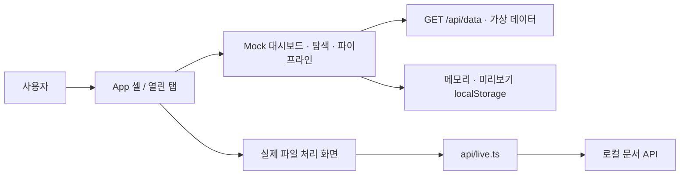

# 프론트엔드 화면·상호작용 계약

> 2026-11-18 화면 개편 반영. 이 문서는 현재 구현과 유지해야 할 사용자 경험을 설명한다. UI 구조는 고객 확정 요구사항이나 실제 운영 기능의 완성을 뜻하지 않는다. API와 처리 규칙은 [API·데이터 계약](API_AND_DATA_CONTRACT.md), 전체 경계는 [아키텍처](ARCHITECTURE.md)를 함께 확인한다.

## 1. 목적과 경계

사용자는 문서 처리 과정과 예외를 파악하고, 파일 형식별 흐름과 파싱 품질을 비교할 수 있는 **정보 밀도가 있는 내부 운영 도구**를 원한다. 원천과 파일 형식은 계속 늘어날 수 있으며, 목록을 미리 확정할 수 없다. 시각적으로 정돈된 품질, 충분한 가독성, 탐색 가능성, 드래그와 접기·숨기기 같은 직접 조작을 중요하게 여긴다.

이 앱에는 명시적으로 분리된 두 경험이 있다.

| 경험 | 데이터와 조작 | 실제 영향 |
|---|---|---|
| Mock 워크스페이스 | `/api/data`의 가상 문서·관계, 브라우저 내 위젯과 파이프라인 설정 | 대시보드·파이프라인과 파싱 비교의 예시 모드에 사용. 가상 파일 추가는 이름·확장자·크기만 메모리에 반영하고 파일 내용을 읽거나 서버에 전송하지 않음 |
| 실제 파일 처리 | `/api/live/documents` 기반 로컬 업로드·실행·상태·결과 | 파일 선택/드롭 즉시 서버의 로컬 저장소에 실제 원본 저장. 파싱은 별도 버튼으로 시작 |

이 둘의 수치·파일·설정은 공유되지 않는다. Mock의 `Docling + OCR`, 완료 상태, 시간, 참조 관계는 실측 결과가 아니다. Mock 데이터 로딩이 실패해도 사이드바와 실제 파일 처리 화면에 접근할 수 있다. 실제 API 자체의 장애는 실제 화면에서 별도로 나타난다.

## 1-1. 화면 설계 원칙 (2026-11-17)

화면은 사람이 함께 보며 이야기하는 용도다. 한 화면에 모든 정보를 넣지 않고, 아래 원칙과 공통 부품(`frontend/src/ui/`)으로 나눈다.

| 원칙 | 이 콘솔에서 지키는 방식 |
|---|---|
| 개요 → 걸러 보기 → 세부는 요청할 때 (Shneiderman) | 첫 화면은 개요 하나(표·타일·흐름). 세부는 클릭하면 팝업(`Modal`)으로 연다. |
| 선택지는 적게 (Hick) | 첫 화면의 버튼·필터는 핵심만. 나머지 설정은 팝업이나 탭 뒤로. |
| 한 묶음 7±2 (Miller) | 열·칩·항목이 많으면 탭(`Tabs`)이나 목록(`ListBox`)으로 나눈다. |
| 익숙한 패턴 (Jakob) | 새 시각화보다 탭, 리스트 박스, 표, 팝업, 목록 + 상세(마스터-디테일)를 먼저 쓴다. |
| 강조는 한 곳 (Von Restorff) | 색은 의미(요소 종류·문제)에만. 한 화면에서 튀는 것은 이상치 하나. |
| 간격으로 묶기 (Gestalt) | 테두리·카드 반복 대신 간격과 정렬로 묶는다. 숫자는 오른쪽 정렬, 같은 자릿수. |
| 상태는 늘 보이게 (Nielsen) | 예시 데이터·이전 결과·연결 없음은 한 번만, 짧게 표시. 같은 안내를 두 번 띄우지 않는다. |
| hover는 보충만 | 툴팁에는 그 자리에 보이지 않는 정보만. 머리·이름처럼 이미 보이는 글자에는 hover를 달지 않는다. |
| 토큰 | 간격 4·8 배수, 글자 12·13·14·16·20·24, 본문 대비 4.5:1 이상. 값은 `ui/ui.css`. |

팝업은 Escape·바깥 클릭·X로 닫고, 닫으면 연 자리로 초점이 돌아온다. 팝업 안에서도 탭과 목록 + 상세로 나눈다.

## 2. 화면과 파일 책임

| 영역 | 사용자에게 보이는 기능 | 주요 코드 |
|---|---|---|
| 공통 화면 부품 | 팝업(`Modal`), 탭(`Tabs`), 선택 버튼 묶음(`Segmented`), 리스트 박스(`ListBox`), 목록 + 상세 배치, 간격·글자·색 토큰 | `ui/*`, `ui/ui.css` |
| 앱 셸 | 사이드바 그룹과 열린 작업 탭, 모바일 탐색 메뉴, 화면 찾기(`⌘K` / `Ctrl+K`), 데이터 출처 표시 | `App.tsx`, `WorkspaceFinder.tsx`, `shell.css` |
| 운영 대시보드 | 실제 파일 작업 시작, 모의 처리 흐름의 주의 단계에서 파이프라인 상세로 이동, 예시 문서 집계에서 상태별 목록 열기, 형식·품질 위젯 | `WorkspaceIntro.tsx`, `Dashboard.tsx`, `flow/LiveFlowPanel.tsx`, `dashboard.css` |
| 문서 탐색 | 다중 검색어, 상태·형식·원천 필터, 가상 파일 추가, 상세의 정보·처리 이력·참조 탭과 연결 문서 탐색 | `DocumentBrowser.tsx`, `DocumentDrawer.tsx`, `documents.css` |
| 처리 파이프라인 | 운영/설계 모드 전환, 흐름도·단계 목록, 전체 흐름과 형식별 하위 흐름, 형식과 경로 검색, 운영 개입, 캔버스 편집 | `PipelineStudio.tsx`, `flow/*` |
| 파싱 비교 | 같은 원본의 **이전 실행 → 현재 실행**(파서 버전·설정·OCR 변경 전후)을 비교. 위쪽 요약 줄: 처리 시간·글자 수·표 칸·숫자·단위·문서번호·깨진 글자의 변화. 팝업 **변화 지표**(전체 지표와 사라진/새로 나온 숫자·문서번호)와 **정답 대조**(정답 자료 JSON을 불러와 두 실행의 재현율). 아래는 원본 파일과 두 결과의 줄 단위 차이. 예시 PDF·XLSX·DOCX는 빌드에 포함된 가상 원본을 사용 | `CompareView.tsx`, `compare/*`, `api/live.ts` |
| 문서 계보 | 실제 파일 / 예시 데이터 전환. 문서군 목록과 선택 문서군의 판(최신 판단)·포함 트리·참조(나가는/들어오는) 또는 관계 그래프. 요약은 접힘, hover 툴팁·관련 항목 강조, 클릭하면 오른쪽 상세에 고정(X·Escape) | `LineageView.tsx`, `lineage/*`, `lineage.css`, `api/lineage.ts` |
| 벡터 DB | 탭 **개요**(컬렉션별 같은 크기 파티션 타일: 이름·청크 수·비중 막대)와 **컬렉션**(트리·칩·청크 표/스키마·인덱스). 타일을 누르면 팝업에서 청크 목록 + 상세, 문서별 다시 읽기. 컬렉션 탭의 청크도 같은 상세 팝업. 예시 데이터 / Milvus(설정 시), 읽기 전용. 자동으로 연 Milvus가 연결되지 않으면 오류에서 멈추지 않고 예시 데이터로 열며 '예시 데이터 · Milvus 연결 실패'를 표시한다(사용자가 직접 Milvus를 고른 경우는 오류와 다시 시도 표시) | `VectorDbWorkspace.tsx`, `vectordb/*`, `vectordb.css`, `api/vectordb.ts` |
| 청킹 벤치 | 원문(예시 3종·실제 문서) 선택과 요소 구성 막대. 탭 **전략 비교**(전략별 청크 수·길이·표 보존·그림·캡션·머리말 제거·한도 초과 표)와 **원문 구성**(요소 목록 + 미리보기·전략별 결과). 행을 누르면 팝업에서 청크 목록 + 상세, 문서 위 청크, 설정. 전략 설정·원문 선택·토큰 실측도 팝업 | `ChunkBench.tsx`, `retrieval/chunk-*`, `retrieval/shared.tsx`, `retrieval/elements.ts`, `retrieval.css`, `api/retrieval.ts` |
| 임베딩 평가 | 모델 순위표 하나: 모델(기본 5개, 사양은 이름 아래 표시) × 본문·표·그림 질문 정확도, 입력 한도 초과 청크·벡터 용량(실행 전에도 계산), 지연. 청킹은 청킹 벤치 전략 하나로 고정. 문서·질문·모델 설정과 칸별 질문 결과는 팝업 | `EmbeddingEval.tsx`, `retrieval/eval-*`, `embedding.css`, `api/retrieval.ts` |
| 모델 연결 | 서버에 등록된 게이트웨이 설정 조회, 사용자가 실행한 연결 확인, 반환된 모델 목록 검색 | `ModelWorkspace.tsx`, `modelWorkspace.css` |
| 실제 파일 처리 | 업로드, 상태 목록/상세, 명시적 실행, 텍스트 결과·오류·경고, 구조 분석(문서 계보 트리·링크 표·플래그, 전체 요약) | `LiveWorkspace.tsx`, `StructurePanel.tsx`, `live.css`, `api/live.ts` |

`DocumentViews.tsx`는 문서 관련 화면을 재내보내는 호환 경계다. `types.ts`는 Mock에 사용되는 화면 데이터 타입이며, 실제 처리 DTO는 `api/live.ts`에 별도로 정의돼 있다.

## 3. 작업 탭과 상태의 수명

- 사이드바에서 화면을 열면 상단 작업 탭에 추가한다. 운영 대시보드는 고정 탭이다. 열린 Mock 화면은 활성 탭이 아니어도 마운트를 유지해 탭을 왕복할 때 하위 선택·접기 상태를 유지한다.
- 닫은 작업 탭의 컴포넌트 상태는 사라진다. 다른 문서에서 특정 확장자 파이프라인을 열면 해당 형식으로 전환하기 위해 파이프라인 컴포넌트가 다시 만들어질 수 있다.
- 실제 파일 처리 탭은 열려 있는 동안 목록·검색·선택과 업로드 진행 상태를 유지한다. 여러 파일은 순차 전송하며 다른 작업 탭을 보는 동안에도 저장이 계속된다. 저장이 끝나면 탭을 닫을 수 있다. 탭을 닫으면 화면 상태가 초기화되고, 실제 파일과 작업 기록은 로컬 서버에 남는다.
- 예시 파일 추가 목록, 열린 탭, 문서 선택·필터 등은 브라우저 메모리 기반이다. 새로고침 후 저장되는 문서 인벤토리가 아니다.
- 대시보드 위젯의 순서·숨김·접기 설정은 브라우저 `localStorage`의 `document-ops-dashboard-layout-v2`에 보관한다. 파이프라인 흐름 정의(노드·연결·위치·방향)는 `document-ops:flows:v3`, 직접 추가한 형식은 `document-ops:manual-formats:v1`에 보관한다. 이전 `document-ops:pipeline-preview:v1`·캔버스 배치 키는 더 이상 읽지 않는다. 모의 운영 상태(문서·개입·이벤트)는 메모리에만 있고 새로고침하면 초기화된다. 모의 엔진은 앱에서 하나를 만들어 대시보드와 파이프라인이 함께 쓰며, 둘 중 하나가 보이는 동안만 시간이 흐른다. 문서 계보는 `document-ops:lineage-source:v1`·`document-ops:lineage-ui:v1`, 벡터 DB는 `vdb.` 접두어 키, 청킹 벤치·임베딩 평가는 `document-ops:chunk-presets`·`chunk-bench`·`chunk-bench-ui`·`embedding-candidates`·`embedding-eval-ui`에 접기·탭·선택을 보관한다(청킹 프리셋은 두 화면이 함께 쓴다). 브라우저 저장에 실패해도 해당 세션의 화면은 동작하도록 처리한다. 이 값들은 서버 설정이나 감사 이력이 아니다.

## 4. 직접 조작과 접근성

- **화면 찾기**는 화면 이름이나 작업 설명을 검색한다. 화살표로 고르고 Enter로 열며 이동한 화면으로 초점을 옮긴다. Escape로 닫으면 연 자리로 돌아온다.
- 대시보드의 **위젯 편집**에서 위젯을 숨기거나 복원할 수 있고, 핸들 드래그와 위/아래 버튼으로 순서를 바꾼다. 위젯은 개별 접기·펼치기를 지원한다.
- 파이프라인의 하위 흐름에서는 제목 옆 **뒤로가기** 또는 **Esc**로 전체 처리 흐름으로 돌아간다. 입력 중에는 입력이 단축키보다 우선하고, 형식과 경로 패널이나 단계 삽입 메뉴가 열려 있으면 Esc로 먼저 닫는다.
- 운영 모드의 **주의 단계** 버튼은 실패, 보류, 적체 또는 일시정지 상태인 단계가 있을 때 표시한다. 전체 처리 흐름에서는 모든 흐름을, 하위 흐름에서는 보고 있는 흐름을 대상으로 한다. 목록에서 단계를 누르면 해당 단계의 문서와 조작 도구를 연다.
- 파이프라인 **설계 모드**: 왼쪽 팔레트 도형을 끌어 놓거나 눌러 추가(기존 노드와 겹치지 않는 자리), 노드 가장자리 점을 끌어 대상 도형 위에 놓으면 연결, 연결선의 + 또는 상세 패널로 연결 사이에 단계 삽입(뒤쪽 노드를 밀어 자리 확보), 연결선 위에 도형을 놓아도 삽입, 앞뒤가 하나씩인 노드를 지우면 앞뒤를 다시 연결, 더블클릭 이름 수정, ⌘Z/⇧⌘Z·⌘D·Delete, 방향키 이동, 세로·가로 자동 정렬, JSON 내보내기·가져오기, 검증(시작 없음·연결 끊김·분기 부족·하위 흐름 미지정).
- 파이프라인 **운영 모드**: 노드를 선택하면 상세 패널에서 일시정지·재개, 동시 처리 수, 우회, 조건 분기 경로 고정, 실패 재시도, 보류 승인·반려, 다른 단계나 흐름으로 문서 이동, 문서별 우선 처리·건너뛰기·제외를 할 수 있다. 압축 분리·첨부 재투입·내장 개체가 있는 단계는 하위 문서를 만들어 형식 판별로 다시 보내며(모의), 지표와 문서 추적에 파생 수·깊이·상위 문서가 표시된다. 하위 흐름 노드는 더블클릭이나 열기 버튼으로 들어간다. 아래쪽 운영 기록에서 이벤트와 문서 위치를 추적한다. 이 조작은 **브라우저 안 모의 엔진에만 적용되고 실제 백엔드의 실행 순서·어댑터·파일을 바꾸지 않는다.**
- 예시 파일 드롭 영역과 실제 업로드 영역은 별개다. 실제 화면에는 로컬에 파일이 저장됨을 안내한다. 파일 선택 버튼은 드래그의 대안이다.
- 문서 상세는 대화상자로 열리고 닫기·Escape 및 키보드 포커스 처리를 제공한다. 관계도의 노드는 키보드로 선택할 수 있다.
- 화면은 좁은 폭에서 사이드바/카드가 재배치되며, 가로가 긴 표·관계도는 스크롤될 수 있다. 새 UI 작업 때 데스크톱과 모바일에서 조작 크기, 줄바꿈, 수평 스크롤 및 대비를 확인한다.

모델 연결은 사용자가 확인을 실행했을 때 응답을 조회한다. 서버 설정 여부와 마지막 확인 결과는 따로 표시한다.

## 5. 실제 문서 상태와 결과 표시

`LiveWorkspace.tsx`는 목록을 읽고, 처리 중인 문서가 있으면 2초 간격으로 상태를 확인한다. 최대 120회 확인 후 자동 확인을 중단하며 사용자는 수동 새로고침할 수 있다. `processing`은 **실행 중 또는 전용 워커 대기 중**을 포함한다.

- 업로드된 원본을 선택하면 문서명·크기·상태·파서와 오류를 표시한다. 업로드와 처리 요청은 별개다.
- 마지막 성공 결과가 있다면 현재 작업이 진행 중이거나 실패해도 읽을 수 있고, `is_stale: true`인 경우 **이전 성공 결과이며 현재 작업 결과가 아님**을 표시한다.
- `warnings`는 화면에 보인다. PDF OCR 경고는 스캔 페이지를 감지했다는 뜻이 아니라, 모든 PDF에 적용되는 누락 가능성 경고다.
- 결과 API 409 중 `완료된 파싱 결과가 없습니다.`는 정상적인 결과 없음으로 취급한다. 다른 409(결과 파일·메타데이터 문제 등)는 오류로 표시한다. 현재 이 구분은 메시지 문구에 의존하므로 API 오류 코드 계약이 도입되면 `api/live.ts`와 서버·테스트를 함께 바꾼다.
- 서버의 결과 Markdown은 현재 서식을 실행하지 않는 텍스트로 표시한다. 실제 문서 내용을 신뢰할 수 있는 HTML로 간주하지 않는다.
- 파싱 비교의 **실제 실행**은 성공본 두 개를 선택한다. 결과별 완료 시각·파서·버전·PDF OCR 설정을 표시한다. 위치가 저장된 차이는 PDF 원본의 해당 페이지 또는 XLSX 원본의 시트·셀 값으로 이동한다. PDF·일반 이미지·텍스트와 시트 셀 값은 비교 화면에서 확대할 수 있다. DOCX·PPTX의 전체 배치와 서식은 원본 다운로드 후 전용 앱에서 확인한다. 위치를 확인할 수 없는 결과도 텍스트로 비교할 수 있다.
- 진단은 두 산출물 사이의 차이에 규칙을 적용한다. 표 셀 비교는 파이프 구분 표의 열 순서를 사용한다. 결과마다 처음 50,000줄을 비교하고 제한이 적용되면 화면에 표시한다.

## 6. 데이터를 연결할 때 지켜야 할 경계

실제 데이터를 대시보드에 연결하는 작업은 별도 설계다. 출처·시점·집계 범위, 실제 상태 모델, 파일 형식 표시와 사용자 권한을 정하고, 예시 수치를 실제처럼 섞지 않는다. 파이프라인 화면에서 실제 구성을 편집하게 될 때도 `pipelineModel.ts`의 Mock 저장값을 실제 정책으로 암묵적으로 취급해서는 안 된다.

## 7. 검증과 변경 시 체크

`frontend/src/__tests__/workspace.test.tsx`와 `live.test.tsx`는 위젯·문서 필터·드롭·작업 탭·Mock 장애와 Live 독립성·업로드/실행·결과 경고·오류 및 응답 경합 등을 검증한다. 실제 UI를 바꿀 때는 다음을 확인한다.

1. Mock 드롭이 파일 내용을 전송하지 않고, 실제 드롭은 저장 전 화면상 의미가 분명한가?
2. 차트와 예외 집계 클릭이 같은 범위의 문서 필터로 연결되는가?
3. 탭을 왕복하거나 닫을 때 남는 상태와 사라지는 상태가 사용자에게 자연스러운가?
4. 마우스 없이 단계와 위젯 순서를 바꾸고 상세를 닫을 수 있는가?
5. 재처리 중/실패 후 결과가 오래된 것인지, PDF가 OCR 미적용인지 표시되는가?
6. 작은 화면에서 문서명·상태·오류·조작 영역이 잘리거나 겹치지 않는가?
7. 변경 후 `npm test`, `npm run build`를 실행하고, 시각 관련 변경은 가능한 환경에서 직접 화면을 확인했는가?
