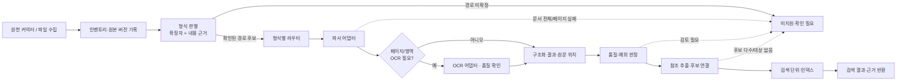

# 문서 처리·관계·검색 설계 노트

> **문서 성격:** 후속 구현을 위한 설계 제안 및 인수인계. 이 문서의 목표 구조, 예시 데이터, 우선순위와 평가 항목은 승인된 고객 요건이나 이미 구현된 기능이 아니다. 코드에서 확인한 현행 상태는 아래에 따로 표기한다. 실제 API 계약은 [API·데이터 계약](API_AND_DATA_CONTRACT.md), 화면과 서비스의 전체 경계는 [아키텍처 문서](ARCHITECTURE.md)를 함께 본다.

## 1. 문제와 확인된 전제

- 처리할 원천 시스템과 파일의 형식은 미리 열거할 수 있는 닫힌 목록이 아니다. **새 원천·새 확장자·같은 확장자의 새로운 내부 구조**가 계속 나타날 수 있다는 것을 설계 전제로 둔다.
- 논의된 전체 규모는 **사전 수치**일 뿐이다. 실제 형식별 분포, 압축/첨부 전개 후 건수·용량, 스캔 비율과 향후 증가량은 확인되지 않았다. 처리량 보장이나 용량 산정의 확정값으로 사용하지 않는다.
- 목표는 잘 파싱하는 것뿐 아니라 문서와 원문 위치·버전·처리 이력·참조 근거를 추적하고, 이후 검색 및 에이전트가 근거를 활용할 수 있는 구조를 마련하는 것이다. 검색 API, 검색 운영과 에이전트 간 책임 범위는 미확정이다.
- 대상 환경에는 `base_url`, `api_key`, `model_id`로 접근하는 OpenAI 호환 게이트웨이와 여러 모델이 있다. 각 모델의 입력 형식·임베딩 API·모델 등록 권한·망 정책은 별도 확인이 필요하다.
- 파일 형식 판별, 파서 라우팅, 업무 문서 분류, OCR, 참조 추출, 검색은 서로 다른 책임이다. LLM이나 System 1 형태 모델을 모든 파일의 필수 경로로 두지 않는다.

## 2. 현재 구현과 미구현 경계

### 현재 동작 — 코드에서 확인

1. **Mock 콘솔:** 대시보드·문서 탐색·파이프라인 편집·파싱 비교·문서 관계는 가상 데이터다. Mock 파일 드롭은 이름·크기·확장자만 브라우저 메모리에 넣는다. `frontend/src/pipelineModel.ts`의 확장자별 단계·분기와 순서 변경, 활성화 여부는 브라우저 미리보기이며 실제 파서 설정을 바꾸지 않는다.
2. **실제 로컬 작업:** 사용자가 별도 화면에 파일을 선택하면 `runtime/`에 저장되고, 별도 처리 요청 시 백엔드가 확장자로 파서를 선택한다. 결과는 Markdown, 상태와 이력은 SQLite에 저장한다. Mock 현황과 실제 파일 목록은 연결되지 않는다.
3. **현재 파서 라우팅**. 텍스트·CSV는 표준 라이브러리로, PDF·Office는 Docling으로 읽고, 스캔 쪽·래스터 이미지·문서 속 그림은 문서 OCR 모델(OpenAI 호환 비전 API)로 읽는다(라이브러리 OCR은 2026-11-24부터 쓰지 않음). SVG의 XML 텍스트와 인라인 그림도 처리한다. 형식 서명 판별과 OOXML 보정·충실도 점검을 적용한다.
4. **검증 범위**. 합성 텍스트·CSV·스캔/혼합 PDF·Office·이미지로 원문 보존, OCR, 누락 경고와 위치를 확인한다.
5. **PDF 경고**. OCR 설정과 추출된 본문·표가 없는 페이지 번호를 기록한다. OCR 설정이 꺼진 실행에는 이미지 누락 가능성 경고를 유지한다.
6. **작업 처리:** 전용 워커 1개와 최대 64건의 메모리 대기열을 사용한다. `processing`은 실행 중 또는 대기 중을 함께 뜻한다. 만석이면 새 요청은 503으로 거절하고 이력을 남긴다. 재처리 중·실패 후 마지막 성공 결과는 `is_stale: true`로 조회할 수 있다.

**아직 없는 것:** 페이지·시트·셀 단위 위치의 완전한 보존, XLSX 참조 추출, 압축/메일 내부 분리, 고객 원천 연계, 문서 관계 추론·확정, 검색 청크/인덱스·검색 API, 게이트웨이 모델 호출 및 실제 처리 정책의 화면 편집. 사용자에게 보이는 예시 단계의 존재를 실제 지원으로 해석하지 않는다.

## 3. 목표 처리 흐름 — 제안



이는 책임을 보여주는 제안도다. 파일 형식에 따라 OCR은 파서 내부 단계일 수 있고, 압축/메일은 자식 파일별로 다시 판별한다. 구현 전에는 실제 작업 순서·저장소·배포 및 소유자를 확정하지 않는다.

| 책임 | 입력과 판단 | 제안 출력 / 경계 |
|---|---|---|
| 수집·인벤토리 | 원천에서 발견한 파일과 가능한 메타데이터 | 원천 ID, 파일 ID·버전, 취득 시각, 부모 파일, 접근 정보. 동일 내용이어도 원천·권한이 다르면 문서 식별을 합치지 않는다. |
| 형식 판별 | 확장자, 실제 바이트 시그니처·컨테이너, 인코딩 등 확인 가능한 근거 | 관찰된 형식, 근거와 충돌 상태. 확장자와 실제 형식이 다르면 임의로 성공 처리하지 않는다. |
| 라우팅 | 관찰 형식, 사용 가능한 어댑터 버전, 입력 상태와 정책 | 선택 경로, 선택 근거, 미지원/검토 사유. 목록에 없는 형식은 새로운 관찰값으로 남긴다. |
| 업무 분류 | 문서의 용도·업무상 유형이 실제 검색이나 운영에 필요할 때만 판단 | 분류 결과, 분류 기준·버전, 근거와 미확정 상태. 파서 선택과 별개다. |
| 파싱·OCR | 원본 또는 페이지/영역과 선택된 어댑터 | 텍스트·표·구조, 원문 위치, 파서/OCR 버전과 경고. 원본은 별도로 보존한다. |
| 품질·예외 | 추출 결과, 파일 상태와 확인된 품질 신호 | 처리 실패와 품질 검토를 분리하고 원인·재처리·검토 이력 관리. 모델 점수만으로 품질을 확정하지 않는다. |
| 참조 추출·연결 | 하이퍼링크, 셀 수식, 문서번호, 원문 등 | 원문 위치가 딸린 후보와 연결 상태. 명시적 근거와 모델 추정을 구분한다. |
| 검색용 변환·검색 | 검토된 구조화 결과와 접근·버전 메타데이터 | 문서/청크 및 검색 인덱스. 검색 결과는 원문 위치와 문서 버전까지 되돌아갈 수 있어야 한다. |

### 새 형식 처리 원칙 — 제안

- 확장자 목록을 화면이나 서버의 유일한 진실로 두지 않는다. 파일명 확장자, 시그니처, 컨테이너와 디코딩 결과가 충돌할 수 있으므로 **각 근거와 충돌 사유**를 기록한다. 새 형식은 누락하지 않고 `형식 미확인`/`경로 미설정` 같은 명시적 예외로 보낸다.
- 파서 어댑터는 입력 자산과 실행 설정을 받고 **공통 결과·출처·경고·오류**를 반환하게 설계한다. 포맷 특유의 시트·셀, 페이지, 첨부 관계는 공통 본문 텍스트로 평탄화하면서 잃지 않도록 확장 필드를 둔다.
- 작업 설정과 파서 버전을 기록하고, 같은 입력 버전과 설정의 재시도는 중복 산출물/중복 인덱스가 생기지 않도록 설계한다. 동일 내용의 서로 다른 원천·문서·권한을 해시 하나만으로 합치지는 않는다.
- 자동 처리 여부를 알 수 없으면 **미지원·검토 필요·대상 미발견**으로 보존한다. 이들은 성공도 데이터 폐기도 아니다.

## 4. 형식별 상세 설계 후보

| 형식 | 먼저 구분할 상황 | 제안 처리·보존 항목 | 현재 상태 |
|---|---|---|---|
| PDF | 디지털 텍스트, 스캔, 혼합, 깨진 텍스트 계층, 암호/손상 | 페이지별 추출 가능성과 품질을 확인하고 필요한 페이지/영역에만 OCR 후보를 적용한다. 페이지·영역 위치, 읽기 순서, 표, 경고 및 OCR 사용 여부를 남긴다. 텍스트가 있다는 사실만으로 품질을 보증하지 않는다. | Docling(글자 층) + OCR 모델(글자 층 없는 쪽·큰 그림). 쪽 순서 끼워 넣기·위치·OCR 경고를 가짜 OCR 서버와 합성 PDF로 검증, 실제 모델은 PaddleOCR-VL-1.6으로 합성 스캔 확인. PDF 모델이 없으면 `pdf-text`(글자 층·쪽 위치·큰 그림·깨진 글자 층 경고, 2026-11-25). |
| XLSX/XLSM | 시트·셀·표·병합, 수식과 표시값, 링크·외부 연결, 숨김 항목 | 값과 수식을 구분하고 시트명·셀 주소·표 구조·원문 파일 버전을 보존한다. 하이퍼링크, 수식의 외부 파일 참조, 문서번호 문자열은 각각 발견 방법을 남긴다. 외부 연결 접근과 매크로 실행은 자동 수행하지 않는 방안을 기본 후보로 둔다. | XLSX·XLSM Docling 워크시트 경로(시트·행 위치, 원문 대조). 하이퍼링크·외부 통합문서·문서번호 후보는 구조 분석에서 추출. XLSM 매크로는 실행하지 않고 모듈 목록·자동 실행 여부를 경고로, 매크로 코드 속 경로·URL·문서번호는 구조 분석 후보로 남긴다(2026-11-25). 실제 문서 품질은 미검증. |
| DOCX/PPTX | 본문·표·슬라이드, 이미지, 문서 내 참조 | 구조와 원문 위치를 보존하고 이미지 내 문자 필요성은 별도 판단한다. | Docling 경로. 합성 DOCX 검증, PPTX 미검증. |
| HWP/HWPX | 형식·버전별 본문과 표, 개체 | `kordoc` 등 후보를 독립 어댑터로 시험하고 표·원문 위치·오프라인 조건과 라이선스를 확인한다. | 미지원. 화면의 kordoc은 예시다. |
| XLS/DOC/PPT 등 구형 | 변환 가능 여부, 암호·손상, 변환 전후 차이 | 격리된 변환 후보, 원본·변환본의 연결, 표/위치 손실과 실패 사유를 기록한다. | 미지원. |
| 이미지 | 문자 유무, 회전·해상도·기울기, 인쇄체/필기 | OCR 후보의 텍스트와 영역 좌표, 엔진·버전, 품질 검토 상태를 남긴다. | OCR 모델(영역·쪽 방식) 지원. 프레임별 쪽 위치와 'OCR 모델로 읽음' 경고. 모델 비교는 `docs/reports/ocr-bench`. |
| ZIP·메일/첨부 | 암호, 손상, 중첩, 내부 크기/항목 수, 첨부 관계 | 부모→자식 관계와 내부 경로를 보존하고 자식별로 다시 형식을 판별한다. 압축 폭탄·경로 이탈, 외부 연결 등은 제한 정책을 먼저 정한다. | 미지원. |
| TXT/CSV 등 | UTF-8/CP949, 손상, 큰 파일, CSV 행/열 및 인용 부호 | 문자 인코딩과 행/표 구조, 실패 사유를 기록한다. | 로컬 텍스트/CSV 어댑터. 용량·행/열 제한은 API 계약 참조. |

실제 포맷 조합이 계속 바뀌므로 이 표는 **초기 후보**다. 지원을 추가하기 전 샘플과 오류 사례로 검증하고, 지원 목록을 백엔드의 실제 능력과 연결해야 한다.

### XLSX에서 다른 문서를 가리키는 사례 — 제안

1. `점검 이력` 시트 `B12`의 원문 `SOP-QC-0040 Rev.5 참조` 또는 셀 하이퍼링크/수식 외부 연결을 각각의 근거 유형으로 추출한다.
2. 문서번호·버전·경로를 정규화한 뒤 현재 접근 가능한 문서 목록에서 **후보**를 찾는다. 하나만 발견됐다는 이유만으로 같은 이름의 다른 버전이나 다른 원천 문서와 무조건 동일시하지 않는다.
3. `연결 완료`, `후보 확인 필요`, `대상 미발견` 등을 별도 상태로 남기고, 연결/수정에는 출발 문서 버전·시트·셀·원문·방법·대상 후보의 버전을 기록한다.
4. 파일 경로나 URL이 발견돼도 자동으로 네트워크에 접속하거나 로컬 임의 경로를 읽지 않는다. 허용 범위·권한·연결 방식은 별도로 정한다.

### 전달받은 파싱 엣지 케이스 11건과 대응 위치 (2026-11-19)

사용자가 전달한 엣지 케이스를 합성 파일로 재현해(`backend/tests/edge_case_files.py`) Docling 2.150.0 Office 경로에서 실측했다. **실제 고객 문서로 잰 값이 아니다.** 원본 파일의 형식·건수 분포는 여전히 미확인이다.

| # | 엣지 케이스 | 손실이 생기는 층 | Docling 실측(합성) | 현재 구현 | OCR이 돕는가 |
|---|---|---|---|---|---|
| 1 | `℃`, `≥`(밑줄 붙은 부등호) 등 특수기호 | 원본 텍스트 층 | 유니코드는 보존. Word '기호 삽입'(Symbol 글꼴 `w:sym`)은 **삭제** | 사본에서 기호 글꼴→유니코드 변환, 원문 대비 기호 수 대조 | 아니오. OCR은 `≥→>`, `℃→°C/C` 혼동 위험이 더 크다 |
| 2 | SVG + 래스터 혼합 | 그림 층 | SVG 안 글자 **누락**, 그림 자리표시도 없음 | SVG `<text>`를 직접 읽어 보충 추출, 참조한 래스터 그림은 OCR 모델로 읽어 원문 위치와 함께 보충 | 래스터 부분만 필요 |
| 3 | `±`(`∓`) 통합 기호 | 원본 텍스트 층 | 유니코드 보존, 기호 글꼴이면 삭제 | 1과 같음 | 아니오 |
| 4 | 아래첨자, 엑셀 병합 셀 | 서식·표 구조 | 첨자 **평탄화**(`CO₂→CO2`, `10⁻³→10-3`), 병합 값 **칸마다 반복** | 바꿀 수 있는 첨자는 유니코드로 변환, 병합 범위 보고(반복 제거는 미구현) | 아니오(표 구조 인식은 별개 문제) |
| 5 | 그림 안의 그림 | 그림 층 | 그룹 도형 그림은 자리표시도 없음 | 그룹·글상자·OLE 표시 그림·SVG 속 그림을 집계하고 참조 가능한 래스터는 개별 OCR | 예. 단, 겹친 그림의 영역 분리는 레이아웃 모델 몫 |
| 6 | 파일명의 `섭씨 -70도` 같은 기호 | 메타데이터 | 해당 없음 | NFD→NFC, 방향 제어 글자 제거. 문서군 키가 `-70℃`와 `70℃`를 합치던 문제 수정, `−70°C`=`-70℃`, `m²`=`m2` | 아니오 |
| 7 | 제곱 포함 특수기호 215건 문서 | 원본 텍스트 층 | 215건 중 서식 위첨자 7건 손실(208/215) | 보정 후 215/215. 문서마다 기대·발견·손실 기호 수 저장 | 아니오 |
| 8 | DRM(NASCA 래핑) DOCX | 파일 컨테이너 | 열 수 없음 | 내용 서명 판별로 `drm_protected`/`drm_suspected` 실패 코드, 파서 호출 안 함. 제품 서명은 설정으로 등록 | 아니오. 복호화는 DRM 공식 해제 경로 |
| 9 | 확장자는 XLSX, 실제는 DRM | 파일 컨테이너 | 열 수 없음 | 8과 같음. 확장자·내용 불일치는 `format_mismatch` | 아니오 |
| 10 | 표 + 표 선 위에 쓴 글상자 | 도형 층 | DOCX는 글상자 글자를 넣지만 순서가 앞당겨짐, XLSX 도형 글상자는 **누락** | 원본에 없으면 시트·셀 범위와 함께 보충 추출 | PDF·스캔에서만 필요 |
| 11 | 흰색에 가까운 회색 글자 | 서식 | 표시 없이 본문에 포함 | 배경 대비(WCAG 1.6 미만) 글자를 찾아 경고 | 역효과. OCR·이진화는 저대비 글자를 놓친다 |

**OCR 위치에 대한 제안(미확정):** 11건 중 대부분은 원본 XML 층의 손실이라 OCR보다 원본 직접 읽기가 정확하다. OCR은 원본에 글자 층이 없는 부분, 즉 래스터 그림(2·5), 스캔·혼합 PDF, PDF의 표 위 글자(10)에만 영역 단위로 붙이는 편이 맞다. 후보 비교에서는 범용 비전 모델보다 **글자 좌표·신뢰도를 주는 OCR 전용 모델**을 우선 본다. 숫자·단위 문서에서 범용 생성형 모델은 그럴듯한 숫자를 채워 넣을 위험이 있고, 좌표가 없으면 원문 위치 근거를 남기기 어렵다. 범용 비전 모델은 차트·복잡한 그림 설명 같은 보조 경로 후보로 둔다. 사전(문자 목록) 기반 OCR은 사전에 없는 글자를 출력할 수 없으므로, 채택 전에 `fidelity.symbols`로 모은 실제 기호 목록이 모델 문자 사전에 있는지 먼저 확인한다. 모델·버전·라이선스·오프라인 배포 조건은 대상 환경에서 확인한 뒤 정한다.

## 5. 데이터·근거 계약 — 제안 예시

아래는 목표 계약을 논의하기 위한 **가상 JSON**으로, 현재 API 모델이나 저장 스키마가 아니다. 필수 필드, ID 생성법, 위치 좌표계, 권한 형식, 버전 정책은 아직 결정되지 않았다.

### 문서·파싱 산출물

```json
{
  "document_id": "doc-example-01",
  "document_version_id": "version-example-01",
  "source": {"source_id": "source-example", "source_item_id": "item-example"},
  "file": {"display_name": "sample.pdf", "declared_extension": "pdf", "observed_format": "pdf"},
  "run": {"run_id": "run-example-01", "parser": "candidate-parser", "parser_version": "example", "config_version": "example"},
  "blocks": [
    {"block_id": "block-01", "kind": "paragraph", "text": "예시 문장", "location": {"kind": "pdf_page", "page_number": 3, "bbox": null}}
  ],
  "warnings": [{"code": "ocr_not_applied", "scope": "document", "message": "OCR 미적용"}]
}
```

- 내부 `document_id`와 `document_version_id`를 분리하고, 원천의 식별자·버전과 취득 시점, 해시 등의 활용 여부는 원천별로 결정한다. 이 예시는 서로 다른 버전을 덮어쓰지 않기 위한 제안이다.
- 위치는 형식별로 `pdf_page`의 페이지·가능하면 영역, `spreadsheet_cell`의 시트·셀, `slide`의 슬라이드 번호 등으로 나타낼 수 있다. 좌표가 없으면 없는 상태를 명시하고 추정값과 확정값을 구분한다.
- 원본의 구조화 결과와 사람이 볼 Markdown/텍스트를 분리한다. **현재 백엔드는 Markdown 결과만 반환**하므로 위 구조화 블록이나 위치를 보장하지 않는다.
- 추출된 숫자와 단위, 표의 행·열, 값과 수식은 원문 근거와 연결한다. 문서 처리 완료와 사람이 검증한 품질 완료는 별개다.

### 문서 참조·대상 연결

```json
{
  "relation_id": "rel-example-01",
  "source": {"document_id": "doc-example-02", "version_id": "version-example-02", "location": {"kind": "spreadsheet_cell", "sheet": "점검 이력", "cell": "B12"}},
  "evidence": {"text": "SOP-QC-0040 Rev.5 참조", "method": "document_number_pattern", "method_version": "example"},
  "target": {"document_number": "SOP-QC-0040", "version_label": "Rev.5", "document_id": null},
  "status": "target_not_found",
  "review": {"state": "not_reviewed"}
}
```

제안 상태는 `matched`, `multiple_candidates`, `target_not_found`, `needs_review` 등으로 구분할 수 있다. 이는 **미확정 예시 enum**이다. 직접 하이퍼링크/외부 참조, 규칙 기반 문자열, 모델 추정의 근거 유형은 섞지 않는다. 문서 변경·삭제·권한 변경 시 연결과 인덱스를 어떻게 갱신할지는 원천 정책 확인 후 결정한다.

### 검색 단위 — 제안

청크가 원문 `document_id`, `document_version_id`, 위치 범위, 파싱 결과/설정 버전과 권한 판단에 필요한 정보에 연결되어야 한다. 표나 시트의 맥락이 잘리지 않도록 구조별 단위를 시험하고, 원본과 파생 청크의 관계를 남긴다. 검색 결과는 정답처럼 문장만 반환하지 말고 **문서·버전·페이지/시트/셀 및 결과 점수의 의미**를 함께 반환하는 계약을 에이전트 담당자와 합의한다. 점수 자체를 정답 확률로 단정하지 않는다.

## 6. 빠른 판단 모델과 게이트웨이 — 제안

- 현재 백엔드는 게이트웨이에 연결 확인(짧은 채팅 요청)과 모델 목록 조회만 보낸다. 문서 처리 단계에서는 호출하지 않는다. 입력/출력, 인증·보안, 지원 모델과 모달리티, 배치·동시성 한도, 타임아웃 및 오류, 로그 정책, GPU/반입 가능성은 확인되지 않았다. 주소·API 키는 프론트 번들이나 Git에 넣지 않는다.
- 텍스트 생성, 이미지/OCR, 텍스트·비전 임베딩, 빠른 의사결정 모델은 **각각 다른 기능과 API 계약**을 가질 수 있다. 채팅 API로 연결이 확인된다고 해서 모든 모델의 추론·임베딩·분류 API나 모델 업로드 방식을 보장하지 않는다.
- 빠른 판단 모델은 예컨대 문서번호 후보의 검토 우선순위, 복수 후보 분류, 규칙만으로 모호한 라우팅 보조 등을 **후보**로 실험한다. 먼저 명시적 링크, 파일 구조, 확정 규칙으로 처리할 수 있는 부분을 측정한다.
- 평가 전까지 모델 점수는 보정된 확률이나 정답 보증으로 간주하지 않는다. `모르겠음`/검토 대기를 허용하고, 한국어·영문 혼합, 표, 낯선 서식, 새 라벨, 모델 미응답을 포함해 정확도·지연·자원과 재현성을 비교한다. 사전 정의된 분류가 실제 검색/운영 품질을 개선하는지도 확인한다.
- 모델 후보를 특정하는 것은 도입 결정이 아니다. 로컬/게이트웨이 배포 가능성, 모델 가중치·라이선스·API 호환성 및 데이터 전달 조건은 환경에서 검증한다.

## 7. 품질·운영·검색 평가 — 제안

실제 분포가 알려지지 않았으므로 **처음부터 전체 확장자 비율을 가정하지 않는다**. 새 형식 발견 시 평가셋에 추가하고, 가능한 범위에서 서식별 대표 샘플·오류 사례를 누적한다. 합성 예시는 회귀 테스트에 유용하지만 실제 업무 문서의 품질을 대신하지 못한다.

| 평가 대상 | 비교 항목의 예 | 실패를 보는 방법 |
|---|---|---|
| 형식 감지·라우팅 | 실제 형식 대비 판별/경로 정확도, 미지원 식별·누락, 오류 원인 | 확장자 불일치, 손상, 암호, 신규 유형, 잘못된 파서 선택을 분리해 기록 |
| 본문·OCR | 한국어/영문·숫자 문자 오류율, 읽기 순서, 누락 페이지·영역, 처리 시간 | 스캔/혼합 PDF, 저해상도·회전·표, 글꼴 깨짐과 필기를 따로 본다. 전체 텍스트 평균만으로 페이지 누락을 감추지 않는다. |
| 표·스프레드시트 | 행/열/병합 구조, 셀값 및 수식, 숫자·단위 정확 일치, 시트/셀 위치 | 셀은 맞지만 단위나 행 대응이 틀린 사례를 별도로 추적한다. 수식과 저장된 계산 결과를 구분한다. |
| 문서 관계 | 참조 발견의 정밀도·재현율, 대상/버전 연결의 정밀도, 근거 위치 | 동명이문서, 버전 혼동, 다중 후보, 대상 없음, 오탐·미탐과 검토량을 확인 |
| 검색 | 근거 문서·청크의 Recall@k, MRR/nDCG, 근거 위치 정확성, 권한·버전 정합 | 대표 질문과 정답 근거를 준비해 문서번호 완전 일치·동의어·표 질문 등을 평가 |
| 처리 운영 | 건수·실패율·재처리율·지연 분포·문서/페이지당 자원 | 문서 수와 페이지·시트 수를 구분하고 구성/파서 버전, 대상·측정 시각, 실패 사유를 같이 남긴다. |

임계값·통과 기준·허용 지연·비용 상한은 사용자/고객과 합의 전이다. 평가셋의 학습·조정·검증 분리, 모델과 설정 버전 고정, 문서 유형별 결과 보고, 원문 근거를 사용한 에이전트 답변 평가를 권장한다. 한 가지 종합 점수만으로 숫자·단위나 표 손실의 위험을 가리지 않는다.

## 8. 관측과 예외 처리 — 제안

- 문서 수집, 형식 판별, 파싱, OCR, 관계, 인덱스의 각 단계에서 `시작/종료`, `상태`, `파서·모델·설정 버전`, `처리 범위`, `오류/경고 코드`, `소요 시간`, `재시도 횟수`, 결과 포인터를 연결할 수 있어야 한다. 현재의 로컬 이력은 전체 단계별 관측 시스템이 아니다.
- 장애, 파서 미설치, 미지원, 암호, 손상, 용량 제한, 표 구조 불확실, OCR 미적용/저품질, 참조 미연결, 권한 부재 등은 서로 다른 사유로 보여준다. 자동 재시도/사람 검토/처리 보류의 정책은 별도 결정한다.
- 이전 성공 결과와 현재 시도 상태를 함께 보여주고, 이전 결과라면 생성 시각·원본/파서 버전·작업 ID를 추적할 수 있도록 확장한다. **현재 구현은 마지막 결과와 파서/버전, `is_stale`를 제공하지만 이 모든 출처 필드를 제공하지는 않는다.**
- 원문·파일명·경로·API 키와 파생 결과도 민감할 수 있으므로 실제 운영의 저장·보존·삭제·권한·로그 정책이 필요하다. 현재 `runtime/`은 Git 제외 대상이고 로컬 프로토타입은 인증·문서별 권한 및 삭제 화면을 제공하지 않는다.
- 처리율이나 품질 점수는 **분모와 기간, 수집 범위, 실패/미지원 포함 여부, 실제 데이터인지 Mock인지**를 함께 표시한다. 구현되지 않은 단계의 수치를 만들어 표시하지 않는다.

## 9. 단계별 다음 작업과 결정 기준 — 제안

1. **실제 파일 범위와 결과 계약 정리:** 실제 로컬 처리 결과를 단계·출처·경고와 함께 일관되게 조회하도록 API와 오류 코드를 정리한다. Mock 편집과 실제 정책을 계속 분리한다. 성공 조건은 처리 실패와 마지막 성공 결과를 혼동하지 않고 진단할 수 있는지다.
2. **파싱 품질 기준선:** 허용된 합성 문서와 이후 접근 가능한 대표 문서로 Docling 기준 결과를 저장·대조하고, 특히 텍스트/스캔 혼합 PDF와 숫자·표, XLSX 시트·셀을 검증한다. OCR·kordoc은 이 기준선과 오프라인/자원·라이선스 조건을 비교해 선정한다.
3. **참조 후보 추출:** XLSX의 하이퍼링크·외부 수식·문서번호부터 시트/셀 근거와 후보 상태를 저장한다. 평가에서 연결 정확성과 다중 후보 처리가 확인되기 전 자동 확정을 확대하지 않는다.
4. **검색 단위·평가:** 문서/표/시트의 구조와 위치를 유지하는 청킹 및 검색 방식을 비교한다. 임베딩 모델·벡터 차원·인덱스, 하이브리드 검색·리랭킹 및 에이전트 반환 계약은 평가와 대상 환경에 따라 정한다.
5. **운영 전환 설계:** 실제 수집 커넥터·원천 변경/삭제·권한 전파, 내구성 작업 큐, 병렬 처리·재시도·감사, 자원·용량·배포 방식을 측정 및 합의한다. 현재 로컬 단일 워커·메모리 대기열을 운영용으로 간주하지 않는다.

### 후속으로 확인할 질문

- 어느 문서·사용자 권한과 개인정보 처리 범위까지 파싱·저장·검색에 사용할 수 있는가? 원천·파일 유형이 사전에 확정되지 않아도 새로운 형식의 발견과 처리 승인/검토는 누가 담당하는가?
- 원문/파생 결과/인덱스의 보존·변경·삭제·재처리 정책과 버전·권한 전파 방식은 무엇인가?
- 파싱 품질에서 표 구조, 숫자·단위, 시트·셀, 읽기 순서, OCR 누락 중 어떤 오류를 우선 검토하고 통과 기준은 누가 정하는가?
- 게이트웨이별 가능한 모델·API·인증, 사내 데이터 입력 허용 여부, 모델 등록, 오프라인/자원 제약은 무엇인가?
- 검색 담당 범위와 에이전트 인터페이스, 원문 근거 및 권한 전달 방식, 최종 답변 평가 책임은 무엇인가?
- 초기 적재 시간, 변경분 갱신 주기, 응답 지연, 실패 대응시간과 인프라 비용 기준은 무엇인가? 현재 예상 규모와 확장자 분포는 확정되지 않았다.
